# AI Vehicle Sales Assistant (AVSA)

**EECS3311 Fall 2026 — Course Project, Stage 1: Software and Agent Design**

**Student:** Parsa Majdol Hosseini · **Student ID:** 221625579 · **Repository:** https://github.com/parsamd1/EECS3311_TermProject.git

## Report Contents

1. [Project Overview](#1-project-overview)
2. [Detailed Feature Specifications](#2-detailed-feature-specifications)
3. [UML Class Diagram](#3-uml-class-diagram)
4. [Design Pattern Explanations](#4-design-pattern-explanations)
5. [Use-Case Diagram](#5-use-case-diagram)
6. [Detailed Use-Case Descriptions](#6-detailed-use-case-descriptions)
7. [Sequence Diagrams](#7-sequence-diagrams)
8. [Feature-to-Design Traceability Table](#8-feature-to-design-traceability-table)
9. [Feature Implementation Explanations](#9-feature-implementation-explanations)

---|---|---|
| 1 | Project Overview | Done |
| 2 | Detailed Feature Specifications | Done |
| 3 | UML Class Diagram | Done |
| 4 | Design Pattern Explanations | Done |
| 5 | Use-Case Diagram | Done |
| 6 | Detailed Use-Case Descriptions | Done |
| 7 | Sequence Diagrams | Done |
| 8 | Feature-to-Design Traceability Table | Done |
| 9 | Feature Implementation Explanations | Done |

---

# 1. Project Overview

## 1.1 Problem and Motivation

A used vehicle effectively has two market prices.

- The **retail price** is what a consumer pays, either to a private seller or to a dealership. It is the price shown on consumer marketplaces such as AutoTrader and Kijiji.
- The **wholesale price** is what a dealer will pay to buy the vehicle from its owner, so that the dealer can recondition it and resell it at retail for a profit.

A seller therefore has two routes. Selling to a consumer at retail gives the **maximum profit** but takes longer. Selling to a dealer at wholesale is the **fastest** route but pays less.

Private sellers rarely know where their vehicle sits between these two prices. Dealers and buyers take advantage of this with low-ball offers presented as "the going rate," pressure to accept the first offer, and arguments that dents, mileage, or location reduce the value. The project author experienced this first-hand while selling a personal vehicle. Getting a fair price took many hours of manual work: finding genuinely comparable listings, adjusting for condition and location, reading the history report, writing an honest advertisement, and preparing for negotiations.

**AVSA automates that workflow.** The seller describes the vehicle once. The agent researches the market, computes wholesale and retail price ranges, forecasts the cost of waiting, writes an honest listing, evaluates the offers the seller receives, and lets the seller rehearse negotiations before talking to real buyers. The seller stays in control: they choose the selling strategy and approve every important decision.

## 1.2 Target Users

**Primary users:** private individuals selling a used passenger vehicle in Canada (initial focus: Ontario / Greater Toronto Area). They are typically selling a car once every few years, have no industry experience, and want to (1) know a fair price, (2) defend it, and (3) avoid being low-balled.

**Out of scope:** dealerships, fleet sellers, and vehicle buyers.

## 1.3 What the Agent Can Do

AVSA can:

1. Collect a structured profile of the vehicle, including every dent, scratch, and mechanical defect.
2. Find and rank comparable listings near the seller, scoring similarity transparently.
3. Compute a **wholesale range**, a **retail range**, a recommended **asking price**, and a **walk-away floor** for the strategy the seller chooses.
4. Import a vehicle history report (such as CARFAX) and check it against the vehicle profile.
5. Identify the vehicle's competitive strengths and weaknesses against local listings.
6. Forecast depreciation over 3, 6, and 12 months and calculate the break-even point against selling to a dealer now.
7. Write an honest, SEO-friendly listing and verify automatically that it discloses every defect.
8. Format the listing for AutoTrader, Kijiji, or Facebook Marketplace.
9. Evaluate a dealer's offer and say whether it is a low-ball, with a counter-offer script.
10. Role-play buyers (serious, low-baller, dealer, suspicious) so the seller can practise negotiating.
11. Remember vehicles, market snapshots, listings, and conversations across sessions.
12. Plan and execute the whole workflow from a plain-language request such as "Price my car for a quick sale and write a Kijiji ad."

## 1.4 Why an AI Agent Is Appropriate

A conventional application can store a form and run a formula, but this problem also requires capabilities that a fixed program cannot provide.

- **Unstructured data.** Listing descriptions, history reports, and buyer messages are free text. Deciding that a listing is a salvage-title car or a different trim requires language understanding.
- **Judgment under uncertainty.** Whether a listing is truly comparable, which advantages a vehicle has, and how to answer a pushy buyer are reasoning tasks.
- **Multi-step planning with tools.** The workflow depends on earlier results. Pricing needs comparables, the listing needs the price, and a failed search needs a fallback. A planner that selects tools, validates its plan, and recovers from failures is a natural fit.
- **Natural-language generation.** Honest, platform-ready advertisements and realistic buyer role-play are language tasks.
- **Interactive memory.** The buyer simulator and the assistant panel must remember the conversation.

An LLM alone is not enough and would be unsafe for the numeric parts. A language model can invent prices or call a dented car "flawless." AVSA therefore follows one rule: **the AI proposes, the code verifies.** Every number is computed by deterministic code, and every AI output is validated before the user sees it.

## 1.5 AI/LLM Model and Integration

**Model.** The primary LLM is a Claude model accessed through its HTTP API. The exact model ID is a configuration value fixed in Stage 2. The software depends only on an `LLMClient` interface, so another provider can be substituted. A `MockLLMClient` returns scripted responses and is used for deterministic tests and failure injection.

**Where the LLM is used**

| Role | Used by |
|---|---|
| Reviewing comparable listings and flagging problems from a fixed list of flag codes | F02 |
| Explaining prices and proposing bounded adjustments that the user may accept | F03 |
| Turning computed metrics into advantages, weaknesses, and talking points | F05 |
| Writing the listing | F07 |
| Playing the buyer persona and coaching the seller | F09 |
| Writing counter-offer scripts | F11 |
| Interpreting a natural-language goal and proposing a plan | F12 |

**How the LLM interacts with the rest of the system**

1. **No direct access to the outside world.** The LLM never calls an API, file, or database. External actions run only through the `ToolManager`.
2. **Structured output.** Prompts request JSON. A `ResponseParser` validates it against a schema. Malformed output is retried once, and then a deterministic fallback is used.
3. **Numbers come from code.** The LLM can explain a price or propose a bounded adjustment, but it cannot change a computed value.
4. **Every generated listing is validated** by a deterministic `ListingValidator` before it can be exported.
5. **Prompts are built in one place.** The `PromptComposer` creates all prompts from domain objects. The VIN and any contact details are never sent to the LLM.
6. **Everything is traceable.** An `AgentTrace` records every tool call (name, arguments, result or error), prompt, and response.

## 1.6 Overall Architecture

AVSA is a layered Java application with two front ends (a GUI and a CLI) that share one application facade.

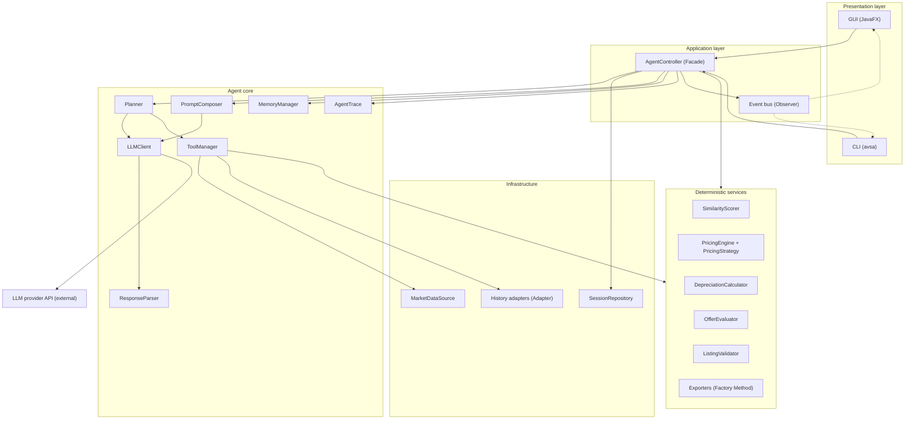

*The diagram shows planned component names. Final class names and relationships appear in the UML class diagram (Section 3).*

| Layer | Responsibility |
|---|---|
| **Presentation** | GUI and CLI. Both only talk to `AgentController` and subscribe to events. Neither contains business logic. |
| **Application** | `AgentController` is the single entry point (Facade) used by both interfaces. An event bus (Observer) publishes progress and state changes. |
| **Agent core** | Planning, prompt construction, LLM calls, response validation, conversation memory, tool execution, and tracing. |
| **Deterministic services** | Similarity scoring, pricing, depreciation, offer evaluation, listing validation, and export formatting. These produce identical output for identical input. |
| **Infrastructure** | Market data sources, history report adapters, and local persistence. |

**Design principles**

- **AI proposes, code verifies.** Numbers are computed deterministically and AI output is validated.
- **Graceful degradation.** If the LLM is unavailable, every deterministic feature still works. AI features fall back to deterministic alternatives, such as template listings and template scripts, and clearly say so.
- **Honesty by construction.** The system cannot export a listing that fails the disclosure check unless the user explicitly overrides it.
- **User control.** The seller chooses the strategy and approves key steps, and nothing is published automatically.
- **Testability.** The `LLMClient`, `MarketDataSource`, and tools are replaceable. A CLI option prints the answer and the `AgentTrace` as JSON.

## 1.7 Scope, Assumptions, and Constraints

- **Market:** Canadian used-vehicle market, prices in CAD, distances and odometer readings in kilometres. Initial data focus is Ontario.
- **Asking price is not selling price.** Marketplace listings show asking prices, so the system applies a configurable *negotiation margin* to estimate expected selling prices.
- **Wholesale is estimated.** Paid wholesale guides are not available, so the wholesale range is derived from the retail range using a configurable *dealer spread*. Its default will be calibrated from the author's own selling experience and can be changed by the user.
- **Market data.** Marketplaces restrict automated scraping, so the default source is a seeded local dataset of listings. CSV import and optional live search are supported through the same `MarketDataSource` interface. This also makes testing reproducible.
- **Platform rules** (character limits and required fields for each marketplace) are kept in editable configuration files and will be verified before Stage 2.
- **Estimates, not appraisals.** The application displays a notice that prices and forecasts are estimates and AI-generated text may contain mistakes.
- **Single user, local data.** There is no login or server. All data is stored locally.
- **Planned technology** (confirmed in Stage 2): Java 17+, JavaFX for the GUI, JUnit 5 for deterministic tests, a JSON library, and a PDF text-extraction library.

---

# 2. Detailed Feature Specifications

## 2.1 Feature Summary

| ID | Feature | Type | Summary |
|---|---|---|---|
| F01 | Vehicle Profile & Condition Assessment | Deterministic | Collect and validate vehicle details and structured defects |
| F02 | Comparable Listing Retrieval & Ranking | Hybrid | Find nearby similar listings and rank them by a transparent score |
| F03 | Wholesale/Retail Pricing Engine | Hybrid | Compute wholesale and retail ranges, asking price, and walk-away floor |
| F04 | Vehicle History Import | Deterministic | Import a CARFAX or manual history and check it against the profile |
| F05 | Competitive Positioning Analysis | AI | Identify strengths and weaknesses against comparables, with evidence |
| F06 | Depreciation & Cost-of-Waiting Forecast | Deterministic | Project value loss at 3, 6, and 12 months and find the break-even point |
| F07 | Listing Description Generation | AI | Write an honest SEO-friendly listing and validate its disclosures |
| F08 | Multi-Platform Export | Deterministic | Format the listing for AutoTrader, Kijiji, or Facebook Marketplace |
| F09 | Buyer Inquiry Simulator | AI | Role-play buyer personas and coach the seller |
| F10 | Saved Sessions & History | Deterministic | Persist vehicles, snapshots, listings, and transcripts locally |
| F11 | Dealer Offer Evaluator | Hybrid | Judge an offer against the wholesale range and suggest a counter |
| F12 | Guided Sales Workflow | Hybrid | Plan and run the full workflow from a plain-language goal |

## 2.2 Conventions Used in All Features

**Standard AI failure handling** applies to every feature that uses the LLM (F02, F03, F05, F07, F09, F11, F12). It is not repeated in each feature.

1. If the LLM is unreachable or times out, retry once. If it is still unavailable, use the feature's deterministic fallback.
2. If the response is malformed, retry once with a repair prompt, and then use the fallback.
3. The system never silently invents data. Any fallback or dropped output is labelled in the interface.

**CLI.** Each feature is also available through the `avsa` command-line tool. The global option `--json` prints machine-readable output together with the agent trace.

**Prerequisite.** Features F02 onward need an active vehicle profile (F01). If none exists, the system directs the user to F01 first.

---

## F01 — Vehicle Profile & Condition Assessment

**Type:** Deterministic

**Description.** Collects and validates everything about the vehicle being sold, including its physical condition as a list of structured defects. All other features read from this profile.

**User interaction (GUI).** In the *Vehicle* tab the seller fills in a form (make, model, year, trim, body style, odometer in km, transmission, fuel type, city and province, optional VIN, features, and recent maintenance records). A *Condition* panel offers an overall grade selector and an **Add defect** dialog (type, body location, severity, note, optional repair estimate).
**CLI:** `avsa profile create|edit|show`

**Input.** The fields above. Defect types are dent, scratch, rust, and mechanical. Severities are minor, moderate, and severe. Overall grades are excellent, clean, average, and rough.

**Output.** A validated `VehicleProfile` containing a `ConditionReport` and its `Defect` list, plus derived values: vehicle age, segment (economy, SUV, truck, luxury, EV), and a damage severity score.

**AI involvement.** None.

**Expected workflow**

1. The user opens the form and enters the vehicle details.
2. The user adds defects one at a time.
3. On submit, the system validates the input.
4. The system computes the severity score and suggests an overall grade if none was chosen.
5. The profile is stored in the session and a `ProfileUpdated` event is published.

**Error / alternative cases**

- Year outside 1980 to the current year + 1, or odometer outside 0–999,999 km: inline error and the form is not submitted.
- Make/model not in the bundled catalog: accepted as "custom" with a warning that fewer comparables may be found.
- VIN present but invalid (length, forbidden letters, or check digit): warning, since the VIN is optional.
- Chosen grade conflicts with the defects (for example "excellent" with a severe defect): the user must confirm.
- A profile for the same vehicle already exists: the system offers to open it instead of creating a duplicate.

---

## F02 — Comparable Listing Retrieval & Ranking

**Type:** Hybrid (deterministic retrieval and scoring; AI review of listings)

**Description.** Finds listings similar to the seller's vehicle near their location and ranks them with a transparent similarity score. The AI reviews listing text for problems, such as salvage titles or wrong trims, that numbers cannot reveal.

**User interaction (GUI).** In the *Market* tab the seller sets a search radius (default 100 km), picks a data source (seeded dataset, imported CSV, or live search if enabled), and clicks **Find comparables**. A results table shows similarity score, price, odometer, distance, source, and flags. Selecting a row shows the score breakdown. The seller can exclude or pin any listing.
**CLI:** `avsa comps search --radius 100`

**Input.** `VehicleProfile`, location, radius, maximum results (default 10), data source, and optionally the `VehicleHistory`.

**Output.** A ranked list of `ComparableListing` objects (score, score breakdown, flags), market statistics (count, minimum, median, maximum price), and a timestamped `MarketSnapshot`.

**AI involvement.** Hybrid. Retrieval, outlier removal, and scoring are deterministic. The LLM reads the free-text description of the top candidates and returns flags drawn from a **fixed list of codes** (for example `SALVAGE_TITLE`, `TRIM_MISMATCH`, `LIKELY_DUPLICATE`, `PRICE_TOO_LOW_TO_TRUST`) with a one-line reason. The code applies a fixed penalty per flag. The LLM never changes a score directly.

**Expected workflow**

1. Resolve the seller's location to coordinates from a bundled gazetteer.
2. `ToolManager` runs the market search tool, which queries the selected `MarketDataSource` for the same make and model within the year and distance window.
3. Normalize the records, remove duplicates, and remove price outliers (1.5 × IQR rule).
4. `SimilarityScorer` scores each listing on year, odometer, trim, distance, condition, and history.
5. The LLM reviews the top candidates and returns flag codes, which are validated against the fixed list.
6. Apply penalties, rank the listings, compute statistics, and save the snapshot.
7. Publish a `MarketDataReady` event.

**Error / alternative cases**

- Fewer than 3 comparables: widen the search in steps (radius, then year range, then drop the trim requirement). If there are still too few, mark the result low-confidence and suggest CSV import.
- Data source unavailable: fall back to the most recent cached snapshot (shown with its date) or the seeded dataset.
- Malformed listing records: skip them and report how many were skipped.
- LLM unavailable: rank without flags and mark the listings "unreviewed."
- Profile missing or invalid: block and direct the user to F01.

---

## F03 — Wholesale/Retail Pricing Engine

**Type:** Hybrid (deterministic calculation; AI explanation and bounded adjustment proposals)

**Description.** Computes the wholesale range, retail range, recommended asking price, and walk-away floor for the strategy the seller selects, adjusting for condition and history, and explains the result.

**User interaction (GUI).** In the *Pricing* tab the seller picks a strategy: **Maximum profit** (sell to consumers at retail) or **Quick sale** (sell to dealers at wholesale). The seller must choose one, and none is preselected. An advanced panel exposes the negotiation margin and dealer spread. The result is shown as a price ladder (floor → wholesale range → asking price → retail range) with an itemized adjustment breakdown, a confidence level, and an AI explanation. **Accept price** sets the active price.
**CLI:** `avsa price --strategy max-profit|quick-sale`

**Input.** `VehicleProfile`, ranked comparables (F02), optional `VehicleHistory` (F04), strategy, and tuning parameters.

**Output.** A `PriceRecommendation` containing the strategy, wholesale range, retail range, asking price, walk-away floor, confidence (high, medium, or low), itemized adjustments, assumptions, and an explanation.

**AI involvement.** Hybrid. The LLM writes the explanation and may propose up to three qualitative adjustments the code cannot know about (for example winter tires included or aftermarket modifications). Each proposal is capped at ±3% of the baseline and applied only if the user accepts it.

**Expected workflow**

1. Compute the baseline: the similarity-weighted median of comparable prices, with each comparable first adjusted for odometer difference.
2. Apply condition deductions from the defect list and history adjustments (accidents, number of owners).
3. Convert asking prices to expected selling prices using the negotiation margin. This gives the **retail range**.
4. Derive the **wholesale range** from the retail range using the dealer spread.
5. The selected `PricingStrategy` computes the asking price and the walk-away floor. By default, *Maximum profit* uses a retail asking price and sets the floor at the top of the wholesale range, because the seller should not accept a private offer below what a dealer would pay. *Quick sale* uses a wholesale-focused price and sets the floor at the bottom of the wholesale range.
6. The LLM writes the explanation and any proposed adjustments.
7. Sanity checks run (all values positive, ranges ordered, nothing outside a plausible band around the baseline) and the result is shown.

**Error / alternative cases**

- Fewer than 3 comparables: confidence is low, a warning is shown, and the user may enter a manual baseline.
- Highly dispersed comparable prices: warn that the market may contain separate segments, such as trims.
- No strategy chosen: the calculation does not run, and the user is prompted to choose.
- Invalid parameters (negative margin, spread over 100%): rejected with a message.
- LLM unavailable: show the numbers with a template explanation.
- Missing history: use neutral assumptions and lower the confidence level.

---

## F04 — Vehicle History Import

**Type:** Deterministic

**Description.** Imports the vehicle's history from a CARFAX report or manual entry, checks it against the vehicle profile, and makes the facts available to pricing, positioning, listing, and simulation. History is strongly encouraged but not mandatory.

**User interaction (GUI).** In the *History* tab the seller either uploads a report file (PDF, TXT, or JSON) or fills in a manual form (owners, accidents, service record count, lien status, last recorded odometer, provinces of registration). Parsed values appear in an editable review table. Fields that could not be read are marked "please confirm." A warnings panel and trust badges ("single owner," "no reported accidents") are shown.
**CLI:** `avsa history import <file>` or `avsa history manual`

**Input.** A report file or manual values, plus the profile's VIN and odometer for validation.

**Output.** A `VehicleHistory` (owner count, accident records, service record count, odometer readings, lien status, registration history, source type) and a `ConsistencyReport` listing any warnings.

**AI involvement.** None. Parsing uses fixed rules.

**Expected workflow**

1. The user selects a file or manual entry.
2. The system chooses the matching adapter (CARFAX PDF text, JSON, or manual) and converts the input into a `VehicleHistory`.
3. For files, text is extracted and known sections are parsed with rules. Anything that cannot be parsed is set to UNKNOWN and never guessed.
4. The history is validated against the profile (VIN match, odometer consistency).
5. The user reviews and edits, then confirms.
6. The history is stored and a `HistoryUpdated` event marks any existing price recommendation as stale.

**Error / alternative cases**

- The PDF has no extractable text (a scanned image) or the format is unrecognized: switch to manual entry.
- VIN mismatch: blocking warning, and the user must confirm it is the same vehicle.
- A recorded odometer reading above the profile's reading: warn about a possible data-entry error.
- Outstanding lien: show a warning that it should be resolved before sale.
- Corrupt or unreadable file: clear error message, nothing stored.

---

## F05 — Competitive Positioning Analysis

**Type:** AI (grounded in deterministic metrics)

**Description.** Compares the seller's vehicle with the ranked comparables to find real competitive advantages and weaknesses, and produces talking points and a price justification, each backed by evidence.

**User interaction (GUI).** In the *Positioning* tab the seller sees a side-by-side table (their vehicle against the top comparables) with highlighted cells, plus cards for **Advantages**, **Weaknesses**, **How to address them**, and a **Price justification**. Each claim lists the comparables it is based on.
**CLI:** `avsa position`

**Input.** `VehicleProfile`, `VehicleHistory`, ranked comparables, and `PriceRecommendation`.

**Output.** A `PositioningReport`: a metrics table (percentile of odometer, price, age, and owners), advantages, weaknesses, talking points, and a price justification, each with evidence references.

**AI involvement.** AI-based. The code first computes the metrics. The LLM turns them into prose and recommendations. A validator then removes any claim whose cited comparable or metric does not exist or contradicts the computed numbers.

**Expected workflow**

1. Compute the percentile metrics.
2. `PromptComposer` assembles the prompt from the metrics and the top comparables.
3. The LLM returns structured JSON.
4. The validator checks every evidence reference and numeric statement, and drops unsupported claims.
5. The report is displayed and stored.

**Error / alternative cases**

- Fewer than 3 comparables: show a limited report with a notice.
- Some claims removed by the validator: show how many were removed.
- Malformed output after the retry: show only the deterministic metrics table.
- LLM unavailable: same metrics-only fallback.

---

## F06 — Depreciation & Cost-of-Waiting Forecast

**Type:** Deterministic

**Description.** Calculates how much value the vehicle is expected to lose if it stays unsold for 3, 6, or 12 months. It also computes the *break-even point*, the month at which waiting for a retail buyer stops being better than selling to a dealer now.

**User interaction (GUI).** In the *Forecast* tab the seller sees the reference price (default: expected retail price), the segment (detected automatically, changeable), and an optional monthly holding cost (insurance, loan payment). The output is a chart and table of projected value with a low–high band at 3, 6, and 12 months, loss in dollars and percent, and a break-even message.
**CLI:** `avsa forecast --holding-cost 150`

**Input.** Reference price, model year, segment, today's date, optional monthly holding cost, and the wholesale value today (from F03).

**Output.** A `DepreciationForecast`: for each horizon, the projected low and high value, loss in dollars and percent, cumulative holding cost, and the break-even month (or "none within 12 months").

**AI involvement.** None. The same input always produces the same output.

**Expected workflow**

1. Determine the vehicle's age and look up the annual depreciation rate band for its segment and age bracket in the configuration table.
2. Convert the annual rate to a monthly rate: `m = 1 − (1 − annual)^(1/12)`.
3. Project the value at month *t* as `P × (1 − m)^t` for the low and high rates.
4. Subtract the accumulated holding cost and compare with the wholesale value today to find the break-even month.
5. Display the results with a note that the model assumes the car sells at the end of each period.

**Error / alternative cases**

- Unknown segment: use a default rate table and warn.
- Vehicle older than the table covers: use the oldest bracket and warn that the estimate is unreliable.
- Zero or negative price or holding cost: reject with a message.
- Missing or corrupt rate table: use built-in defaults and warn.

---

## F07 — Listing Description Generation

**Type:** AI (with deterministic validation and a template fallback)

**Description.** Writes an honest, SEO-friendly listing that highlights features and maintenance and transparently discloses defects. A deterministic validator checks every generated listing.

**User interaction (GUI).** In the *Listing* tab the seller picks a tone (professional, friendly, or concise), toggles sections (maintenance, features), and optionally adds keywords. After **Generate** the title, description, and highlights are shown in an editable view next to a live validation panel (for example "✔ all defects disclosed," "✔ price matches"). **Regenerate** and **Make shorter** are available.
**CLI:** `avsa listing generate --tone friendly`

**Input.** `VehicleProfile`, `VehicleHistory`, `PositioningReport`, active price, tone and options.

**Output.** A `GeneratedListing`: title, description, highlights, condition disclosure section, price, SEO keywords, and a validation report.

**AI involvement.** AI-based. The LLM writes the text. The `ListingValidator` is deterministic.

**Expected workflow**

1. `PromptComposer` builds the prompt with an immutable facts block and the list of defects that must be disclosed.
2. The LLM returns structured JSON.
3. `ListingValidator` checks that:
   - every defect is disclosed;
   - banned claims are absent ("flawless," "no issues," or "accident-free" when the history shows an accident);
   - year, make, model, odometer, and price in the text match the profile;
   - length is within bounds.
4. If validation fails, regenerate (up to 2 times) with the violations included as feedback.
5. Show the listing with its validation status and let the user edit. Edited text is validated again.

**Error / alternative cases**

- Validation still fails after the retries: the best draft is shown with red warnings, and export is blocked until it is fixed or the user explicitly overrides.
- LLM unavailable: generate a plain template-based listing from the profile and label it as such.
- Missing data (for example no maintenance records): omit that section and never invent content.
- No active price: ask the user to run F03.

---

## F08 — Multi-Platform Export

**Type:** Deterministic

**Description.** Formats the validated listing and price for a specific marketplace according to that platform's layout and character limits.

**User interaction (GUI).** In the *Export* tab the seller chooses a platform (AutoTrader, Kijiji, or Facebook Marketplace) and sees a preview with character counters and per-field status. **Copy** and **Save as file** buttons produce the output.
**CLI:** `avsa export --platform kijiji --out listing.txt`

**Input.** A validated `GeneratedListing`, the platform's `PlatformProfile` (limits, required fields, price format), and the platform choice.

**Output.** An `ExportedListing` with the platform's fields, warnings, and an optional text file.

**AI involvement.** None.

**Expected workflow**

1. The `ExporterFactory` creates the exporter for the selected platform.
2. The exporter runs a fixed sequence: check prerequisites → map fields → apply limits → render → verify the disclosure is still present.
3. When text exceeds a limit, optional content is removed in a fixed priority order (SEO keywords, feature list, maintenance details). The condition disclosure and price are never removed.
4. The preview is shown.

**Error / alternative cases**

- Listing not validated: export is blocked.
- Still over the limit after trimming: warn and offer **Make shorter** (F07).
- Required platform field missing: prompt for it.
- Platform limits last verified long ago: show the verification date in the preview.
- File cannot be written: show the error and offer clipboard copy.

---

## F09 — Buyer Inquiry Simulator

**Type:** AI (with deterministic scaffolding)

**Description.** Role-plays prospective buyers so the seller can test the listing's clarity and practise negotiating. It also coaches the seller afterwards.

**User interaction (GUI).** In the *Simulator* tab the seller picks a persona (serious buyer, low-baller, dealer, or suspicious buyer) and starts a chat. A side panel shows the asking price, the walk-away floor, and the latest offer. **End & get coaching** produces a report.
**CLI:** `avsa simulate --persona lowballer`

**Input.** `GeneratedListing`, `VehicleProfile`, `VehicleHistory`, asking price and floor, persona, maximum turns (default 10), and the seller's messages.

**Output.** A transcript, an offer log, a list of *listing gaps* (questions the listing could not answer), and a coaching report covering honest disclosure, holding the floor, and red flags the buyer showed.

**AI involvement.** AI-based. The persona's opening offer ratio and behavior rules are set by code. The LLM writes the buyer's messages and the coaching text. Each buyer turn returns structured data (message, offer amount, intent), and a deterministic `NegotiationTracker` compares offers with the asking price and floor. The buyer may only ask about facts that are in the profile, and never states facts that are not.

**Expected workflow**

1. The seller picks a persona.
2. `PromptComposer` builds the persona prompt from the vehicle facts and behavior rules.
3. The buyer opens with a message.
4. For each seller reply, `MemoryManager` stores the turn and the LLM produces the next buyer turn. The tracker updates.
5. The session ends when the seller accepts, the buyer walks away, the turn limit is reached, or the seller ends it.
6. The coaching report is generated and the transcript is saved.

**Error / alternative cases**

- The LLM leaves the persona or contradicts the vehicle facts: re-prompt the turn.
- Long conversation: older turns are summarized to stay within context limits.
- Off-topic seller input: the buyer responds in character, and the session continues.
- The suspicious persona only shows well-known warning-sign behavior, to teach recognition, and produces no actionable fraud instructions.
- The seller abandons the chat: the transcript is auto-saved.
- LLM unavailable: the simulator cannot run, and a clear message is shown.

---

## F10 — Saved Sessions & History

**Type:** Deterministic

**Description.** Stores vehicle profiles, history, market snapshots, price recommendations, listings, offers, and simulator transcripts locally so the seller can resume later and see how the price picture changed over time.

**User interaction (GUI).** A *Sessions* panel lists saved vehicles with their last-modified date and status. The seller can open, rename, duplicate, or delete a session, compare two snapshots (including a price-history chart), and back up the data folder. An auto-save indicator is always visible.
**CLI:** `avsa session list|save|load|compare|delete`

**Input.** Domain objects from all features, session identifiers, and user commands.

**Output.** Persisted JSON files, loaded session state, and snapshot comparison reports.

**AI involvement.** None.

**Expected workflow**

1. Each state-changing event (for example `ProfileUpdated` or `PriceRecommended`) triggers an auto-save through `SessionRepository`.
2. On load, the repository reads and validates the files, checks the schema version, and rebuilds the session.
3. Each market search and pricing result is saved as a timestamped snapshot.
4. Compare shows differences between two snapshots, such as median price and recommended price.

**Error / alternative cases**

- Corrupt or unreadable file: move it to a quarantine folder, load what is valid, and report the problem.
- Older or newer schema version: migrate if possible, otherwise open read-only.
- Disk full or permission denied: keep the data in memory, warn the user, and retry.
- Market snapshot older than a threshold: prompt the user to refresh it.
- Deleting a session: requires confirmation.

---

## F11 — Dealer Offer Evaluator

**Type:** Hybrid (deterministic verdict; AI-written script)

**Description.** Tells the seller whether an offer they received is a low-ball, by comparing it with the wholesale range, and prepares a counter-offer.

**User interaction (GUI).** In the *Offers* tab the seller clicks **Add offer** and enters an amount, the buyer type, and optional notes (including what the dealer said to justify the price). A verdict card shows where the offer falls on the price ladder, with a comparison between taking this offer and waiting for retail. A counter-offer script appears below, and all offers are listed in a log.
**CLI:** `avsa offer evaluate --amount 14500 --buyer dealer`

**Input.** Offer amount, buyer type (dealer or private), optional notes, `PriceRecommendation`, and optionally the `DepreciationForecast`.

**Output.** An `OfferEvaluation`: verdict, position within the wholesale range, dollar gaps, suggested counter amount, comparison with the retail route, and a counter-offer script.

**AI involvement.** Hybrid. The verdict and counter amount come from fixed rules. The LLM writes the script and rebuttals to the dealer's stated reasons, citing the comparables.

**Expected workflow**

1. Validate the offer amount.
2. Classify the offer against the wholesale range: **Low-ball** (below the range), **Below average** (lower half), **Fair** (upper half), or **Strong** (above the range).
3. Choose the counter: for Low-ball or Below average, counter at the top of the wholesale range. For Fair, counter halfway between the offer and the top of the range. For Strong, recommend accepting.
4. If a forecast exists, compare the offer with the expected net result of waiting for a retail sale.
5. The LLM writes the script, and the evaluation is saved to the offer log.

**Error / alternative cases**

- No price recommendation yet: prompt the user to run F03 first.
- Offer is zero, negative, or not a number: rejected.
- Offer above the retail range: ask the user to confirm the amount.
- LLM unavailable: provide a template script.

---

## F12 — Guided Sales Workflow

**Type:** Hybrid (AI planning; deterministic validation and execution)

**Description.** Lets the seller state a goal in plain language, such as "Price my car for a quick sale and write a Kijiji ad," and have the agent plan and run the multi-step workflow across F02–F08, pausing for the seller's approval at key decisions.

**User interaction (GUI).** The *Assistant* side panel has a message box and quick-action buttons. A plan view lists the steps with their status (pending, running, done, failed, skipped). Approval dialogs appear at checkpoints, and a **Stop** button cancels the run.
**CLI:** `avsa run "Price my car for a quick sale and write a Kijiji ad"`

**Input.** A natural-language goal and the active `VehicleProfile`. Auto-approval is off by default.

**Output.** An executed `Plan` with each step's result, and a consolidated *Sales Package* (price recommendation, forecast, positioning highlights, validated listing, export previews) with a summary message.

**AI involvement.** Hybrid. The LLM interprets the goal and proposes an ordered plan from a fixed catalog of steps. A deterministic `PlanValidator` enforces that only registered steps are used, prerequisites are respected (pricing needs comparables), and required checkpoints are present. Execution is deterministic and goes through `ToolManager`.

**Expected workflow**

1. The user submits a goal.
2. `Planner` asks the LLM for a candidate plan as JSON.
3. `PlanValidator` verifies the plan and inserts any missing prerequisite steps.
4. `AgentController` runs the steps in order, each either a tool call or an LLM task, and publishes progress events.
5. At checkpoints (confirm strategy and price; approve the listing) the run pauses for the user. If the user changes the strategy, the affected later steps are re-run.
6. On a step failure the system retries (up to 2 times for transient errors), falls back (cached snapshot or seeded dataset), or pauses and asks the user.
7. A final summary is shown and the session is saved.

**Error / alternative cases**

- Ambiguous goal: ask one clarifying question.
- No vehicle profile: switch to F01 first.
- Request outside the product's scope: explain what the assistant can do.
- Malformed plan after the retry: use the default template plan for the stated goal.
- User rejects a checkpoint: the plan pauses and can be resumed.
- User cancels mid-run: keep the completed results and create no partial exports.
- Guard against runaway plans with a maximum step count and maximum retries.

---

# 3. UML Class Diagram

## 3.1 How the Diagram Is Organized

The full class model has more than 100 classes and enumerations, which is too many to read as one picture. It is split into seven views that follow the layers in Section 1.6. Each view shows the classes of one package in full. Classes owned by another view appear as grey boxes with no members, labelled with the view that defines them.

| View | Package | Covers |
|---|---|---|
| 3.2 | `avsa.domain` | Vehicle profile, condition, history, comparable listings (F01, F02, F04) |
| 3.3 | `avsa.domain` | Pricing, positioning, forecast, offers (F03, F05, F06, F11) |
| 3.4 | `avsa.domain` | Listing, export, simulation, workflow plan, saved session (F07–F10, F12) |
| 3.5 | `avsa.presentation`, `avsa.application` | GUI, CLI, the facade, events, plan execution |
| 3.6 | `avsa.agent` | Planner, LLM access, prompt building, tools, memory, trace |
| 3.7 | `avsa.services`, `avsa.tools` | Deterministic calculations and the tools that expose them to the agent |
| 3.8 | `avsa.infrastructure` | Market data sources, history adapters, persistence, configuration |

**Notation.** Standard UML: `-` private, `+` public, `#` protected. Filled diamond = composition (the part cannot exist without the whole), hollow diamond = aggregation, solid arrow = association, dashed arrow = dependency, hollow triangle = inheritance or interface realization. `[0..1]` marks an optional value. Stereotypes such as «Facade», «Strategy», «Proxy», «Command» or «Invoker» mark the role a class plays in a design pattern; Section 4 explains each pattern. Getters, setters, and constructors are omitted.

**Changes from the planned components in Section 1.6.** Designing the classes surfaced a few responsibilities that needed their own class:

- `AiTaskRunner` applies the standard AI failure handling (Section 2.2) in one place, so no feature reimplements retry and fallback logic.
- `PlanExecutor` runs plan steps on behalf of `AgentController`, and `PlanValidator` plus `StepCatalog` hold the plan rules for F12.
- `SessionService` groups the session-management operations used by the *Sessions* panel.
- `BuyerSimulator` runs the F09 chat. It is not a plan step, so it is not a tool.
- History adapters sit behind a `HistoryImportService` that also runs the consistency check.
- `CachingMarketDataSource` (a Proxy) owns the F02 fallback rule (live source, then cached results, then the seeded dataset), so `ComparableFinder` never has to know which source answered.
- `PlanExecutor` delegates to `PlanRunState` objects (State pattern) for the F12 pause, approve, reject, resume, and cancel rules.
- Each AI step is a named `AiTask` class (for example `ListingDraftTask`, `BuyerTurnTask`, `PlanProposalTask`), and the five tools with an AI part share an abstract `AiAssistedTool` that holds the `AiTaskRunner`. These came out of drawing the sequence diagrams (Section 7), which must call real classes.
- `Session` exposes the operations that store each feature's results (`addSnapshot`, `setActivePrice`, `setHistory`, …), and a general `SessionUpdated` event covers results that have no dedicated event, so every change is auto-saved.
- The class that builds prompts is named `PromptComposer` rather than "PromptBuilder", because it is not an instance of the Builder pattern.

## 3.2 Domain Model: Vehicle, History, and Market Data

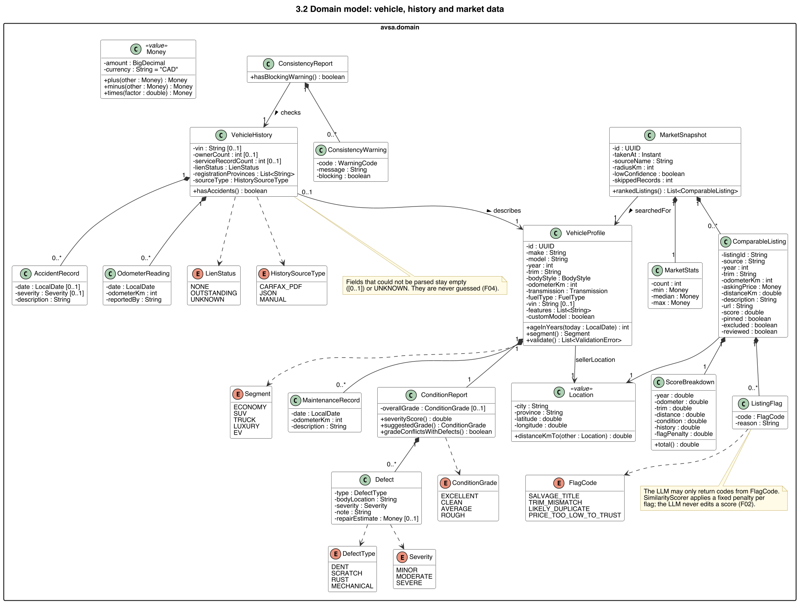

- `VehicleProfile` owns its `ConditionReport`, which owns the `Defect` list. All other features read the profile but never modify it.
- `VehicleHistory` is optional (0..1 per profile), and any field the parser could not read stays empty or `UNKNOWN`.
- A `MarketSnapshot` is an immutable, timestamped result of one search. Each `ComparableListing` keeps its `ScoreBreakdown`, so the score shown in the *Market* tab can always be explained.
- AI review results are stored as `ListingFlag` objects restricted to the `FlagCode` enumeration. This makes "the LLM never changes a score directly" structural: the scorer converts flags to penalties.
- `Money` is a value object (amount + currency) used for every price, so currency and rounding are handled in one place.

## 3.3 Domain Model: Pricing, Positioning, Forecast, and Offers

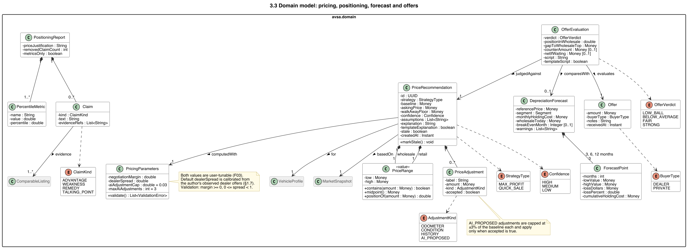

- `PriceRecommendation` holds two `PriceRange` parts (wholesale and retail) and an itemized list of `PriceAdjustment`s. Each adjustment records its kind, so AI-proposed adjustments are visibly separate from computed ones and only count when accepted.
- It keeps references to the `PricingParameters` and `MarketSnapshot` it was computed from, so F10 can show why a price changed between two snapshots. `stale` is set when a `HistoryUpdated` event arrives (F04).
- `PricingParameters` holds the negotiation margin and the dealer spread. Their defaults come from configuration (Section 3.8, `AppConfig`).
- Every `Claim` in a `PositioningReport` links to the comparables it relies on. `ClaimValidator` (Section 3.7) drops claims whose evidence does not exist.
- `OfferEvaluation` is judged against a `PriceRecommendation` and may compare with a `DepreciationForecast` (the "take it now or wait" comparison in F11).

## 3.4 Domain Model: Listing, Export, Simulation, Workflow, and Sessions

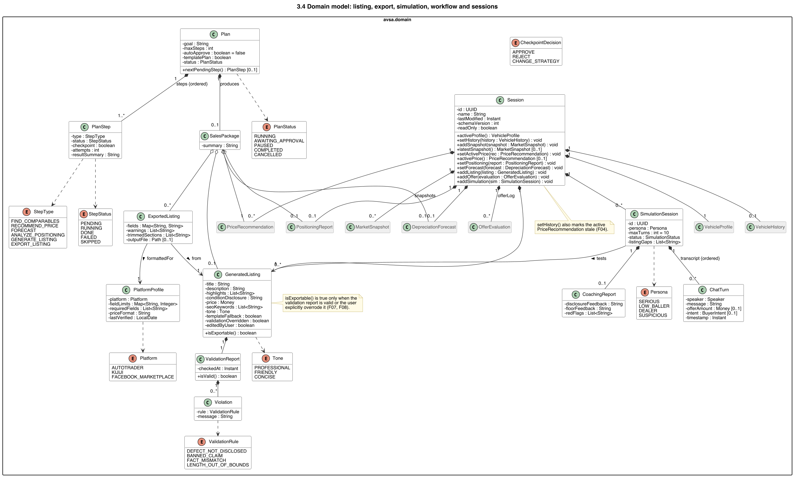

- `GeneratedListing` always carries its `ValidationReport`. `isExportable()` is the single rule that F08 checks before exporting.
- `ExportedListing` is derived from one listing and one `PlatformProfile`, whose limits are loaded from editable configuration.
- `SimulationSession` keeps an ordered transcript of `ChatTurn`s. Buyer turns carry a structured offer amount and intent, which feed the `NegotiationTracker`.
- A `Plan` is an ordered list of `PlanStep`s whose types come from the fixed `StepType` catalog. A completed plan produces a `SalesPackage` that aggregates (but does not own) results also stored in the session.
- `Session` is the aggregate root that F10 persists. Deleting a session deletes everything it composes.

## 3.5 Presentation and Application Layers

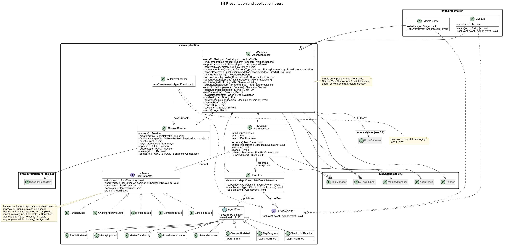

- `MainWindow` (GUI) and `AvsaCli` (CLI) depend only on `AgentController` and on `EventListener`. This is what lets both front ends share every feature.
- `AgentController` exposes one method per user action in Section 2 and delegates the work. It contains no pricing, parsing, or prompt logic.
- `EventBus` delivers `AgentEvent` subclasses to subscribers. The two front ends refresh their views from events, and `AutoSaveListener` saves the session on every state-changing event (F10).
- `PlanExecutor` runs F12 plans: it calls tools or AI tasks, retries failed steps, and publishes `StepProgress` and `CheckpointReached` events. What it does when the user approves, rejects, resumes, or cancels depends on its current `PlanRunState` (Running, AwaitingApproval, Paused, Completed, Cancelled); see Section 4.9.

## 3.6 Agent Core

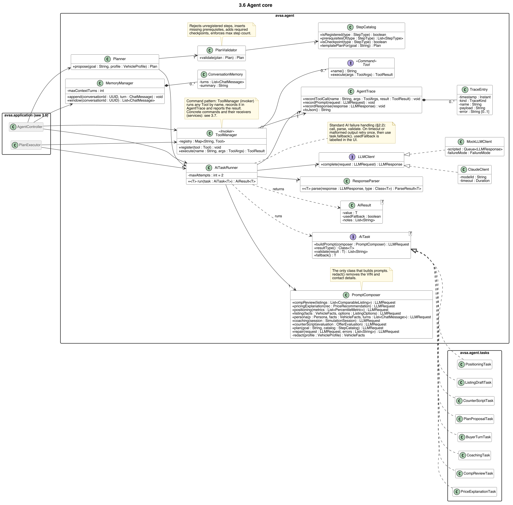

- Every LLM interaction is an `AiTask<T>`: it builds its prompt, names its result type, validates the parsed result, and supplies a deterministic fallback. `AiTaskRunner` executes any task with the same call → parse → validate → retry → fallback sequence and returns an `AiResult<T>` that says whether the fallback was used.
- `LLMClient` is the only class that talks to the provider. `ClaudeClient` is the production implementation and `MockLLMClient` returns scripted responses or injected failures for tests.
- `PromptComposer` is the only class that builds prompts, and it works on redacted `VehicleFacts`, so the VIN and contact details cannot reach the LLM.
- `ToolManager` is the only path from the agent to data and services. Each `Tool` is a command object that `ToolManager` looks up by name and executes (Command pattern, Section 4.7). Lookup by name is also how `PlanValidator` checks that a proposed plan uses only registered steps.
- `AgentTrace` records every tool call, prompt, and response. `toJson()` is what `avsa --json` prints.

## 3.7 Deterministic Services and Agent Tools

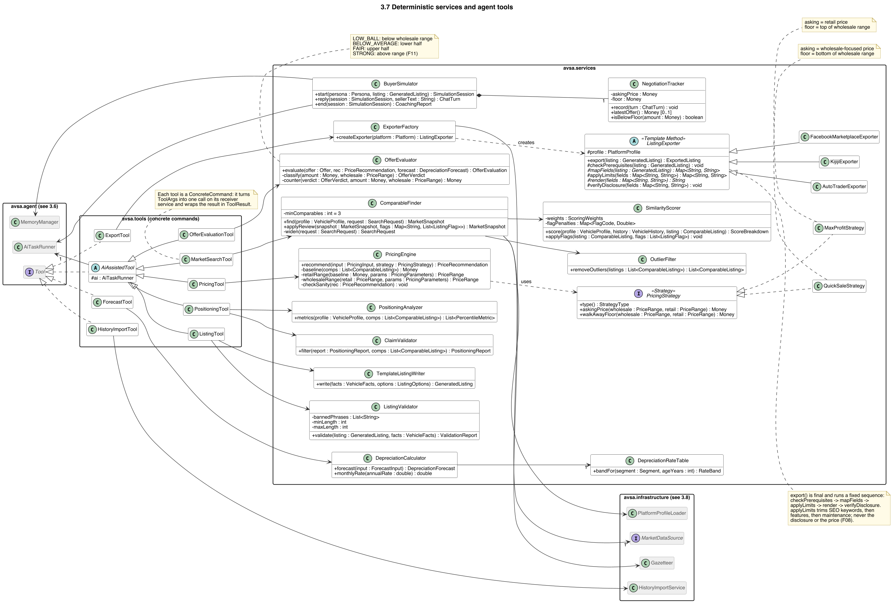

- Each tool is a thin adapter from `ToolArgs` to one service, so services stay independent of the agent and can be unit-tested directly.
- `PricingEngine` computes the baseline, retail range, and wholesale range, then asks the selected `PricingStrategy` for the asking price and walk-away floor. Adding a strategy does not change the engine.
- `ExporterFactory` creates the exporter for a platform. `ListingExporter.export()` fixes the order of the export steps, and each platform subclass supplies only field mapping and rendering.
- `ListingValidator`, `ClaimValidator`, and `OfferEvaluator` are the deterministic checks behind "the AI proposes, the code verifies."

## 3.8 Infrastructure

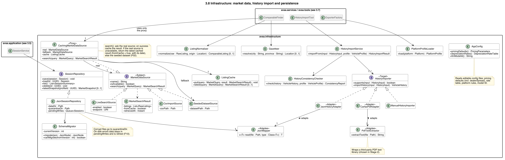

- `MarketDataSource` has three real implementations (seeded dataset, CSV import, live search). `ComparableFinder` only ever talks to `CachingMarketDataSource`, a Proxy with the same interface, which caches successful results and returns cached results (marked `fromCache`, with their date) or the seeded dataset when the real source is unavailable.
- `HistoryImporter` is the interface the rest of the system expects. `CarfaxPdfAdapter` and `JsonHistoryAdapter` adapt a PDF text-extraction library and a JSON library to it. `ManualHistoryImporter` converts form input; it implements the same interface but adapts nothing, so it is not counted as an Adapter.
- `JsonSessionRepository` stores sessions as JSON, quarantines corrupt files, keeps unsaved data in memory on disk errors, and uses `SchemaMigrator` for version changes.
- `AppConfig` and `PlatformProfileLoader` read the editable configuration files (pricing defaults, depreciation rates, platform rules, model ID).

---

# 4. Design Pattern Explanations

## 4.0 Summary

AVSA applies nine design patterns. Each one solves a specific problem in the features of Section 2, and each appears in the class diagrams of Section 3 with stereotypes naming the role of every participating class.

| # | Pattern | Category | Main classes | Features | Course coverage |
|---|---|---|---|---|---|
| 4.1 | Facade | Structural | `AgentController` | All (F01–F12) | Structural Patterns lecture |
| 4.2 | Observer | Behavioral | `EventBus`, `EventListener` | F04, F10, F12, both front ends | Course outline; project handout |
| 4.3 | Strategy | Behavioral | `PricingStrategy`, `MaxProfitStrategy`, `QuickSaleStrategy` | F03, F11 | Project handout |
| 4.4 | Factory Method | Creational | `ExporterFactory`, `ListingExporter` | F08 | Creational Patterns lecture ("Factory") |
| 4.5 | Template Method | Behavioral | `ListingExporter` and its subclasses | F08 | Project handout |
| 4.6 | Adapter (object adapter) | Structural | `HistoryImporter`, `CarfaxPdfAdapter`, `JsonHistoryAdapter` | F04 | Structural Patterns lecture |
| 4.7 | Command | Behavioral | `Tool`, `ToolManager`, the eight tools | F02–F08, F11, F12 | Project handout |
| 4.8 | Proxy | Structural | `CachingMarketDataSource`, `MarketDataSource` | F02 | Structural Patterns lecture |
| 4.9 | State | Behavioral | `PlanExecutor`, `PlanRunState` and five states | F12 | Course outline; project handout |

For each pattern the subsections below answer the same five questions: what problem it addresses, which classes participate, what role each class plays, why the pattern fits, and what would be harder without it.

---

## 4.1 Facade

*Participating classes are shown in the class diagram of Section 3.5.*

**Problem.** AVSA has two front ends, a JavaFX GUI and the `avsa` CLI, and both must offer every feature. Behind them sit a dozen collaborating subsystems: planning, AI task execution, tools, the buyer simulator, memory, tracing, and persistence. If each front end called these subsystems directly, both would have to know how they fit together (for example, that pricing needs comparables first, that results must be traced, and that state changes must be published), and that knowledge would be duplicated and drift apart.

**Participants.**

| Class | Role | Responsibility |
|---|---|---|
| `AgentController` | Facade | Offers one method per user action (`findComparables`, `recommendPrice`, `generateListing`, `runGoal`, …) and coordinates the subsystems to carry it out. |
| `Planner`, `PlanExecutor`, `AiTaskRunner`, `ToolManager`, `BuyerSimulator`, `SessionService` | Subsystem classes | Do the actual work. They do not know the facade exists. |
| `MainWindow`, `AvsaCli` | Clients | Translate user input into facade calls and display the results. |

**Why it fits.** This is the situation the lecture describes: "a single class represents an entire subsystem," and the facade "decouples the subsystem from clients" and "layers subsystems." Like the lecture's `CarEngineFacade.startEngine()`, which switches on the air flow, fuel injector, starter, and cooling in the right order, `AgentController.recommendPrice()` runs the pricing tool, records the trace, and publishes `PriceRecommended` in the right order.

**Without it.** Every feature would be wired twice, once in the GUI and once in the CLI. Any change to a subsystem's interface would ripple into both front ends.

---

## 4.2 Observer

*Participating classes are shown in the class diagram of Section 3.5.*

**Problem.** Many parts of the system must react when the session changes, but the code that changes it should not know who is interested. When pricing finishes, the GUI must refresh the *Pricing* tab, the CLI must print progress, and the session must be auto-saved (F10). When a new history is imported, any existing price must be marked stale (F04). During an F12 run, the plan view must update after every step.

**Participants.**

| Class | Role | Responsibility |
|---|---|---|
| `EventBus` | Subject | Keeps the list of listeners per event type; `publish()` notifies every listener registered for that type. |
| `EventListener` | Observer | The single `onEvent(AgentEvent)` interface all listeners implement. |
| `MainWindow`, `AvsaCli`, `AutoSaveListener` | Concrete observers | Refresh the view, print progress, or save the session. |
| `AgentEvent` and subclasses (`PriceRecommended`, `HistoryUpdated`, `StepProgress`, …) | Event (state passed to observers) | Carry what changed and when. |

**Why it fits.** The relationship is one-to-many and the set of observers changes: the CLI never opens a window, and tests register no GUI at all. Publishing typed events lets the producer stay ignorant of all of them.

**Without it.** `PlanExecutor`, `AgentController`, and the services would hold direct references to `MainWindow`, `AvsaCli`, and the repository, and would have to check which of them exist. Adding a new reaction (for example, a progress bar) would mean editing the code that produces the change. Running the agent headless in tests would require stubbing GUI classes.

---

## 4.3 Strategy

*Participating classes are shown in the class diagram of Section 3.7.*

**Problem.** F03 gives the seller two selling strategies, *Maximum profit* and *Quick sale*. Both share the same pipeline (baseline, condition and history adjustments, retail range, wholesale range), but they differ in two decisions: the recommended asking price and the walk-away floor. The seller chooses the strategy at run time, and the floor it produces is later used by F09 and F11.

**Participants.**

| Class | Role | Responsibility |
|---|---|---|
| `PricingStrategy` | Strategy | Declares `askingPrice(wholesale, retail)` and `walkAwayFloor(wholesale, retail)`. |
| `MaxProfitStrategy` | Concrete strategy | Asks the retail price; floor is the top of the wholesale range. |
| `QuickSaleStrategy` | Concrete strategy | Asks a wholesale-focused price; floor is the bottom of the wholesale range. |
| `PricingEngine` | Context | Computes the shared ranges and asks the selected strategy for the two strategy-specific values. |

**Why it fits.** The variation is a family of interchangeable algorithms chosen at run time, which is exactly what Strategy encapsulates. The shared computation stays in one place and only the part that differs is swapped.

**Without it.** `PricingEngine` would contain `if (strategy == MAX_PROFIT) … else …` branches in every place a strategy-specific value is needed. Adding a third strategy (for example, a trade-in strategy) would mean editing the engine and retesting all of its paths, instead of adding one class and testing it alone.

---

## 4.4 Factory Method

*Participating classes are shown in the class diagram of Section 3.7.*

**Problem.** F08 exports a listing to AutoTrader, Kijiji, or Facebook Marketplace. Each platform needs a different exporter object, configured with that platform's rules (`PlatformProfile`). The code that asks for an export only knows the platform the user picked, and it should not need to know which concrete exporter classes exist.

**Participants.**

| Class | Role | Responsibility |
|---|---|---|
| `ExporterFactory` | Creator | `createExporter(platform)` decides which exporter to build and gives it the platform's `PlatformProfile`. |
| `ListingExporter` | Product | The common type every exporter shares. |
| `AutoTraderExporter`, `KijijiExporter`, `FacebookMarketplaceExporter` | Concrete products | One per platform. |
| `ExportTool` | Client | Asks the factory for an exporter and calls `export()` on it. |

**Why it fits.** This is the parameterized form taught in the lecture, where `NameFactory.getNamer(entry)` returns a `FirstFirst` or `LastFirst` depending on its argument: "the Factory is a class that decides which of these subclasses to return depending on the arguments you give it," and it is appropriate when "a class can't anticipate which kind of class of objects it must create" and "you want to localize the knowledge of which class gets created."

**Without it.** Every caller that exports (the tool, the CLI's `export` command, and the F12 plan) would contain its own `switch` over platforms and its own code to load platform rules. Adding a fourth marketplace would mean finding and editing all of those places, which violates the Open/Closed Principle listed in the lecture's pros and cons.

---

## 4.5 Template Method

*Participating classes are shown in the class diagram of Section 3.7.*

**Problem.** Every export must follow the same safety sequence: check that the listing passed validation, map fields, trim to the platform's limits in a fixed priority order, render, and finally confirm that the condition disclosure survived trimming. Only two steps differ between platforms: how fields are mapped and how the output is rendered. The disclosure check must never be skipped, because F07 and F08 promise that a listing hiding a defect cannot be exported.

**Participants.**

| Class | Role | Responsibility |
|---|---|---|
| `ListingExporter` | Abstract class | Defines the final `export()` template method that calls the steps in order, and implements the shared steps (`checkPrerequisites`, `applyLimits`, `verifyDisclosure`). |
| `AutoTraderExporter`, `KijijiExporter`, `FacebookMarketplaceExporter` | Concrete classes | Implement only the platform-specific steps, `mapFields` and `render`. |

**Why it fits.** The algorithm's skeleton is fixed and safety-critical, and only some steps vary. Making `export()` final puts the guarantee in the base class instead of trusting each subclass to remember it. Template Method and Factory Method work together here: the factory decides *which* exporter is created, and the template method decides *how* every exporter runs.

**Without it.** Each exporter would implement the whole sequence itself. The trimming order and the disclosure check would be copied three times, and a new exporter could forget the disclosure check, silently breaking the honesty guarantee.

---

## 4.6 Adapter (object adapter)

*Participating classes are shown in the class diagram of Section 3.8.*

**Problem.** F04 imports a vehicle history from a CARFAX PDF or a JSON file. The rest of the system wants a single operation, "give me a `VehicleHistory` from this input," but the tools that read these files have unrelated interfaces: a third-party PDF library returns raw text, and a JSON library returns generic objects. Neither knows anything about vehicle histories.

**Participants.**

| Class | Role | Responsibility |
|---|---|---|
| `HistoryImporter` | Target | The interface the client expects: `supports(input)` and `importHistory(input)`. |
| `CarfaxPdfAdapter` | Adapter | Holds a `PdfTextExtractor`, calls `extractText()`, and converts the text into a `VehicleHistory` using fixed rules. |
| `JsonHistoryAdapter` | Adapter | Holds a `JsonMapper` and converts its output into a `VehicleHistory`. |
| `PdfTextExtractor`, `JsonMapper` | Adaptees | Wrap the external libraries, which have their own interfaces. |
| `HistoryImportService` | Client | Picks the importer whose `supports()` returns true and uses it through the target interface only. |

`ManualHistoryImporter` also implements `HistoryImporter`, but it adapts no existing class, so it is not a participant in the pattern.

**Why it fits.** This is the object-adapter form from the lecture: "the adapter inherits the target interface that the client expects to see, while it holds an instance of the adaptee," and "only the adapter knows about both of them," just as `RoundToSquarePegAdapter` holds a `RoundPeg`. Composition was chosen over the class-adapter form because the adaptees are library classes that should not be subclassed, and because the PDF library is only chosen in Stage 2.

**Without it.** `HistoryImportService` would call PDF and JSON library APIs directly. Replacing the PDF library, or adding a new report provider, would mean editing the service and every test that touches it. With adapters, a new format is one new class.

---

## 4.7 Command

*Participating classes are shown in the class diagram of Section 3.6 (`Tool`, `ToolManager`) and 3.7 (the concrete tools).*

**Problem.** The agent must perform actions chosen at run time: in F12 the LLM proposes a plan such as "find comparables, then price, then write a Kijiji ad," and the system must execute those steps by name. Every action must also be traced (Section 1.5, rule 6), retried on transient failures, and checked against a fixed catalog so the LLM cannot invoke anything that is not registered.

**Participants.**

| Class | Role | Responsibility |
|---|---|---|
| `Tool` | Command | `name()` and `execute(ToolArgs) : ToolResult`. |
| `MarketSearchTool`, `PricingTool`, `ExportTool`, and five more | Concrete commands | Each turns `ToolArgs` into one call on its receiver and wraps the result. |
| `ComparableFinder`, `PricingEngine`, `ExporterFactory`, … | Receivers | The services that do the real work. |
| `ToolManager` | Invoker | Keeps the registry of tools, executes one by name, and records every call in `AgentTrace`. |
| `PlanExecutor` (and `AgentController`) | Client | Decides which tool to run and with which arguments. |

**Why it fits.** Command turns a request into an object. That is exactly what the agent needs: a plan is a list of named requests, so requests must be objects that can be looked up, validated, run, retried, and logged uniformly.

**Without it.** `PlanExecutor` would need a large `switch` mapping step names to service calls, with tracing and retry code repeated in each branch. Checking that an LLM-proposed step exists would require a separate list kept in sync by hand. Adding a new capability would mean editing the executor rather than registering one new tool.

---

## 4.8 Proxy

*Participating classes are shown in the class diagram of Section 3.8.*

**Problem.** F02 requires that if the selected market data source is unavailable, the system falls back to the most recent cached results (shown with their date), and if there are none, to the seeded dataset. Live and CSV sources can fail at any time. Putting this logic in `ComparableFinder` would mix data-access policy with similarity scoring and ranking.

**Participants.**

| Class | Role | Responsibility |
|---|---|---|
| `MarketDataSource` | Subject | The common interface: `isAvailable()` and `search(query)`. |
| `LiveSearchSource`, `CsvImportSource`, `SeededDatasetSource` | Real subjects | Actually retrieve listings. |
| `CachingMarketDataSource` | Proxy | Same interface. Controls access to the real source: forwards the search when it is available and caches the result; otherwise returns the cached result marked `fromCache` with its date, or the seeded dataset. |
| `ListingCache` | Helper | Stores the latest successful result per query. |
| `ComparableFinder` | Client | Uses the proxy as if it were any data source. |

**Why it fits.** The lecture defines Proxy as a substitute that "implements the same interface as the real object," "controls the access to the object," and lets the proxy "perform additional processing" while being "invisible to the client, so introducing proxies does not affect client code." Availability checks and caching are exactly that kind of additional processing. The pattern also follows the lecture's distinction from Decorator: the intent here is to control access to the source, not to add new features to it.

**Without it.** `ComparableFinder` would check availability, read and write a cache, and choose fallbacks for every search, and the same logic would be needed anywhere else that reads market data. Testing the scorer would require simulating network failures. With the proxy, the fallback can be tested once, by giving it a source that reports itself unavailable.

---

## 4.9 State

*Participating classes are shown in the class diagram of Section 3.5.*

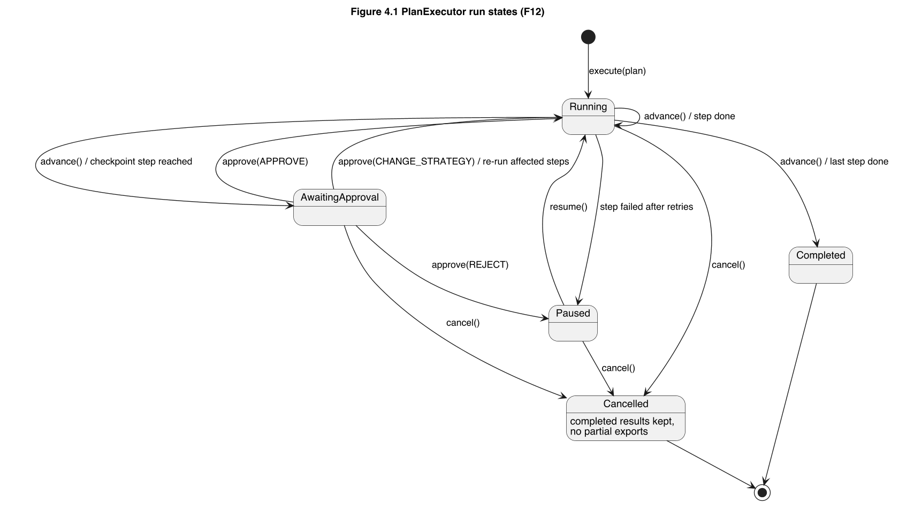

**Problem.** An F12 run can be running, waiting for the seller's approval at a checkpoint, paused after a rejection or a failed step, completed, or cancelled. The same user actions mean different things in each situation: *Approve* resumes a run that is waiting but means nothing while it is running; *Cancel* stops a running or paused run but must do nothing to a finished one; and changing the strategy at a checkpoint must re-run the affected steps. These rules are stated across F12's workflow and error cases.

**Participants.**

| Class | Role | Responsibility |
|---|---|---|
| `PlanExecutor` | Context | Holds the current `PlanRunState` and forwards `approve`, `resume`, `cancel`, and step completion to it. |
| `PlanRunState` | State | Declares the operations every state must handle, plus `status()` for display and saving. |
| `RunningState`, `AwaitingApprovalState`, `PausedState`, `CompletedState`, `CancelledState` | Concrete states | Each implements the operations for one situation and calls `changeState()` to move to the next one (Figure 4.1). |
| `AgentController` | Client | Passes the seller's checkpoint decisions and *Stop* clicks to the executor. |

**Why it fits.** The object's behaviour depends on its state, and the transitions are explicit and testable. Each state class is small and its rules can be read in one place.

**Without it.** Every public method of `PlanExecutor` would start with a `switch` over a status flag, and the transition rules would be spread across five methods. Missing one case (for example, approving a cancelled run) would be easy and hard to spot.

---

---

# 5. Use-Case Diagram

## 5.1 Actors

| Actor | Type | Description | Interacts through |
|---|---|---|---|
| **Seller** | Primary, human | A private individual selling a used vehicle (Section 1.2). Starts every use case, through the GUI or the `avsa` CLI. | `MainWindow`, `AvsaCli` |
| **LLM Service** | Secondary, AI service | The hosted Claude model (Section 1.5). Reviews listings, explains prices, writes text, plays buyers, and proposes plans. It never starts a use case and never sees the VIN or contact details. | `LLMClient` (`ClaudeClient`) |
| **Market Data Source** | Secondary, external service | Supplies used-vehicle listings: the seeded dataset, an imported CSV, or optional live search. | `MarketDataSource` (behind `CachingMarketDataSource`) |

The vehicle history report (F04) is not modelled as an actor. The seller obtains the report outside AVSA and supplies it as a file, so AVSA never communicates with the report provider.

## 5.2 Diagrams

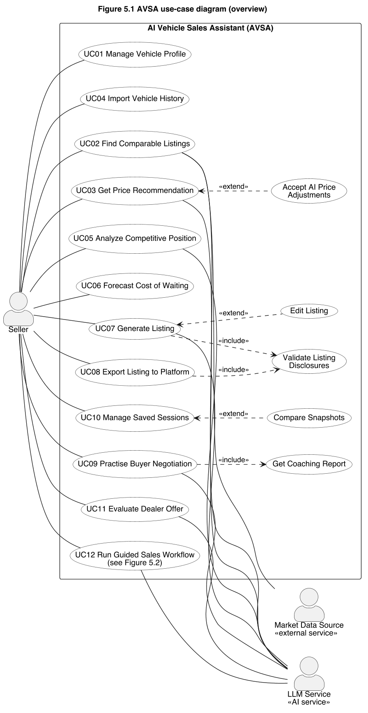

Figure 5.1 shows all twelve use cases. Each corresponds to one feature, so together they cover F01–F12. Five smaller use cases make shared or optional behaviour explicit:

- **Validate Listing Disclosures** is «included» by both UC07 and UC08, because a listing is validated when it is generated and checked again before it is exported.
- **Get Coaching Report** is «included» by UC09, because every practice session ends with coaching.
- **Accept AI Price Adjustments** «extends» UC03, **Edit Listing** «extends» UC07, and **Compare Snapshots** «extends» UC10. Each is an optional step the seller may take in the base use case.

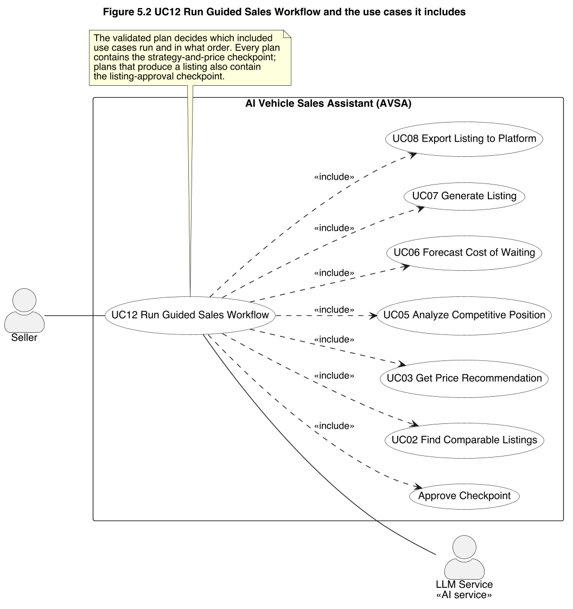

Figure 5.2 shows the guided workflow separately to keep Figure 5.1 readable. UC12 «includes» the feature use cases it can run as plan steps, together with **Approve Checkpoint**.

## 5.3 Use-Case Summary

| ID | Use case | Actors | Related feature(s) | Includes / extended by |
|---|---|---|---|---|
| UC01 | Manage Vehicle Profile | Seller | F01 | — |
| UC02 | Find Comparable Listings | Seller, Market Data Source, LLM Service | F02 | — |
| UC03 | Get Price Recommendation | Seller, LLM Service | F03 | extended by Accept AI Price Adjustments |
| UC04 | Import Vehicle History | Seller | F04 | — |
| UC05 | Analyze Competitive Position | Seller, LLM Service | F05 | — |
| UC06 | Forecast Cost of Waiting | Seller | F06 | — |
| UC07 | Generate Listing | Seller, LLM Service | F07 | includes Validate Listing Disclosures; extended by Edit Listing |
| UC08 | Export Listing to Platform | Seller | F08 | includes Validate Listing Disclosures |
| UC09 | Practise Buyer Negotiation | Seller, LLM Service | F09 | includes Get Coaching Report |
| UC10 | Manage Saved Sessions | Seller | F10 | extended by Compare Snapshots |
| UC11 | Evaluate Dealer Offer | Seller, LLM Service | F11 | — |
| UC12 | Run Guided Sales Workflow | Seller, LLM Service, Market Data Source | F12 (runs F02, F03, F05–F08) | includes Approve Checkpoint, UC02, UC03, UC05–UC08 |

---

# 6. Detailed Use-Case Descriptions

**Conventions.** Main success scenarios are numbered steps. Alternative and exception flows are numbered after the step where they branch: "3a" is the first alternative at step 3. Unless a use case says otherwise, the standard AI failure handling of Section 2.2 applies to every step that calls the LLM Service, and every use case can be started from the GUI or the CLI command listed in its feature.

---

### UC01 — Manage Vehicle Profile

- **Actor(s):** Seller
- **Goal:** Record a complete, validated description of the vehicle, including every defect, so that all other features can use it.
- **Preconditions:** None.
- **Trigger:** The seller opens the *Vehicle* tab and chooses to create or edit a profile, or runs `avsa profile create|edit`.
- **Main success scenario:**
  1. The seller enters the vehicle details (make, model, year, trim, body style, odometer, transmission, fuel type, location, optional VIN, features, maintenance records).
  2. The seller adds defects one at a time, each with type, location, severity, an optional note, and an optional repair estimate.
  3. The seller optionally chooses an overall condition grade and submits.
  4. The system validates every field.
  5. The system computes the vehicle's age, segment, and damage severity score, and suggests a condition grade if none was chosen.
  6. The system stores the profile in the session, publishes `ProfileUpdated`, and shows the saved profile.
- **Alternative / exception flows:**
  - 4a. Year or odometer out of range: the field is marked with an inline error and the profile is not saved until it is corrected.
  - 4b. Make or model not in the catalog: the profile is accepted as custom, with a warning that fewer comparables may be found.
  - 4c. VIN present but invalid: a warning is shown; the seller may correct or remove it and continue.
  - 4d. A profile for the same vehicle already exists: the system offers to open it instead; if the seller accepts, the use case ends with the existing profile open.
  - 5a. The chosen grade conflicts with the recorded defects (for example "excellent" with a severe defect): the seller must confirm the grade or change it.
- **Postconditions:** A valid `VehicleProfile` with its `ConditionReport` is the active profile and has been auto-saved.
- **Related feature(s):** F01

---

### UC02 — Find Comparable Listings

- **Actor(s):** Seller (primary); Market Data Source, LLM Service (secondary)
- **Goal:** Obtain a ranked, explained list of similar vehicles for sale near the seller.
- **Preconditions:** An active vehicle profile exists (UC01).
- **Trigger:** The seller clicks **Find comparables** in the *Market* tab, runs `avsa comps search`, or a UC12 plan reaches this step.
- **Main success scenario:**
  1. The seller sets the search radius and data source, or accepts the defaults (100 km, seeded dataset).
  2. The system resolves the seller's location to coordinates.
  3. The system requests matching listings from the Market Data Source.
  4. The system normalizes the records, removes duplicates and price outliers, and scores each listing for similarity.
  5. The system sends the descriptions of the top candidates to the LLM Service, which returns flags from the fixed list of flag codes.
  6. The system applies a fixed penalty for each flag, ranks the listings, and computes market statistics.
  7. The system saves a timestamped market snapshot, publishes `MarketDataReady`, and shows the ranked table.
  8. The seller may open a listing's score breakdown, and pin or exclude listings.
- **Alternative / exception flows:**
  - 3a. The selected source is unavailable: the system uses the most recent cached results for the same search, labelled with their date; if none exist, it uses the seeded dataset and says so.
  - 4a. Some records are malformed: they are skipped and the number skipped is reported.
  - 4b. Fewer than 3 comparables remain: the system widens the search in steps (radius, then year range, then trim). If there are still too few, the result is marked low-confidence and CSV import is suggested.
  - 5a. The LLM Service is unavailable or its output is invalid after the retry: listings are ranked without flags and labelled "unreviewed."
  - 5b. A returned flag is not in the fixed list: that flag is discarded.
- **Postconditions:** A `MarketSnapshot` with ranked `ComparableListing`s is stored in the session and auto-saved.
- **Related feature(s):** F02

---

### UC03 — Get Price Recommendation

- **Actor(s):** Seller (primary); LLM Service (secondary)
- **Goal:** Obtain wholesale and retail price ranges, a recommended asking price, and a walk-away floor for a chosen selling strategy.
- **Preconditions:** An active profile exists (UC01). A market snapshot exists (UC02).
- **Trigger:** The seller chooses a strategy and clicks **Calculate** in the *Pricing* tab, runs `avsa price --strategy …`, or a UC12 plan reaches this step.
- **Main success scenario:**
  1. The seller chooses *Maximum profit* or *Quick sale*, and optionally adjusts the negotiation margin and dealer spread.
  2. The system validates the parameters.
  3. The system computes the baseline from the comparables, adjusted for odometer differences.
  4. The system applies condition and history adjustments and computes the retail range, then the wholesale range.
  5. The chosen strategy produces the asking price and the walk-away floor.
  6. The system runs its sanity checks.
  7. The LLM Service writes an explanation and may propose up to three qualitative adjustments.
  8. The system shows the price ladder, the itemized adjustments, the confidence level, and the explanation.
  9. The seller clicks **Accept price**; the system stores the recommendation as the active price and publishes `PriceRecommended`.
- **Extension point — Accept AI Price Adjustments (after step 8):** The seller accepts any of the proposed adjustments. Each is capped at ±3% of the baseline. The system recomputes from step 4 with the accepted adjustments included.
- **Alternative / exception flows:**
  - 1a. No strategy is chosen: the calculation does not run and the seller is prompted to choose one.
  - 2a. A parameter is invalid (negative margin, spread of 100% or more): it is rejected with a message.
  - 3a. Fewer than 3 comparables: confidence is set to low, a warning is shown, and the seller may enter a manual baseline.
  - 3b. Comparable prices are highly dispersed: a warning says the market may contain separate segments.
  - 4a. No vehicle history: neutral assumptions are used and confidence is lowered.
  - 7a. The LLM Service is unavailable: the numbers are shown with a template explanation and no adjustments are proposed.
- **Postconditions:** An accepted `PriceRecommendation` is the active price and is auto-saved.
- **Related feature(s):** F03

---

### UC04 — Import Vehicle History

- **Actor(s):** Seller
- **Goal:** Add the vehicle's history to the session and check it against the profile.
- **Preconditions:** An active vehicle profile exists.
- **Trigger:** The seller uploads a report file or chooses manual entry in the *History* tab, or runs `avsa history import <file>` or `avsa history manual`.
- **Main success scenario:**
  1. The seller selects a report file (PDF, TXT, or JSON) or chooses manual entry.
  2. The system selects the matching importer and converts the input into a vehicle history. Fields it cannot read are set to unknown, never guessed.
  3. The system checks the history against the profile (VIN match, odometer consistency).
  4. The system shows the parsed values in an editable review table, marking unread fields "please confirm," together with warnings and trust badges.
  5. The seller reviews, edits if needed, and confirms.
  6. The system stores the history and publishes `HistoryUpdated`. Any existing price recommendation is marked stale.
- **Alternative / exception flows:**
  - 2a. The PDF has no extractable text or the format is not recognized: the system switches to manual entry.
  - 2b. The file is corrupt or unreadable: an error is shown and nothing is stored.
  - 3a. VIN mismatch: a blocking warning is shown; the seller must confirm it is the same vehicle or cancel.
  - 3b. A recorded odometer reading is higher than the profile's: a warning about a possible data-entry error is shown.
  - 3c. An outstanding lien is recorded: a warning says it should be resolved before the sale.
- **Postconditions:** A confirmed `VehicleHistory` and its `ConsistencyReport` are stored. Any prior `PriceRecommendation` is marked stale.
- **Related feature(s):** F04

---

### UC05 — Analyze Competitive Position

- **Actor(s):** Seller (primary); LLM Service (secondary)
- **Goal:** Learn the vehicle's real advantages and weaknesses against the local market, with evidence.
- **Preconditions:** An active profile, a market snapshot, and an active price recommendation exist.
- **Trigger:** The seller opens the *Positioning* tab and clicks **Analyze**, runs `avsa position`, or a UC12 plan reaches this step.
- **Main success scenario:**
  1. The system computes percentile metrics (odometer, price, age, owners) against the comparables.
  2. The system sends the metrics and top comparables to the LLM Service.
  3. The LLM Service returns advantages, weaknesses, ways to address the weaknesses, talking points, and a price justification, each citing its evidence.
  4. The system validates every claim and removes any whose evidence does not exist or contradicts the computed metrics.
  5. The system shows the side-by-side table and the report cards, with the evidence for each claim.
- **Alternative / exception flows:**
  - 1a. Fewer than 3 comparables: a limited report is produced with a notice.
  - 3a. The LLM Service is unavailable or its output is invalid after the retry: only the metrics table is shown, labelled as such.
  - 4a. Some claims were removed: the number removed is shown.
- **Postconditions:** A `PositioningReport` is stored in the session.
- **Related feature(s):** F05

---

### UC06 — Forecast Cost of Waiting

- **Actor(s):** Seller
- **Goal:** See how much value the vehicle is likely to lose while waiting for a retail buyer, and when waiting stops paying off.
- **Preconditions:** An active profile exists. An active price recommendation exists, providing the wholesale value today.
- **Trigger:** The seller opens the *Forecast* tab, runs `avsa forecast`, or a UC12 plan reaches this step.
- **Main success scenario:**
  1. The seller confirms the reference price (default: expected retail price) and the detected segment, and optionally enters a monthly holding cost.
  2. The system looks up the depreciation rate band for the segment and age.
  3. The system projects the low and high value at 3, 6, and 12 months and subtracts the accumulated holding cost.
  4. The system compares each projection with the wholesale value today to find the break-even month.
  5. The system shows the chart, the table, and the break-even message.
- **Alternative / exception flows:**
  - 1a. Zero or negative price or holding cost: rejected with a message.
  - 2a. Unknown segment: the default rate table is used, with a warning.
  - 2b. Vehicle older than the table covers: the oldest bracket is used, with a warning that the estimate is unreliable.
  - 2c. The rate table is missing or corrupt: built-in defaults are used, with a warning.
  - 4a. No break-even within 12 months: the system reports "none within 12 months."
- **Postconditions:** A `DepreciationForecast` is stored in the session.
- **Related feature(s):** F06

---

### UC07 — Generate Listing

- **Actor(s):** Seller (primary); LLM Service (secondary)
- **Goal:** Obtain an honest, platform-ready advertisement that discloses every defect.
- **Preconditions:** An active profile and an active price exist.
- **Trigger:** The seller clicks **Generate** in the *Listing* tab, runs `avsa listing generate`, or a UC12 plan reaches this step.
- **Main success scenario:**
  1. The seller chooses a tone, the sections to include, and optional keywords.
  2. The system builds the prompt with a fixed facts block and the list of defects that must be disclosed.
  3. The LLM Service returns a title, description, highlights, a disclosure section, and SEO keywords.
  4. **Include Validate Listing Disclosures:** the system checks that every defect is disclosed, no banned claims appear, the facts and price match the profile, and the length is within bounds.
  5. The system shows the listing with its validation status and publishes `ListingGenerated`.
- **Extension point — Edit Listing (after step 5):** The seller edits the text or uses **Make shorter**. The edited text goes through Validate Listing Disclosures again.
- **Alternative / exception flows:**
  - 1a. No active price: the seller is asked to complete UC03 first.
  - 2a. Information is missing (for example, no maintenance records): that section is left out; nothing is invented.
  - 3a. The LLM Service is unavailable: a template listing is generated from the profile and labelled as such; the flow continues at step 4.
  - 4a. Validation fails: the system regenerates up to two times, sending the violations as feedback.
  - 4b. Validation still fails after the retries: the best draft is shown with red warnings, and export is blocked until it is fixed or the seller explicitly overrides.
- **Postconditions:** A `GeneratedListing` with its `ValidationReport` is stored. It is exportable only if it is valid or explicitly overridden.
- **Related feature(s):** F07

---

### UC08 — Export Listing to Platform

- **Actor(s):** Seller
- **Goal:** Get the listing formatted for a specific marketplace, ready to copy or save.
- **Preconditions:** A generated listing exists and is exportable (valid or overridden).
- **Trigger:** The seller chooses a platform in the *Export* tab, runs `avsa export --platform …`, or a UC12 plan reaches this step.
- **Main success scenario:**
  1. The seller selects AutoTrader, Kijiji, or Facebook Marketplace.
  2. The system creates the exporter for that platform and loads its rules.
  3. **Include Validate Listing Disclosures:** the system confirms the listing is still exportable.
  4. The exporter maps the fields and trims optional content to the platform's limits, in the fixed priority order.
  5. The exporter renders the output and confirms that the disclosure and price are still present.
  6. The system shows a preview with character counters and per-field status.
  7. The seller clicks **Copy** or **Save as file**.
- **Alternative / exception flows:**
  - 3a. The listing is not exportable: export is blocked and the seller is sent back to UC07.
  - 4a. Still over the limit after trimming: a warning is shown and **Make shorter** (UC07) is offered.
  - 4b. A required platform field is missing: the seller is prompted for it.
  - 6a. The platform rules were last verified long ago: the verification date is shown in the preview.
  - 7a. The file cannot be written: an error is shown and clipboard copy is offered.
- **Postconditions:** An `ExportedListing` exists, and optionally a saved text file. Nothing is posted to any marketplace.
- **Related feature(s):** F08

---

### UC09 — Practise Buyer Negotiation

- **Actor(s):** Seller (primary); LLM Service (secondary)
- **Goal:** Rehearse conversations with realistic buyers and learn where the listing or the seller's answers are weak.
- **Preconditions:** A generated listing, an active profile, and an active price (asking price and floor) exist.
- **Trigger:** The seller picks a persona and clicks **Start** in the *Simulator* tab, or runs `avsa simulate --persona …`.
- **Main success scenario:**
  1. The seller selects a persona: serious buyer, low-baller, dealer, or suspicious buyer.
  2. The system builds the persona prompt from the vehicle facts and the persona's behaviour rules.
  3. The LLM Service, as the buyer, sends an opening message, possibly with an offer.
  4. The seller replies.
  5. The system stores the turn and asks the LLM Service for the next buyer turn (message, offer, intent). The negotiation tracker compares any offer with the asking price and floor, and the side panel updates.
  6. Steps 4–5 repeat until the seller accepts, the buyer walks away, the turn limit is reached, or the seller clicks **End & get coaching**.
  7. **Include Get Coaching Report:** the LLM Service produces a report on honest disclosure, holding the floor, and red flags, plus the listing gaps the buyer exposed.
  8. The system saves the transcript and report.
- **Alternative / exception flows:**
  - 1a. The LLM Service is unavailable: the simulator cannot run and a clear message is shown.
  - 4a. The seller writes something off-topic: the buyer answers in character and the session continues.
  - 5a. The buyer turn breaks character or contradicts the vehicle facts: the turn is regenerated.
  - 5b. The conversation becomes long: older turns are summarized to stay within the context limit.
  - 6a. The seller closes the tab mid-session: the transcript is auto-saved.
- **Postconditions:** A `SimulationSession` with its transcript, offer log, and `CoachingReport` is stored.
- **Related feature(s):** F09

---

### UC10 — Manage Saved Sessions

- **Actor(s):** Seller
- **Goal:** Resume earlier work and see how the market and recommended price changed over time.
- **Preconditions:** None for listing sessions; at least one saved session for the other actions.
- **Trigger:** The seller opens the *Sessions* panel or runs `avsa session list|load|compare|delete`.
- **Main success scenario:**
  1. The system lists saved sessions with their last-modified date and status.
  2. The seller opens a session.
  3. The system reads the files, checks the schema version, and rebuilds the session.
  4. The seller continues working. Every state-changing event is saved automatically.
- **Extension point — Compare Snapshots (after step 3):** The seller picks two market snapshots, and the system shows the differences (for example median price and recommended price) with a price-history chart.
- **Alternative / exception flows:**
  - 2a. The seller renames, duplicates, or deletes a session instead. Deleting requires confirmation.
  - 3a. A file is corrupt: it is moved to a quarantine folder, the valid parts are loaded, and the problem is reported.
  - 3b. The schema version is older or newer: the session is migrated if possible, otherwise opened read-only.
  - 3c. The latest market snapshot is older than the freshness threshold: the seller is prompted to refresh it (UC02).
  - 4a. The disk is full or permission is denied: the data stays in memory, the seller is warned, and saving is retried.
- **Postconditions:** The chosen session is active, and all subsequent changes are persisted.
- **Related feature(s):** F10

---

### UC11 — Evaluate Dealer Offer

- **Actor(s):** Seller (primary); LLM Service (secondary)
- **Goal:** Know whether an offer is a low-ball and what to counter with.
- **Preconditions:** An active price recommendation exists.
- **Trigger:** The seller clicks **Add offer** in the *Offers* tab, or runs `avsa offer evaluate`.
- **Main success scenario:**
  1. The seller enters the offer amount, the buyer type, and optional notes (including what the dealer said to justify the price).
  2. The system validates the amount.
  3. The system classifies the offer against the wholesale range as Low-ball, Below average, Fair, or Strong.
  4. The system chooses the counter amount using the fixed rules of F11.
  5. If a forecast exists, the system compares taking the offer now with the expected net result of waiting for a retail buyer.
  6. The LLM Service writes a counter-offer script and rebuttals to the dealer's stated reasons, citing the comparables.
  7. The system shows the verdict card, the comparison, and the script, and adds the evaluation to the offer log.
- **Alternative / exception flows:**
  - 2a. The amount is zero, negative, or not a number: it is rejected.
  - 2b. The amount is above the retail range: the seller is asked to confirm it.
  - 3a. The offer is Strong: the system recommends accepting, and no counter amount is given.
  - 6a. The LLM Service is unavailable: a template script is used and labelled as such.
- **Postconditions:** An `OfferEvaluation` is stored in the offer log.
- **Related feature(s):** F11

---

### UC12 — Run Guided Sales Workflow

- **Actor(s):** Seller (primary); LLM Service, Market Data Source (secondary)
- **Goal:** Achieve a selling goal stated in plain language, such as "Price my car for a quick sale and write a Kijiji ad," without running each feature by hand.
- **Preconditions:** An active vehicle profile exists.
- **Trigger:** The seller types a goal in the *Assistant* panel or runs `avsa run "<goal>"`.
- **Main success scenario:**
  1. The seller submits a goal.
  2. The system asks the LLM Service for a candidate plan built only from the fixed catalog of steps.
  3. The system validates the plan, inserts any missing prerequisite steps and the required checkpoints, and shows the plan with every step pending.
  4. The system runs the steps in order. Each step performs one of the included use cases (UC02, UC03, UC05, UC06, UC07, UC08), and the plan view updates after each one.
  5. **Include Approve Checkpoint (strategy and price):** the run pauses and shows the chosen strategy and price; the seller approves.
  6. The system continues with the remaining steps.
  7. **Include Approve Checkpoint (listing):** the run pauses and shows the generated listing; the seller approves.
  8. The system runs the final steps and shows the Sales Package (price recommendation, forecast, positioning highlights, validated listing, export previews) with a summary.
  9. The session is saved.
- **Alternative / exception flows:**
  - 1a. The goal is ambiguous: the system asks one clarifying question.
  - 1b. The goal is outside AVSA's scope: the system explains what the assistant can do, and the use case ends.
  - 2a. No active profile: the seller is sent to UC01 first.
  - 2b. The plan is malformed after the retry: the default template plan for the goal is used.
  - 4a. A step fails with a transient error: it is retried up to two times; then a fallback (cached results or the seeded dataset) is used, or the run pauses and asks the seller.
  - 5a. The seller changes the strategy at the checkpoint: the affected later steps are re-run.
  - 5b / 7a. The seller rejects a checkpoint: the run is paused and can be resumed later.
  - \*a. The seller clicks **Stop** at any time: the run is cancelled, completed results are kept, and no partial exports are created.
  - \*b. The plan would exceed the maximum number of steps or retries: the run stops with an explanation.
- **Postconditions:** The plan is Completed, Paused, or Cancelled. Every completed step's result is stored in the session.
- **Related feature(s):** F12, and through its steps F02, F03, F05, F06, F07, F08

---

# 7. Sequence Diagrams

## 7.1 Overview

Nine sequence diagrams cover every feature. As the handout allows, features with the same interaction structure share a diagram. SD00 shows the standard AI task execution of Section 2.2 once, and every AI step in the other diagrams refers to it with a `ref` fragment. Every diagram uses the classes and methods of Section 3.

| SD | Title | Features | Use cases | Patterns shown |
|---|---|---|---|---|
| SD00 | Standard AI task execution | all AI steps | — | — |
| SD01 | Manage vehicle profile and saved sessions | F01, F10 | UC01, UC10 | Facade, Observer |
| SD02 | Find comparable listings | F02 | UC02 | Command, Proxy |
| SD03 | Get price recommendation | F03 | UC03 | Command, Strategy |
| SD04 | Import vehicle history | F04 | UC04 | Command, Adapter, Observer |
| SD05 | Analysis features: positioning, forecast, offer | F05, F06, F11 | UC05, UC06, UC11 | Command |
| SD06 | Generate and export a listing | F07, F08 | UC07, UC08 | Command, Factory Method, Template Method |
| SD07 | Practise buyer negotiation | F09 | UC09 | Facade |
| SD08 | Run guided sales workflow | F12 | UC12 | Command, State, Observer |

**Reading the diagrams.** Messages are numbered; solid arrows are calls, dashed arrows are returns, and an arrow ending at a new participant box creates that object. `alt`, `opt`, `loop`, and `break` fragments show the alternative and error flows of Section 6. `MainWindow` and `AvsaCli` are boundary objects, `AgentController` is the control object, and domain objects such as `Session` are entities. `publish(...)` is always delivered as shown in SD01 (the front ends refresh and `AutoSaveListener` saves), and `ToolManager` records every tool call in `AgentTrace`.

## 7.2 SD00 — Standard AI Task Execution

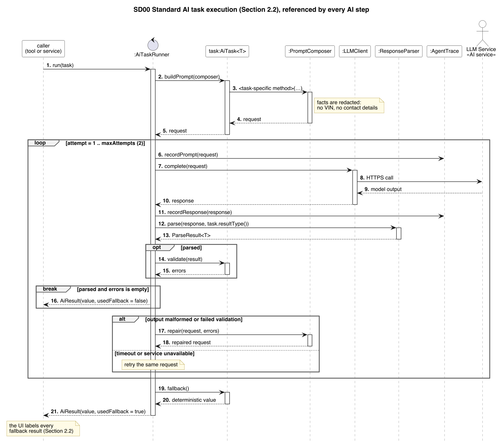

The caller only sees `AiTaskRunner.run(task)` and an `AiResult`. Retry, repair, fallback, and tracing happen in one place, and each `AiTask` supplies its own prompt, validation rule, and deterministic fallback. `task.validate()` is where "the AI proposes, the code verifies" happens: unknown flag codes, buyer turns that invent facts, and plans with unregistered steps are rejected.

## 7.3 SD01 — Manage Vehicle Profile and Saved Sessions (F01, F10)

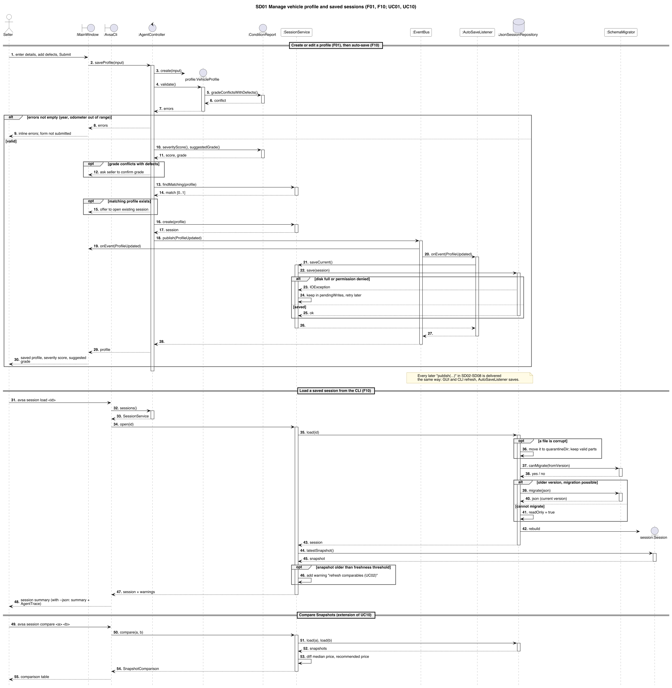

The profile validates itself, so the GUI and CLI enforce the same rules. One `publish(ProfileUpdated)` reaches the GUI and `AutoSaveListener`, which saves through `SessionService` (Observer). The second part is driven from the CLI to show that `AvsaCli` uses the same facade as the GUI; it covers corrupt files, schema migration, stale snapshots, and the Compare Snapshots extension.

## 7.4 SD02 — Find Comparable Listings (F02)

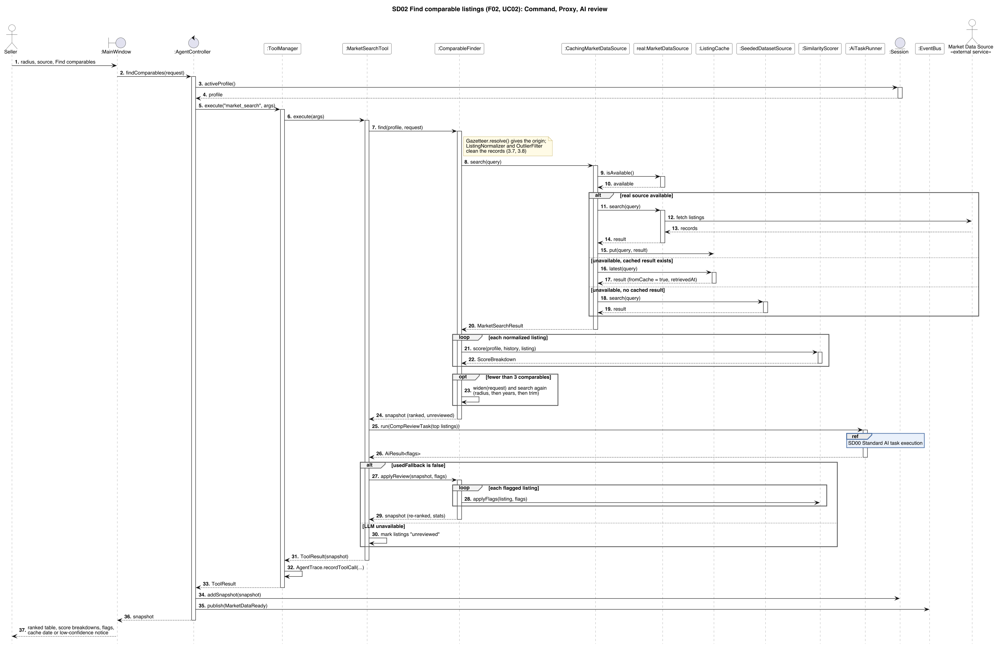

The search runs as a command through `ToolManager`, so the same call works from the GUI, the CLI, and an F12 plan. `ComparableFinder` talks only to `CachingMarketDataSource`, whose three-way `alt` (live source, cached result, seeded dataset) is the Proxy's job. The AI review comes after deterministic scoring, and flags affect scores only through `SimilarityScorer.applyFlags()`.

## 7.5 SD03 — Get Price Recommendation (F03)

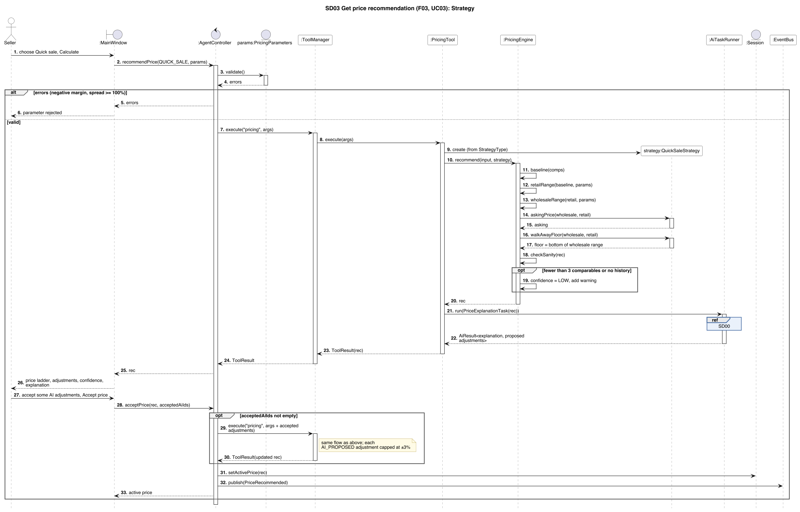

`PricingTool` creates the strategy from the seller's choice, and `PricingEngine` uses it without knowing which one it is (Strategy). The LLM is called only after all numbers are computed, and its proposed adjustments apply only if the seller accepts them, each capped at ±3%.

## 7.6 SD04 — Import Vehicle History (F04)

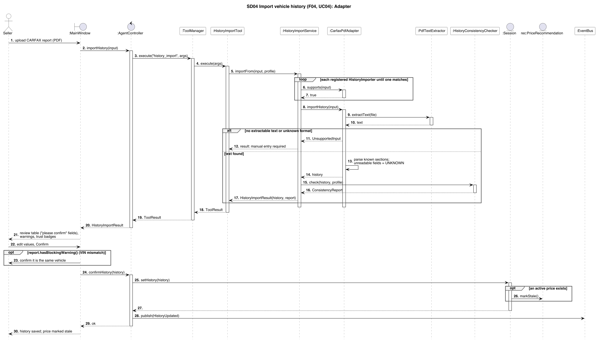

`HistoryImportService` uses the matching importer only through the `HistoryImporter` interface; `CarfaxPdfAdapter` translates the call into `PdfTextExtractor.extractText()` (Adapter). Confirming the history calls `Session.setHistory()`, which marks the active price stale before `HistoryUpdated` is published.

## 7.7 SD05 — Analysis Features (F05, F06, F11)

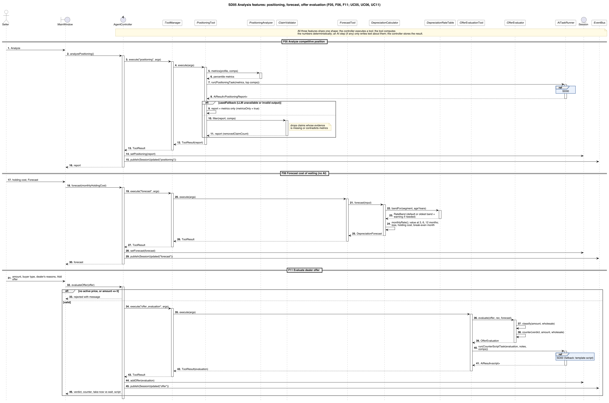

These three features share one structure: the tool computes the numbers deterministically, an AI step (if any) only writes text about them, and the controller stores the result. In F05, `ClaimValidator` removes unsupported AI claims; F06 involves no AI at all; in F11, `OfferEvaluator` decides the verdict and counter amount before the LLM writes the script.

## 7.8 SD06 — Generate and Export a Listing (F07, F08)

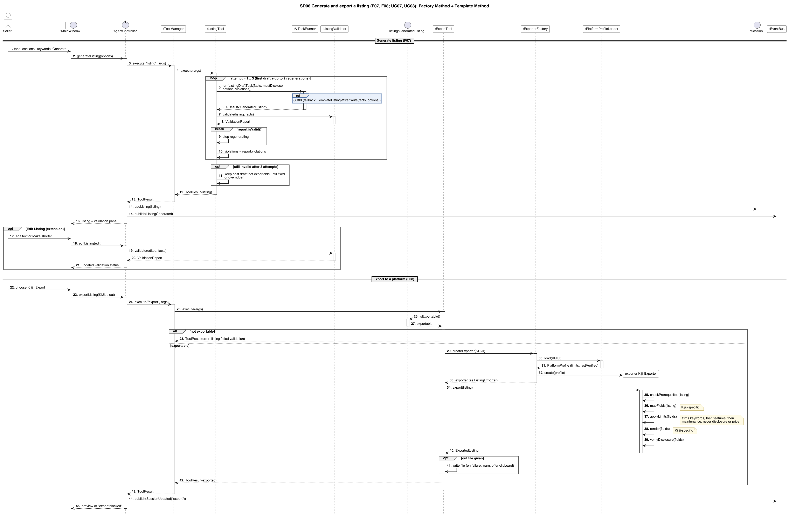

Each draft is checked by the deterministic `ListingValidator`, and violations are fed back into the next attempt (at most three). On export, `ExporterFactory` chooses and configures the exporter (Factory Method), and `export()` runs its fixed steps, of which only `mapFields()` and `render()` are platform-specific (Template Method). `verifyDisclosure()` always runs last.

## 7.9 SD07 — Practise Buyer Negotiation (F09)

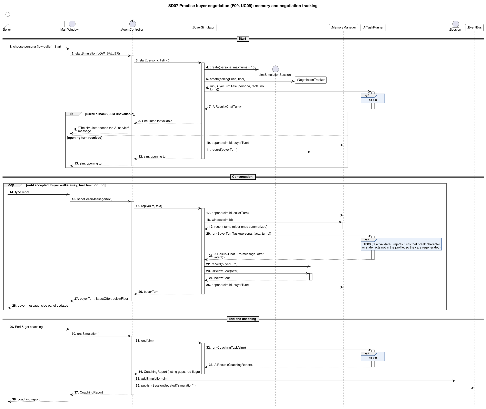

`MemoryManager` keeps the conversation and returns a window of recent turns. Each buyer turn is structured data, so `NegotiationTracker` can check offers against the floor deterministically. The simulator has no meaningful fallback, so an unavailable LLM ends the use case with a clear message.

## 7.10 SD08 — Run Guided Sales Workflow (F12)

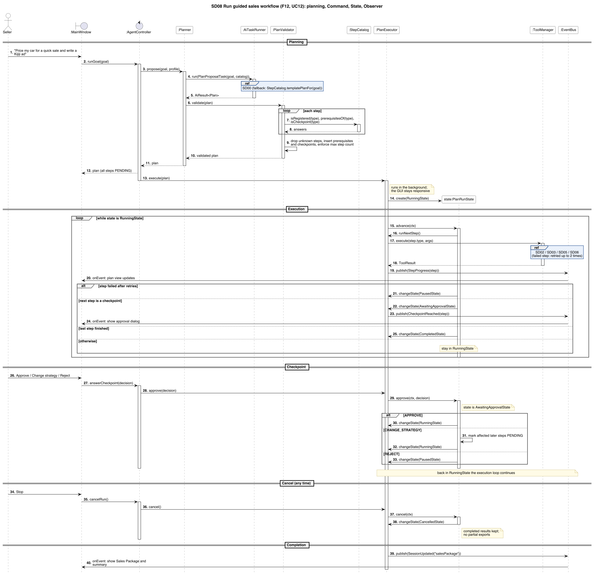

The LLM proposes a plan and `PlanValidator` enforces the step catalog, prerequisites, and checkpoints before anything runs. `PlanExecutor` delegates to its current `PlanRunState`: in `RunningState` each step runs as a command through `ToolManager` (the `ref` points to SD02, SD03, SD05, or SD06), and `StepProgress` and `CheckpointReached` are published to the GUI. Checkpoint decisions and *Stop* are handled by the current state, following Figure 4.1.

---

# 8. Feature-to-Design Traceability Table

Every feature can be traced to the use case that describes the user's interaction, the classes and methods that implement it, the sequence diagram that shows them working together, and the design patterns involved. Every AI-assisted feature also follows SD00 for its AI steps.

| Feature | Description | Type | Related use case | Classes | Key methods | Sequence diagram | Design pattern(s) |
|---|---|---|---|---|---|---|---|
| F01 | Vehicle profile and condition assessment | Deterministic | UC01 Manage Vehicle Profile | `MainWindow`, `AgentController`, `VehicleProfile`, `ConditionReport`, `Defect`, `SessionService`, `EventBus`, `AutoSaveListener` | `saveProfile()`, `validate()`, `severityScore()`, `suggestedGrade()`, `gradeConflictsWithDefects()`, `findMatching()`, `create()`, `publish()` | SD01 | Facade, Observer |
| F02 | Find and rank comparable listings | Hybrid | UC02 Find Comparable Listings | `AgentController`, `ToolManager`, `MarketSearchTool`, `ComparableFinder`, `CachingMarketDataSource`, `ListingCache`, `SeededDatasetSource`, `SimilarityScorer`, `AiTaskRunner`, `CompReviewTask`, `MarketSnapshot` | `findComparables()`, `execute()`, `find()`, `search()`, `score()`, `widen()`, `run()`, `applyReview()`, `applyFlags()`, `addSnapshot()` | SD02, SD00 | Facade, Command, Proxy |
| F03 | Wholesale/retail pricing, asking price, floor | Hybrid | UC03 Get Price Recommendation | `AgentController`, `PricingParameters`, `PricingTool`, `PricingEngine`, `PricingStrategy`, `MaxProfitStrategy`, `QuickSaleStrategy`, `AiTaskRunner`, `PriceExplanationTask`, `PriceRecommendation` | `recommendPrice()`, `validate()`, `recommend()`, `askingPrice()`, `walkAwayFloor()`, `checkSanity()`, `acceptPrice()`, `setActivePrice()` | SD03, SD00 | Strategy, Command, Facade |
| F04 | Import vehicle history and check consistency | Deterministic | UC04 Import Vehicle History | `HistoryImportTool`, `HistoryImportService`, `HistoryImporter`, `CarfaxPdfAdapter`, `JsonHistoryAdapter`, `ManualHistoryImporter`, `PdfTextExtractor`, `JsonMapper`, `HistoryConsistencyChecker`, `Session` | `importHistory()`, `importFrom()`, `supports()`, `extractText()`, `check()`, `confirmHistory()`, `setHistory()`, `markStale()` | SD04 | Adapter, Command, Observer |
| F05 | Competitive positioning with evidence | AI | UC05 Analyze Competitive Position | `PositioningTool`, `PositioningAnalyzer`, `AiTaskRunner`, `PositioningTask`, `ClaimValidator`, `PositioningReport` | `analyzePositioning()`, `metrics()`, `run()`, `filter()`, `setPositioning()` | SD05, SD00 | Command |
| F06 | Depreciation and cost-of-waiting forecast | Deterministic | UC06 Forecast Cost of Waiting | `ForecastTool`, `DepreciationCalculator`, `DepreciationRateTable`, `DepreciationForecast` | `forecast()`, `bandFor()`, `monthlyRate()`, `setForecast()` | SD05 | Command |
| F07 | Honest listing generation with validation | AI | UC07 Generate Listing | `ListingTool`, `AiTaskRunner`, `ListingDraftTask`, `TemplateListingWriter`, `ListingValidator`, `GeneratedListing`, `ValidationReport` | `generateListing()`, `run()`, `fallback()`, `write()`, `validate()`, `isValid()`, `editListing()`, `addListing()` | SD06, SD00 | Command |
| F08 | Multi-platform export | Deterministic | UC08 Export Listing to Platform | `ExportTool`, `ExporterFactory`, `PlatformProfileLoader`, `ListingExporter`, `AutoTraderExporter`, `KijijiExporter`, `FacebookMarketplaceExporter` | `exportListing()`, `isExportable()`, `createExporter()`, `load()`, `export()`, `mapFields()`, `applyLimits()`, `render()`, `verifyDisclosure()` | SD06 | Factory Method, Template Method, Command |
| F09 | Buyer inquiry simulator with coaching | AI | UC09 Practise Buyer Negotiation | `BuyerSimulator`, `SimulationSession`, `NegotiationTracker`, `MemoryManager`, `AiTaskRunner`, `BuyerTurnTask`, `CoachingTask` | `startSimulation()`, `start()`, `sendSellerMessage()`, `reply()`, `append()`, `window()`, `record()`, `isBelowFloor()`, `endSimulation()`, `end()` | SD07, SD00 | Facade |
| F10 | Saved sessions and history | Deterministic | UC10 Manage Saved Sessions | `AvsaCli`, `SessionService`, `AutoSaveListener`, `SessionRepository`, `JsonSessionRepository`, `SchemaMigrator`, `Session` | `saveCurrent()`, `save()`, `open()`, `load()`, `canMigrate()`, `migrate()`, `latestSnapshot()`, `compare()` | SD01 | Observer, Facade |
| F11 | Dealer offer evaluation and counter script | Hybrid | UC11 Evaluate Dealer Offer | `OfferEvaluationTool`, `OfferEvaluator`, `AiTaskRunner`, `CounterScriptTask`, `OfferEvaluation` | `evaluateOffer()`, `evaluate()`, `classify()`, `counter()`, `run()`, `addOffer()` | SD05, SD00 | Command |
| F12 | Guided sales workflow from a plain-language goal | Hybrid | UC12 Run Guided Sales Workflow | `Planner`, `PlanProposalTask`, `PlanValidator`, `StepCatalog`, `PlanExecutor`, `PlanRunState`, `RunningState`, `AwaitingApprovalState`, `PausedState`, `CompletedState`, `CancelledState`, `ToolManager`, `EventBus` | `runGoal()`, `propose()`, `validate()`, `isRegistered()`, `prerequisitesOf()`, `execute()`, `advance()`, `runNextStep()`, `changeState()`, `answerCheckpoint()`, `approve()`, `cancelRun()`, `cancel()` | SD08, SD00 | State, Command, Observer, Facade |

**Coverage check.** Every feature has a use case and at least one sequence diagram, and every one of the nine patterns in Section 4 appears in at least one row. All classes and methods listed above appear in the class diagrams of Section 3.

---

# 9. Feature Implementation Explanations

Each explanation lists the classes involved, the important methods, and how they collaborate at run time. "The controller" means `AgentController`, the Facade that both front ends call. In every feature the controller stores the result in the active `Session` and publishes an event, and `AutoSaveListener` then saves the session (SD01).

### F01 — Vehicle Profile & Condition Assessment

**Related use case:** UC01 Manage Vehicle Profile · **Related sequence diagram:** SD01

**Classes involved**
- `MainWindow` / `AvsaCli`: collect the vehicle details and defects.
- `AgentController`: coordinates validation, duplicate detection, and storage.
- `VehicleProfile`, `ConditionReport`, `Defect`: the domain objects; they validate themselves and compute derived values.
- `SessionService`: finds matching sessions and creates the new one.
- `EventBus`, `AutoSaveListener`: announce the change and save it.

**Important methods:** `AgentController.saveProfile()`, `VehicleProfile.validate()`, `ConditionReport.severityScore()`, `ConditionReport.suggestedGrade()`, `ConditionReport.gradeConflictsWithDefects()`, `SessionService.findMatching()`, `SessionService.create()`, `EventBus.publish()`.

**Execution.** When the seller submits the form, the GUI passes the input to `saveProfile()`. The controller builds a `VehicleProfile` and calls `validate()`. The profile checks its own ranges and VIN, and asks its `ConditionReport` whether the chosen grade conflicts with the defects. If validation fails, the errors go back to the form. Otherwise the controller obtains the severity score and a suggested grade, asks `SessionService.findMatching()` whether the vehicle already has a session, and creates the session with `create()`. It then publishes `ProfileUpdated`: the GUI refreshes, and `AutoSaveListener` calls `SessionService.saveCurrent()`.

### F02 — Comparable Listing Retrieval & Ranking

**Related use case:** UC02 Find Comparable Listings · **Related sequence diagrams:** SD02, SD00

**Classes involved**
- `ToolManager`, `MarketSearchTool`: run the search as a command.
- `ComparableFinder`: retrieves, normalizes, filters, scores, and widens the search; it also applies the AI review.
- `CachingMarketDataSource` with `ListingCache` and `SeededDatasetSource`: the Proxy that decides where the listings come from.
- `SimilarityScorer`: produces each listing's `ScoreBreakdown` and applies flag penalties.
- `AiTaskRunner`, `CompReviewTask`: obtain flags for the top candidates from the LLM.

**Important methods:** `AgentController.findComparables()`, `ToolManager.execute()`, `ComparableFinder.find()`, `CachingMarketDataSource.search()`, `SimilarityScorer.score()`, `AiTaskRunner.run()`, `ComparableFinder.applyReview()`, `SimilarityScorer.applyFlags()`, `Session.addSnapshot()`.

**Execution.** The controller reads the active profile and executes the `market_search` tool. `MarketSearchTool` calls `ComparableFinder.find()`, which queries `CachingMarketDataSource.search()`. The proxy forwards the query to the real source if it is available and caches the result; otherwise it returns the latest cached result (marked `fromCache` with its date) or the seeded dataset. The finder normalizes the records, removes outliers, scores every listing, and widens the search if fewer than three remain. The tool then runs a `CompReviewTask`. The LLM's flags are restricted to the fixed flag codes and only affect scores through `applyFlags()`. If the LLM is unavailable, the listings stay "unreviewed." The controller stores the snapshot and publishes `MarketDataReady`.

### F03 — Wholesale/Retail Pricing Engine

**Related use case:** UC03 Get Price Recommendation · **Related sequence diagrams:** SD03, SD00

**Classes involved**
- `PricingParameters`: holds and validates the negotiation margin and dealer spread.
- `PricingTool`: creates the strategy object for the seller's choice and runs the engine.
- `PricingEngine`: computes the baseline, retail range, wholesale range, and sanity checks.
- `PricingStrategy`, `MaxProfitStrategy`, `QuickSaleStrategy`: decide the asking price and walk-away floor.
- `AiTaskRunner`, `PriceExplanationTask`: write the explanation and propose bounded adjustments.

**Important methods:** `AgentController.recommendPrice()`, `PricingParameters.validate()`, `PricingEngine.recommend()`, `PricingStrategy.askingPrice()`, `PricingStrategy.walkAwayFloor()`, `PricingEngine.checkSanity()`, `AgentController.acceptPrice()`, `Session.setActivePrice()`.

**Execution.** The controller validates the parameters and executes the `pricing` tool. `PricingTool` creates a `QuickSaleStrategy` or `MaxProfitStrategy` and passes it to `PricingEngine.recommend()`. The engine computes the baseline, the retail range (using the negotiation margin), and the wholesale range (using the dealer spread, whose default is calibrated from the author's experience; see Section 1.7). It then asks the strategy for the asking price and floor and runs its sanity checks. Only then does the tool run a `PriceExplanationTask`, so the LLM explains numbers it cannot change. When the seller clicks **Accept price**, `acceptPrice()` re-runs the tool with any accepted AI adjustments (each capped at ±3%), stores the result as the active price, and publishes `PriceRecommended`.

### F04 — Vehicle History Import

**Related use case:** UC04 Import Vehicle History · **Related sequence diagram:** SD04

**Classes involved**
- `HistoryImportTool`, `HistoryImportService`: choose the importer and run the consistency check.
- `HistoryImporter` (target), `CarfaxPdfAdapter` and `JsonHistoryAdapter` (adapters), `PdfTextExtractor` and `JsonMapper` (adaptees): convert each input format into a `VehicleHistory`.
- `ManualHistoryImporter`: converts the manual form.
- `HistoryConsistencyChecker`: compares the history with the profile.
- `Session`: stores the confirmed history and marks the price stale.

**Important methods:** `AgentController.importHistory()`, `HistoryImportService.importFrom()`, `HistoryImporter.supports()`, `HistoryImporter.importHistory()`, `PdfTextExtractor.extractText()`, `HistoryConsistencyChecker.check()`, `AgentController.confirmHistory()`, `Session.setHistory()`, `PriceRecommendation.markStale()`.

**Execution.** The controller executes the `history_import` tool, which calls `HistoryImportService.importFrom(input, profile)`. The service asks each importer whether it `supports()` the input and uses the first that does, through the `HistoryImporter` interface only. For a CARFAX PDF, `CarfaxPdfAdapter` calls `PdfTextExtractor.extractText()` and parses known sections with fixed rules; unreadable fields become UNKNOWN. If the PDF has no text, the result asks for manual entry. The service then runs `HistoryConsistencyChecker.check()`, and the GUI shows the review table with its warnings. When the seller confirms, `confirmHistory()` calls `Session.setHistory()`, which marks any active price stale, and publishes `HistoryUpdated`.

### F05 — Competitive Positioning Analysis

**Related use case:** UC05 Analyze Competitive Position · **Related sequence diagrams:** SD05, SD00

**Classes involved**
- `PositioningTool`: coordinates the analysis.
- `PositioningAnalyzer`: computes percentile metrics deterministically.
- `AiTaskRunner`, `PositioningTask`: turn metrics into claims with evidence.
- `ClaimValidator`: removes unsupported claims.

**Important methods:** `AgentController.analyzePositioning()`, `PositioningAnalyzer.metrics()`, `AiTaskRunner.run()`, `ClaimValidator.filter()`, `Session.setPositioning()`.

**Execution.** The `positioning` tool first calls `PositioningAnalyzer.metrics()`, then runs a `PositioningTask` with the metrics and top comparables. `ClaimValidator.filter()` drops every claim whose cited comparable or metric does not exist or contradicts the numbers, and records how many were removed. If the AI step falls back, the report contains only the metrics table and is labelled as such. The controller stores the report and publishes `SessionUpdated`.

### F06 — Depreciation & Cost-of-Waiting Forecast

**Related use case:** UC06 Forecast Cost of Waiting · **Related sequence diagram:** SD05

**Classes involved**
- `ForecastTool`: runs the forecast.
- `DepreciationCalculator`: applies the F06 formulas.
- `DepreciationRateTable`: provides the annual rate band for a segment and age, loaded from configuration through `AppConfig`.

**Important methods:** `AgentController.forecast()`, `DepreciationCalculator.forecast()`, `DepreciationRateTable.bandFor()`, `DepreciationCalculator.monthlyRate()`, `Session.setForecast()`.

**Execution.** The controller rejects non-positive inputs, then executes the `forecast` tool. `DepreciationCalculator` gets the rate band with `bandFor()` (falling back to defaults with a warning for unknown segments or ages), converts the annual rates with `monthlyRate()`, projects low and high values at 3, 6, and 12 months, subtracts the cumulative holding cost, and finds the break-even month against the wholesale value today. No AI is involved, so the result is reproducible. The controller stores the forecast and publishes `SessionUpdated`.

### F07 — Listing Description Generation

**Related use case:** UC07 Generate Listing · **Related sequence diagrams:** SD06, SD00

**Classes involved**
- `ListingTool`: runs the generate–validate–regenerate loop.
- `AiTaskRunner`, `ListingDraftTask`: produce the draft from the facts block and the defects that must be disclosed.
- `TemplateListingWriter`: the deterministic fallback when the LLM is unavailable.
- `ListingValidator`: checks disclosures, banned claims, facts, price, and length.
- `GeneratedListing`, `ValidationReport`: the result and its validation status.

**Important methods:** `AgentController.generateListing()`, `AiTaskRunner.run()`, `ListingDraftTask.fallback()`, `TemplateListingWriter.write()`, `ListingValidator.validate()`, `ValidationReport.isValid()`, `AgentController.editListing()`, `Session.addListing()`.

**Execution.** The `listing` tool runs a `ListingDraftTask` and validates the result with `ListingValidator.validate()`. If validation fails, the violations are added to the next prompt, for up to three attempts in total. If the LLM is unavailable, the task's fallback uses `TemplateListingWriter.write()` and the template listing is validated the same way. A listing that still fails is kept with red warnings, and `isExportable()` stays false until it is fixed or explicitly overridden. The controller stores the listing and publishes `ListingGenerated`. Every edit goes through `editListing()`, which validates it again.

### F08 — Multi-Platform Export

**Related use case:** UC08 Export Listing to Platform · **Related sequence diagram:** SD06

**Classes involved**
- `ExportTool`: checks that the listing is exportable and asks the factory for an exporter.
- `ExporterFactory`, `PlatformProfileLoader`: choose and configure the exporter for the platform.
- `ListingExporter` and its subclasses `AutoTraderExporter`, `KijijiExporter`, `FacebookMarketplaceExporter`: format the listing using the fixed export template.

**Important methods:** `AgentController.exportListing()`, `GeneratedListing.isExportable()`, `ExporterFactory.createExporter()`, `PlatformProfileLoader.load()`, `ListingExporter.export()`, `checkPrerequisites()`, `mapFields()`, `applyLimits()`, `render()`, `verifyDisclosure()`.

**Execution.** The `export` tool first checks `isExportable()` and blocks the export if the listing failed validation. It then calls `ExporterFactory.createExporter(platform)`, which loads the platform's rules and returns the matching subclass. `export()` always runs the same five steps. The subclass supplies only `mapFields()` and `render()`; the base class trims optional content in the fixed priority order and finishes with `verifyDisclosure()`, so the condition disclosure and the price can never be lost. If a file path was given, the tool writes the file, or offers clipboard copy if writing fails.

### F09 — Buyer Inquiry Simulator

**Related use case:** UC09 Practise Buyer Negotiation · **Related sequence diagrams:** SD07, SD00

**Classes involved**
- `BuyerSimulator`: runs the conversation.
- `SimulationSession`, `ChatTurn`, `CoachingReport`: the conversation and its results.
- `NegotiationTracker`: compares each offer with the asking price and floor.
- `MemoryManager`: keeps the conversation and returns a window of recent turns.
- `AiTaskRunner`, `BuyerTurnTask`, `CoachingTask`: produce buyer turns and the coaching report.

**Important methods:** `AgentController.startSimulation()`, `BuyerSimulator.start()`, `AgentController.sendSellerMessage()`, `BuyerSimulator.reply()`, `MemoryManager.append()`, `MemoryManager.window()`, `NegotiationTracker.record()`, `NegotiationTracker.isBelowFloor()`, `AgentController.endSimulation()`, `BuyerSimulator.end()`.

**Execution.** `start()` creates the `SimulationSession` and a `NegotiationTracker` set to the active price and floor, then runs a `BuyerTurnTask` for the opening message. For each seller reply, `reply()` stores the turn, gets the recent turns from `MemoryManager.window()` (older turns are summarized), and runs the next `BuyerTurnTask`. The task's `validate()` rejects turns that break character or mention facts not in the profile, so they are regenerated (SD00). The tracker records the buyer's offer and checks it against the floor, which updates the side panel. `end()` runs a `CoachingTask`, and the controller stores the simulation. If the LLM is unavailable when the session starts, the simulator reports that it cannot run.

### F10 — Saved Sessions & History

**Related use case:** UC10 Manage Saved Sessions · **Related sequence diagram:** SD01

**Classes involved**
- `AutoSaveListener`: listens for every state-changing event.
- `SessionService`: the session operations used by the *Sessions* panel and the CLI.
- `SessionRepository` / `JsonSessionRepository`: read and write JSON files, quarantine corrupt ones, and keep unsaved data in memory on disk errors.
- `SchemaMigrator`: upgrades older files.

**Important methods:** `AutoSaveListener.onEvent()`, `SessionService.saveCurrent()`, `SessionRepository.save()`, `SessionService.open()`, `SessionRepository.load()`, `SchemaMigrator.canMigrate()`, `SchemaMigrator.migrate()`, `Session.latestSnapshot()`, `SessionService.compare()`.

**Execution.** Saving is automatic: every event published by the controller reaches `AutoSaveListener`, which calls `saveCurrent()`. Opening a session (SD01, here from the CLI) calls `SessionService.open()` and `JsonSessionRepository.load()`. The repository quarantines corrupt files, migrates older schema versions with `SchemaMigrator`, or opens the session read-only if migration is impossible. The service then checks whether the latest snapshot is stale and warns the seller. `compare()` loads two snapshots and reports the differences in median and recommended price.

### F11 — Dealer Offer Evaluator

**Related use case:** UC11 Evaluate Dealer Offer · **Related sequence diagrams:** SD05, SD00

**Classes involved**
- `OfferEvaluationTool`: runs the evaluation and the script generation.
- `OfferEvaluator`: decides the verdict and counter amount with fixed rules.
- `AiTaskRunner`, `CounterScriptTask`: write the counter-offer script and rebuttals.
- `OfferEvaluation`: the result stored in the offer log.

**Important methods:** `AgentController.evaluateOffer()`, `OfferEvaluator.evaluate()`, `OfferEvaluator.classify()`, `OfferEvaluator.counter()`, `AiTaskRunner.run()`, `Session.addOffer()`.

**Execution.** The controller rejects invalid amounts and asks for confirmation of amounts above the retail range, then executes the `offer_evaluation` tool. `OfferEvaluator.evaluate()` classifies the offer against the wholesale range with `classify()`, chooses the counter amount with `counter()`, and, if a forecast exists, compares taking the offer now with waiting. Only then does the tool run a `CounterScriptTask`, so the LLM argues for numbers the code already decided; a template script is used if it is unavailable. The controller adds the evaluation to the offer log and publishes `SessionUpdated`.

### F12 — Guided Sales Workflow

**Related use case:** UC12 Run Guided Sales Workflow · **Related sequence diagrams:** SD08, SD00, and the diagrams of the steps it runs

**Classes involved**
- `Planner`, `PlanProposalTask`: turn the goal into a candidate plan.
- `PlanValidator`, `StepCatalog`: enforce registered steps, prerequisites, checkpoints, and the maximum length.
- `PlanExecutor` (context) and `PlanRunState` with `RunningState`, `AwaitingApprovalState`, `PausedState`, `CompletedState`, `CancelledState` (states): run the plan and handle the seller's decisions.
- `ToolManager`: executes each step as a command.
- `EventBus`: publishes progress and checkpoints to the GUI.

**Important methods:** `AgentController.runGoal()`, `Planner.propose()`, `PlanValidator.validate()`, `StepCatalog.isRegistered()`, `StepCatalog.prerequisitesOf()`, `PlanExecutor.execute()`, `PlanRunState.advance()`, `PlanExecutor.runNextStep()`, `PlanExecutor.changeState()`, `AgentController.answerCheckpoint()`, `PlanRunState.approve()`, `AgentController.cancelRun()`, `PlanRunState.cancel()`.

**Execution.** `runGoal()` asks the `Planner` for a plan. The planner runs a `PlanProposalTask` (falling back to `StepCatalog.templatePlanFor()`), and `PlanValidator.validate()` removes unknown steps, inserts missing prerequisites and the required checkpoints, and enforces the maximum length. The controller shows the plan and starts `PlanExecutor.execute()` in the background. In `RunningState`, `advance()` calls `runNextStep()`, which executes the step's tool through `ToolManager` (the same tools as F02, F03, F05–F08) and publishes `StepProgress`. At a checkpoint the executor moves to `AwaitingApprovalState` and publishes `CheckpointReached`, so the GUI shows the approval dialog. The seller's answer goes through `answerCheckpoint()` to the current state: approval resumes the run, a strategy change marks the affected steps for re-running, and rejection pauses the run. *Stop* moves any active state to `CancelledState`, keeping completed results and creating no partial exports. When the last step finishes, the executor moves to `CompletedState` and the Sales Package is shown.
