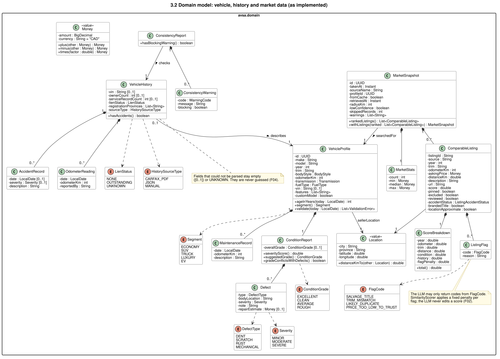
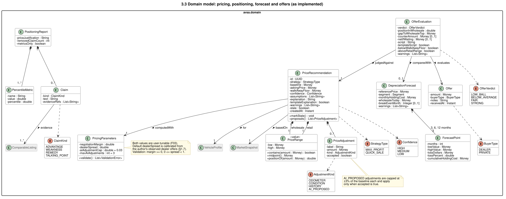
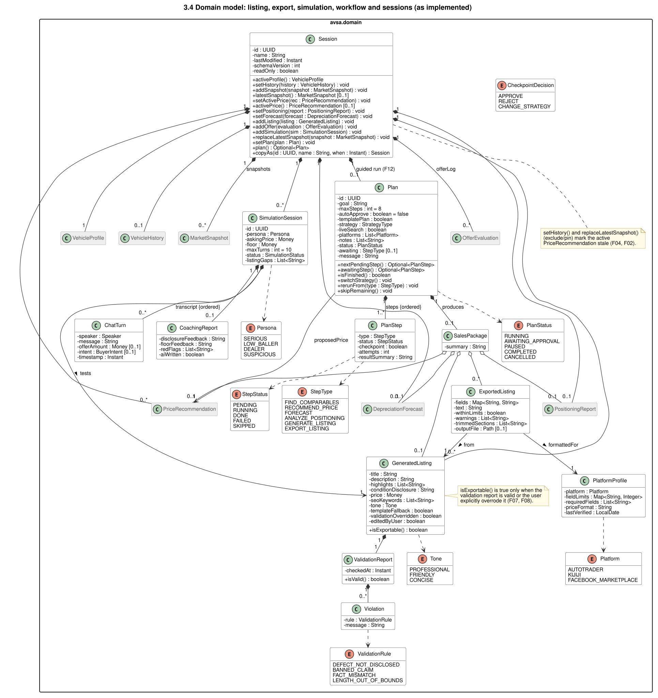
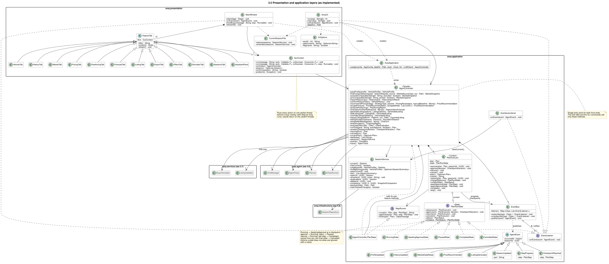
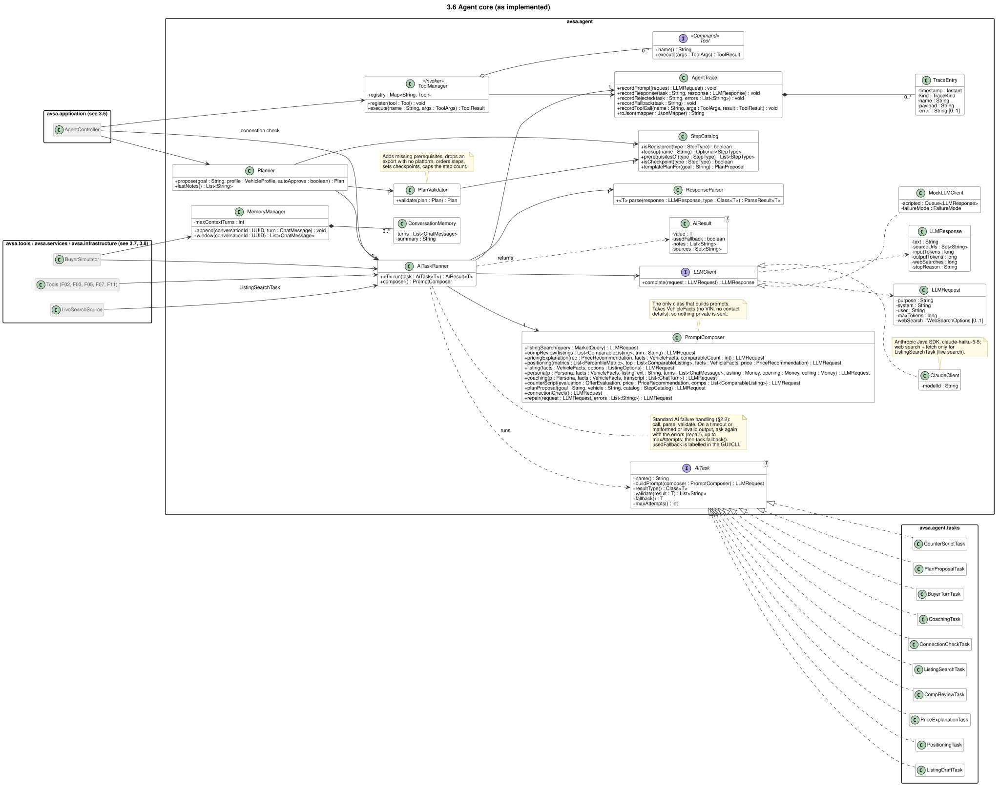
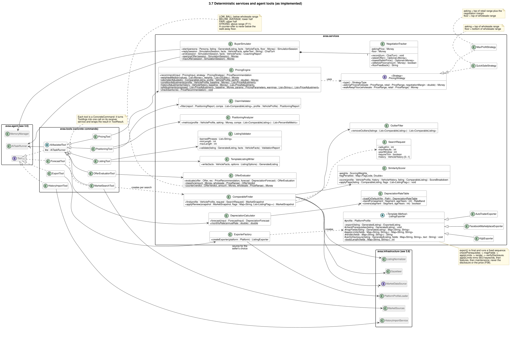
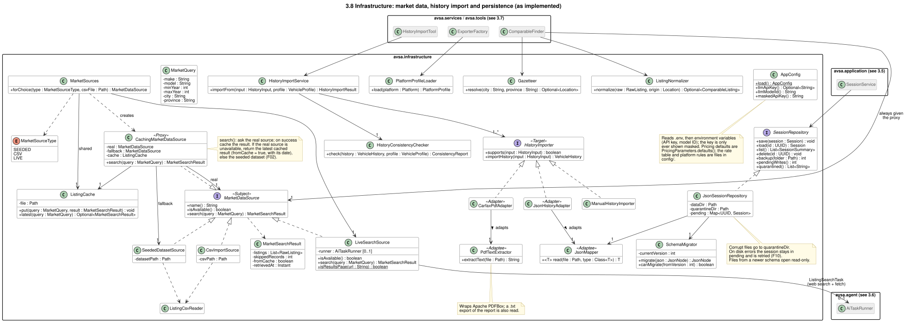
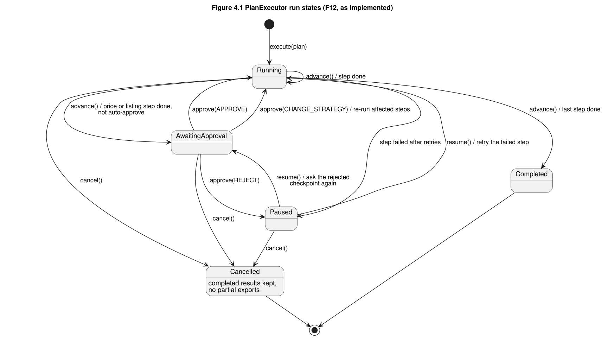
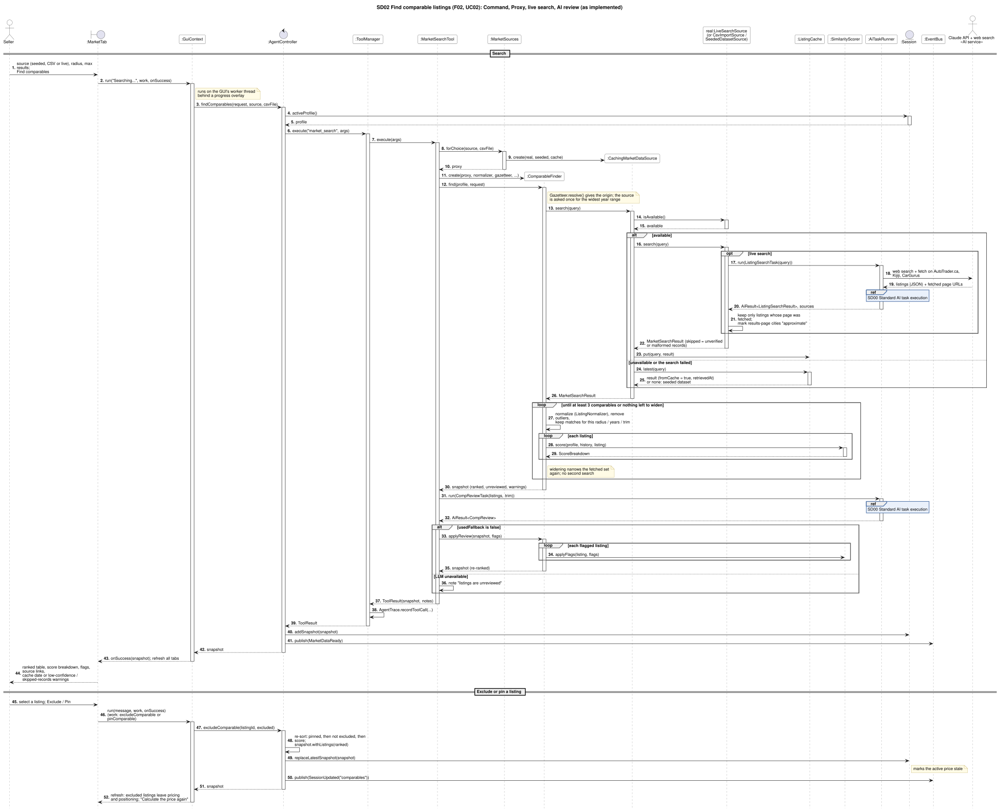
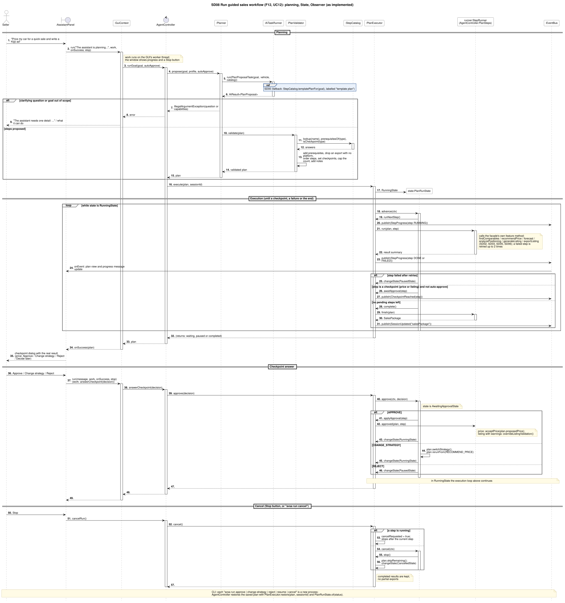

# AI Vehicle Sales Assistant (AVSA): Stage 2 Implementation Report

EECS3311 Software Design, Fall 2026, Section A. Course project Stage 2: AI-human collaborative implementation.

Author: Parsa Majdol Hosseini. Repository: <https://github.com/parsamd1/EECS3311_TermProject>

Report date: November 10, 2026. This report describes the code at the final Stage 2 commit on the `main` branch.

## Report contents

1. [Project overview and implementation status](#1-project-overview-and-implementation-status)
2. [Feature to implementation mapping](#2-feature-to-implementation-mapping)
3. [Implemented design patterns](#3-implemented-design-patterns)
4. [Changes and rationale](#4-changes-and-rationale)
5. [AI tools and collaboration log](#5-ai-tools-and-collaboration-log)
6. [Development and verification summary](#6-development-and-verification-summary)
7. [Demonstration index](#7-demonstration-index)

---

# 1. Project overview and implementation status

## 1.1 The application

AVSA helps a private owner in Canada sell a used car. The seller describes the car once; AVSA then finds comparable listings, computes a wholesale and a retail price, forecasts what waiting costs, compares the car with the competition, writes a validated listing, formats it for AutoTrader, Kijiji and Facebook Marketplace, judges dealer offers, and lets the seller practise a negotiation with an AI buyer. A guided assistant (F12) can plan and run these steps from one sentence, stopping for the seller's approval at the price and at the listing.

**Users.** Private sellers (the primary user), and people preparing to trade in or sell to a dealer who want to know what an offer is worth. The seeded data and defaults are for Ontario; the demonstration vehicle is a 2020 Mazda CX-5 GS in Toronto.

**Front ends.** A JavaFX GUI (`./mvnw javafx:run`) with one tab per feature and an Assistant side panel, and a CLI (`avsa <command>`, run as `./mvnw -q exec:java -Dexec.args="<command>"`). Both call only the `AgentController` facade, so every feature behaves the same in both. Both remember the open session in the data folder (`~/.avsa`, or `AVSA_DATA_DIR`), so a session started in one can continue in the other.

## 1.2 AI/LLM integration

| Item | Implementation |
|---|---|
| Model | Claude Haiku 5.5 (`claude-haiku-5-5`), set by `LLM_MODEL` in the git-ignored `.env` |
| Client | Official Anthropic Java SDK, wrapped by `ClaudeClient implements LLMClient` (`MockLLMClient` for tests and for running without a key) |
| Server tools | Web search and web fetch, used only by live market search (F02), limited to autotrader.ca, kijiji.ca and cargurus.ca |
| Prompts | Built only in `PromptComposer`, from `VehicleFacts`, which has no VIN and no contact details |
| Reliability | `AiTaskRunner` runs every AI task the same way: build prompt, call, parse JSON, validate; on a malformed or invalid answer it asks again with the errors (repair) up to the task's attempt limit; then it uses the task's deterministic fallback. Every fallback is labelled in the GUI and CLI. |

**Where the agent does more than forward a prompt** (handout Section 2, "meaningful agent behavior"):

- **Planning and multi-step execution (F12).** Claude proposes a plan from a fixed step catalog; `PlanValidator` adds missing prerequisites, orders the steps, sets checkpoints and caps the count; `PlanExecutor` runs the steps with retries and pauses for approval (State pattern).
- **Tool use.** Each feature is a `Tool` command run by `ToolManager`, and the plan's steps run the same feature methods.
- **Retrieval.** Live search (F02) has Claude search three marketplaces and read the listing pages; the code keeps only listings whose page was actually fetched.
- **Memory.** The buyer simulator (F09) keeps a per-conversation window in `MemoryManager`, summarizing older turns, and rebuilds it from the saved transcript in a new CLI process.
- **Decision making under validation.** The AI's claims (F05), listing text (F07), price explanation and price proposals (F03), and counter-offer script (F11) are checked by code against computed facts; failing output is repaired or dropped, never shown as fact.

The design rule throughout is "the AI proposes, the code verifies": every number a seller acts on (prices, floors, verdicts, forecasts, percentiles) is computed deterministically, and the AI explains, writes or plans around those numbers.

## 1.3 Implementation status

All twelve Stage 1 features (F01-F12) are implemented and work in both the GUI and the CLI. All nine Stage 1 design patterns are implemented. No feature was removed or replaced; changes are listed in Section 4.

| ID | Feature | Status | Kind |
|---|---|---|---|
| F01 | Vehicle Profile & Condition Assessment | Implemented | Deterministic |
| F02 | Comparable Listing Retrieval & Ranking | Implemented (live search added) | Hybrid |
| F03 | Wholesale/Retail Pricing Engine | Implemented | Hybrid |
| F04 | Vehicle History Import | Implemented | Deterministic |
| F05 | Competitive Positioning Analysis | Implemented | Hybrid |
| F06 | Depreciation & Cost-of-Waiting Forecast | Implemented | Deterministic |
| F07 | Listing Description Generation | Implemented | Hybrid |
| F08 | Multi-Platform Export | Implemented | Deterministic |
| F09 | Buyer Inquiry Simulator | Implemented | AI-based (code sets the offers) |
| F10 | Saved Sessions & History | Implemented | Deterministic |
| F11 | Dealer Offer Evaluator | Implemented | Hybrid |
| F12 | Guided Sales Workflow | Implemented | Hybrid |

## 1.4 Limitations

These are stated honestly; none of them stops a feature from working.

- **Live search varies.** Results depend on what the marketplaces show at the time: runs returned between 3 and 20 usable listings, took about one to three minutes and cost about $0.04-0.06 each. Listings read from a search-results page may only repeat the searched city, so their location is marked approximate. The seeded dataset (19 real Ontario dealer listings collected in October 2026) is the reliable fallback, and a failed search falls back to the last saved result, then to the seeded data, with a label.
- **Several pricing defaults are estimates.** The dealer spread (14%) comes from the author's real dealer offers, and the negotiation margin, depreciation bands, time to sell and accident deductions have published sources (Section 5.3). The odometer rate ($0.07/km), defect deductions (1/2.5/5%) and extra-owner deduction (1%) are estimates. All are editable parameters.
- **Platform limits are unverified.** No official character limits were found for the three marketplaces, so `config/platform-profiles.json` holds working values with no verification date, and every export says so.
- **History import is tuned to CARFAX Canada.** Accident rows in a CARFAX report are not parsed: a report that lists accidents gives "accidents unknown", for the seller to confirm. Other formats use JSON or manual entry.
- **AI wording is not fully verifiable.** Facts, numbers, citations and banned claims are checked, but free-text explanations can still be phrased poorly; one such case (an explanation that described the odometer adjustment backwards) was found and fixed during demo rehearsal (Section 6.3).
- **Long AI calls cannot be interrupted mid-call.** The GUI's Stop button stops a plan after the current step.
- **Single user, local data.** Sessions are plain JSON files in the user's data folder, outside the repository because they can contain a VIN; they are not encrypted.
- **Testing scope.** Stage 2 has unit and integration tests and real end-to-end runs (Section 6). The full deterministic test plan and KUMA agent validation are Stage 3 work, as the handout states.

---

# 2. Feature to implementation mapping

Each feature below has the handout's mapping table, then a short explanation of how the classes collaborate from the user's input to the result. Class names link roles to the class diagrams in Section 3.9. "GUI" names the tab; "CLI" names the command. Every GUI action runs through `GuiContext.run`, which executes the facade call on one worker thread behind a progress overlay and refreshes all tabs afterwards; every state change is published on the `EventBus`, where `AutoSaveListener` saves the session (Observer).

Video links are in Section 7, and each feature's link is repeated in its table.

## F01 - Vehicle Profile & Condition Assessment

| Mapping field | Entry |
|---|---|
| Feature ID and name | F01 - Vehicle Profile & Condition Assessment |
| Stage 1 feature/reference | F01 (UC01, SD01) |
| Status or change | Implemented; minor changes (Section 4, C1) |
| Implemented classes/files and responsibilities | `presentation/VehicleTab` (form, defect and maintenance dialogs, inline errors); `AvsaCli` (`profile set`, `profile show`); `domain/VehicleProfile` (builder, validation, derived values), `ConditionReport` (severity score, suggested grade, grade conflict), `Defect`, `MaintenanceRecord`, `ValidationError` (blocking error or warning); `application/AgentController` (`saveProfile`); `SessionService` (create or update the session, find a saved session for the same vehicle) |
| Key methods | `VehicleProfile.validate(today)`, `sameVehicleAs(other)`, `ageInYears`, `segment`; `ConditionReport.severityScore()`, `suggestedGrade()`, `gradeConflictsWithDefects()`; `AgentController.saveProfile(profile)`; `SessionService.findMatching(profile)` |
| Design patterns | Facade (`AgentController`), Observer (`ProfileUpdated` triggers the auto-save) |
| Video link/timestamp | F01 GUI clip; CLI part 1 (Section 7) |

**Collaboration.** The tab builds a `VehicleProfile` and calls `validate(today)`. Blocking errors (a year outside 1980 to next year, an odometer outside 0-999,999 km) are shown inline and nothing is saved. Warnings (an invalid VIN check digit, a make/model outside the catalog, a grade better than the defects suggest) are shown after saving. If a saved session already describes the same vehicle, the seller is asked whether to open it instead. `AgentController.saveProfile` validates again, creates or updates the session and publishes `ProfileUpdated`. **Deterministic.**

## F02 - Comparable Listing Retrieval & Ranking

| Mapping field | Entry |
|---|---|
| Feature ID and name | F02 - Comparable Listing Retrieval & Ranking |
| Stage 1 feature/reference | F02 (UC02, SD02) |
| Status or change | Implemented; modified: real live search added, exclude/pin added (Section 4, C2-C4) |
| Implemented classes/files and responsibilities | `presentation/MarketTab`; `AvsaCli` (`comps search [--source seeded/live/csv]`, `comps exclude/include/pin/unpin`); `tools/MarketSearchTool` (command); `infrastructure/market/MarketSources` (builds the chosen source behind the proxy), `CachingMarketDataSource` (proxy: real source, then cache, then seeded data), `LiveSearchSource` (live search through Claude), `SeededDatasetSource`, `CsvImportSource`, `ListingCsvReader`, `ListingCache` (saved results), `ListingNormalizer`, `Gazetteer`; `services/ComparableFinder` (search, widen, rank), `OutlierFilter`, `SimilarityScorer`; `agent/tasks/ListingSearchTask`, `CompReviewTask` (AI) |
| Key methods | `AgentController.findComparables(request, source, csvFile)`, `excludeComparable(id, excluded)`, `pinComparable(id, pinned)`; `MarketSources.forChoice(type, csv)`; `CachingMarketDataSource.search(query)`; `LiveSearchSource.search(query)`; `ComparableFinder.find(profile, request)`, `applyReview(snapshot, flags)`; `SimilarityScorer.score(...)`, `applyFlags(...)` |
| Design patterns | Command (`MarketSearchTool`), Proxy (`CachingMarketDataSource`), Facade |
| Video link/timestamp | F02 GUI clip (live search); CLI part 1 (Section 7) |

**Collaboration.** The facade runs the `market_search` tool. The tool asks `MarketSources` for the seller's choice of source (seeded, CSV or live), always wrapped in the caching proxy, and builds a `ComparableFinder` for it. For live search, `LiveSearchSource` runs `ListingSearchTask`: Claude uses web search and fetch on AutoTrader.ca, Kijiji and CarGurus and returns listings as JSON; the code keeps only listings whose page URL appears in the search or fetch results. The finder normalizes the records, removes outliers, scores each listing on year, odometer, trim, distance, condition and history, and widens the radius, then the years, then the trim until at least three comparables remain, without searching again. `CompReviewTask` then asks Claude to flag problems in the listing text (salvage title, trim mismatch, likely duplicate, price too low to trust); the code applies a fixed penalty per flag and re-ranks. The seller can exclude a listing or pin one; this re-sorts the snapshot and marks the active price stale. **Hybrid**: retrieval and review are AI-assisted; filtering, scoring and ranking are code.

## F03 - Wholesale/Retail Pricing Engine

| Mapping field | Entry |
|---|---|
| Feature ID and name | F03 - Wholesale/Retail Pricing Engine |
| Stage 1 feature/reference | F03 (UC03, SD03) |
| Status or change | Implemented; minor changes (Section 4, C5) |
| Implemented classes/files and responsibilities | `presentation/PricingTab`, `PriceLadder`; `AvsaCli` (`price --strategy ... [--accept]`); `tools/PricingTool`; `services/PricingEngine` (baseline, adjustments, ranges), `PricingStrategy`, `MaxProfitStrategy`, `QuickSaleStrategy`; `domain/PricingParameters` (margin, dealer spread, odometer rate; validation), `PriceRecommendation`, `PriceAdjustment`; `agent/tasks/PriceExplanationTask` (AI explanation and capped proposals) |
| Key methods | `AgentController.recommendPrice(strategy, params, manualBaseline)`, `acceptPrice(rec, acceptedAiIds)`; `PricingEngine.recommend(input, strategy)`; `PricingStrategy.askingPrice(wholesale, retail, margin)`, `walkAwayFloor(wholesale, retail)`; `PricingParameters.validate()` |
| Design patterns | Strategy, Command, Facade |
| Video link/timestamp | F03 GUI clip; CLI part 1 (Section 7) |

**Collaboration.** The engine adjusts each comparable to the seller's odometer reading, takes the similarity-weighted median as the baseline, then subtracts condition and history deductions. The expected selling price is the value minus the negotiation margin; the retail range is spread around it, and the wholesale range is retail minus the dealer spread. The chosen strategy sets the asking price and walk-away floor: maximum profit asks the top of retail plus the negotiation margin and walks away below the top of wholesale; quick sale asks the top of wholesale and walks away below its bottom. `PriceExplanationTask` asks Claude to explain the computed figures (it may state only those figures) and to propose at most three adjustments for things the engine cannot know, each capped at 3%; none applies unless the seller ticks it. Invalid parameters (a spread of 100% or more, a negative margin) are rejected before running. **Hybrid**: every number is code; the explanation and optional proposals are AI.

## F04 - Vehicle History Import

| Mapping field | Entry |
|---|---|
| Feature ID and name | F04 - Vehicle History Import |
| Stage 1 feature/reference | F04 (UC04, SD04) |
| Status or change | Implemented; minor changes (Section 4, C6) |
| Implemented classes/files and responsibilities | `presentation/HistoryTab` (import, review and edit, save); `AvsaCli` (`history import --file [--confirm]`, `history set`); `tools/HistoryImportTool`; `infrastructure/history/HistoryImportService`, `HistoryImporter` (target), `CarfaxPdfAdapter` + `PdfTextExtractor` (Apache PDFBox), `JsonHistoryAdapter` + `JsonMapper`, `ManualHistoryImporter`, `HistoryConsistencyChecker`; `domain/VehicleHistory`, `ConsistencyReport` |
| Key methods | `AgentController.importHistory(input)`, `confirmHistory(history)`; `HistoryImportService.importFrom(input, profile)`; `HistoryImporter.supports(input)`, `importHistory(input)`; `HistoryConsistencyChecker.check(history, profile)`; `Session.setHistory(history)` |
| Design patterns | Adapter, Command, Facade, Observer (`HistoryUpdated`) |
| Video link/timestamp | F04 GUI clip; CLI part 1 (Section 7) |

**Collaboration.** The service picks the first importer that supports the file. `CarfaxPdfAdapter` adapts the PDF text extractor to the `HistoryImporter` interface and reads owners, service records, lien status and registration provinces; `JsonHistoryAdapter` adapts the JSON mapper. The consistency checker compares the history with the profile: a different VIN is a blocking warning (Save is disabled), and a recorded odometer reading above the profile or an outstanding lien is a warning. Nothing is stored until the seller confirms; confirming marks the active price stale, since pricing uses owners, accidents and service records. **Deterministic.**

## F05 - Competitive Positioning Analysis

| Mapping field | Entry |
|---|---|
| Feature ID and name | F05 - Competitive Positioning Analysis |
| Stage 1 feature/reference | F05 (UC05, SD05) |
| Status or change | Implemented; minor changes (Section 4, C7) |
| Implemented classes/files and responsibilities | `presentation/PositioningTab` (side-by-side table, percentile table, claim cards with citations); `AvsaCli` (`position`); `tools/PositioningTool`; `services/PositioningAnalyzer` (percentiles), `ClaimValidator` (evidence check); `agent/tasks/PositioningTask` (AI claims); `domain/PositioningReport`, `Claim`, `PercentileMetric` |
| Key methods | `AgentController.analyzePositioning()`; `PositioningAnalyzer.metrics(profile, asking, comps)`; `ClaimValidator.filter(report, comps, profile)` |
| Design patterns | Command, Facade |
| Video link/timestamp | F05 GUI clip; CLI part 2 (Section 7) |

**Collaboration.** The analyzer computes where the car's price, odometer and year fall among the top five comparables that are not excluded. `PositioningTask` gives Claude those metrics and the comparables labelled C1-C5 and asks for advantages, weaknesses, remedies, talking points and a price justification, each citing its evidence. `ClaimValidator` drops any claim with no evidence, an unknown reference, a number that matches neither the car nor the cited listings, or a comparison the cited listings contradict, and the report says how many claims were removed. With fewer than three comparables the report is limited and says so; without the AI, only the metrics are shown, labelled. **Hybrid.**

## F06 - Depreciation & Cost-of-Waiting Forecast

| Mapping field | Entry |
|---|---|
| Feature ID and name | F06 - Depreciation & Cost-of-Waiting Forecast |
| Stage 1 feature/reference | F06 (UC06, SD05) |
| Status or change | Implemented; minor changes (Section 4, C8) |
| Implemented classes/files and responsibilities | `presentation/ForecastTab` (chart and table); `AvsaCli` (`forecast --holding`); `tools/ForecastTool`; `services/DepreciationCalculator`, `DepreciationRateTable` (bands from `config/depreciation-rates.csv`, built-in defaults), `ForecastInput`; `domain/DepreciationForecast`, `ForecastPoint` |
| Key methods | `AgentController.forecast(monthlyHoldingCost)`; `DepreciationCalculator.forecast(input)`, `monthlyRate(annualRate)`; `DepreciationRateTable.loadOrDefault(file)`, `bandFor(segment, age)`, `covers(segment, age)` |
| Design patterns | Command, Facade |
| Video link/timestamp | F06 GUI clip; CLI part 2 (Section 7) |

**Collaboration.** Starting from the expected retail price, the calculator applies the slow and fast annual rates for the car's segment and age, converted to monthly rates, to give the value at 3, 6 and 12 months, the value lost, and the net after the monthly holding cost. It reports the first month in which waiting nets less than selling to a dealer today. A negative holding cost is rejected; an age outside the table uses the oldest band with a warning; a missing or corrupt rate file falls back to the built-in table with a warning. **Deterministic.**

## F07 - Listing Description Generation

| Mapping field | Entry |
|---|---|
| Feature ID and name | F07 - Listing Description Generation |
| Stage 1 feature/reference | F07 (UC07, SD06) |
| Status or change | Implemented; minor changes (Section 4, C9) |
| Implemented classes/files and responsibilities | `presentation/ListingTab` (options, editable text, validation panel, Make shorter, override); `AvsaCli` (`listing generate/show/override`); `tools/ListingTool`; `agent/tasks/ListingDraftTask` (AI draft with validator feedback); `services/ListingValidator` (facts, banned claims, disclosure, length), `TemplateListingWriter` (fallback); `domain/GeneratedListing`, `ValidationReport`, `VehicleFacts` (facts without the VIN) |
| Key methods | `AgentController.generateListing(options)`, `editListing(edit)`, `overrideListingValidation()`; `ListingValidator.validate(listing, facts)`; `TemplateListingWriter.write(facts, options)` |
| Design patterns | Command, Facade, Observer (`ListingGenerated`) |
| Video link/timestamp | F07 GUI clip; CLI part 2 (Section 7) |

**Collaboration.** `ListingDraftTask` gives Claude the vehicle facts, the active price, the defects that must be disclosed and the chosen tone. Each draft goes through `ListingValidator`: the title must name the year, make and model; kilometres, years and prices in the text must match the profile; banned claims ("flawless", "no issues", and "accident-free" unless the history confirms it) are rejected; every defect must appear in the condition disclosure; and the length must fit. A failing draft is sent back with the violations, up to three attempts; if it still fails, the best draft is shown with red warnings and export is blocked until the seller fixes it or explicitly overrides. Seller edits are validated the same way. Without the AI, a template listing is written from the facts and labelled. **Hybrid.**

## F08 - Multi-Platform Export

| Mapping field | Entry |
|---|---|
| Feature ID and name | F08 - Multi-Platform Export |
| Stage 1 feature/reference | F08 (UC08, SD06) |
| Status or change | Implemented; minor changes (Section 4, C10) |
| Implemented classes/files and responsibilities | `presentation/ExportTab` (preview, character counters, copy, save); `AvsaCli` (`export --platform ... [--out]`); `tools/ExportTool`; `services/ExporterFactory`, `ListingExporter`, `AutoTraderExporter`, `KijijiExporter`, `FacebookMarketplaceExporter`, `ExportBlockedException`; `infrastructure/PlatformProfileLoader` (`config/platform-profiles.json`) |
| Key methods | `AgentController.exportListing(platform, out)`; `ExporterFactory.createExporter(platform)`; `ListingExporter.export(listing)` (final), `checkPrerequisites`, `mapFields`, `applyLimits`, `render`, `verifyDisclosure(listing, fields, text)` |
| Design patterns | Factory Method, Template Method, Command, Facade |
| Video link/timestamp | F08 GUI clip; CLI part 2 (Section 7) |

**Collaboration.** The tool refuses a listing that failed validation and was not overridden. Otherwise the factory builds the platform's exporter with its rules, and the exporter's final `export()` method runs the fixed sequence: check prerequisites, map fields, trim optional sections in a fixed order (keywords, then features, then maintenance) until the text fits, render, and verify that the condition disclosure and the price survived. The GUI shows the text with per-field character counters and copies it to the clipboard or saves it to a file. **Deterministic.**

## F09 - Buyer Inquiry Simulator

| Mapping field | Entry |
|---|---|
| Feature ID and name | F09 - Buyer Inquiry Simulator |
| Stage 1 feature/reference | F09 (UC09, SD07) |
| Status or change | Implemented; minor changes (Section 4, C11) |
| Implemented classes/files and responsibilities | `presentation/SimulatorTab` (chat, negotiation panel, coaching card); `AvsaCli` (`simulate start/say/end/show`); `services/BuyerSimulator`, `NegotiationTracker` (offers and the seller's lowest price); `agent/tasks/BuyerTurnTask`, `CoachingTask` (AI); `agent/MemoryManager`, `ConversationMemory`; `domain/SimulationSession`, `ChatTurn`, `CoachingReport`, `Persona` |
| Key methods | `AgentController.startSimulation(persona)`, `sendSellerMessage(text)`, `endSimulation()`; `BuyerSimulator.start(persona, listing, facts, floor)`, `reply(session, facts, text)`, `end(session, facts)`; `NegotiationTracker.record(turn)`, `floorFeedback()` |
| Design patterns | Facade |
| Video link/timestamp | F09 GUI clip; CLI part 3 (Section 7) |

**Collaboration.** The code sets each persona's opening offer and highest price from the asking price and floor (for example, the low-baller opens at 70% of asking). `BuyerTurnTask` asks Claude to play the buyer, with the listing text, the conversation window from `MemoryManager` and those limits; a reply that lowers an earlier offer or states other kilometres or years is rejected and asked again. `NegotiationTracker` reads offers and the seller's prices, including prices typed without a dollar sign ("24,100", "24k"). Ending the chat produces coaching: floor feedback from the tracker, and disclosure feedback, warning signs and listing gaps from `CoachingTask`. The suspicious persona only shows common warning signs to recognize. Off-topic messages get an in-character reply; the simulator cannot run without the AI and says so. **AI-based**, with the offers and limits set by code.

## F10 - Saved Sessions & History

| Mapping field | Entry |
|---|---|
| Feature ID and name | F10 - Saved Sessions & History |
| Stage 1 feature/reference | F10 (UC10, SD01) |
| Status or change | Implemented; extended with rename, duplicate, backup (Section 4, C12) |
| Implemented classes/files and responsibilities | `presentation/SessionsTab` (list, rename, duplicate, delete, backup, compare searches, price chart), `CurrentSessionFile` (open session shared by GUI and CLI); `AvsaCli` (`session list/load/delete/rename/duplicate/backup/compare`); `application/SessionService`, `AutoSaveListener`; `infrastructure/SessionRepository`, `JsonSessionRepository` (one JSON file per session, quarantine, pending writes), `SchemaMigrator`; `domain/Session`, `SnapshotComparison` |
| Key methods | `SessionService.open`, `list`, `rename`, `duplicate`, `delete`, `backup(folder)`, `compare(a, b)`, `saveCurrent()`; `JsonSessionRepository.save`, `load`, `quarantined()`; `SchemaMigrator.migrate(json)` |
| Design patterns | Observer (`AutoSaveListener`), Facade |
| Video link/timestamp | F10 GUI clip; CLI part 3 (Section 7) |

**Collaboration.** Every state-changing event is published on the event bus; `AutoSaveListener` saves the current session, and the GUI's status bar shows when it was saved. If the folder cannot be written, the session stays in memory, the status bar says it is not saved, and saving is retried. A corrupt file is moved to a quarantine folder and reported while the other sessions load; a file from an older schema is migrated, and one from a newer schema opens read-only. Deleting asks for confirmation, and an unknown session id is reported as an input error. **Deterministic.**

## F11 - Dealer Offer Evaluator

| Mapping field | Entry |
|---|---|
| Feature ID and name | F11 - Dealer Offer Evaluator |
| Stage 1 feature/reference | F11 (UC11, SD05) |
| Status or change | Implemented; minor changes (Section 4, C13) |
| Implemented classes/files and responsibilities | `presentation/OffersTab` (offer form, verdict card, offer log); `AvsaCli` (`offer add/list`); `tools/OfferEvaluationTool`; `services/OfferEvaluator` (verdict, counter-offer, compare with waiting); `agent/tasks/CounterScriptTask` (AI reply script); `domain/OfferEvaluation`, `Offer` |
| Key methods | `AgentController.evaluateOffer(offer)`; `OfferEvaluator.evaluate(offer, rec, forecast)`, `classify(amount, wholesale)`, `counter(verdict, amount, wholesale)` |
| Design patterns | Command, Facade (the verdict uses the Strategy-produced price ladder) |
| Video link/timestamp | F11 GUI clip; CLI part 3 (Section 7) |

**Collaboration.** The evaluator places the offer in the wholesale range: low-ball below it, below average in the lower half, fair in the upper half, strong above it. It computes the gap to the top of wholesale and a counter-offer (never below the seller's walk-away floor), and, when a forecast exists, compares the offer with what a private sale is expected to net after waiting. `CounterScriptTask` asks Claude for a reply script that may quote only those computed figures and the comparables' prices. A non-numeric or non-positive offer is rejected; an offer above the retail range must be confirmed as a likely typo; without the AI a template script is used. **Hybrid.**

## F12 - Guided Sales Workflow

| Mapping field | Entry |
|---|---|
| Feature ID and name | F12 - Guided Sales Workflow |
| Stage 1 feature/reference | F12 (UC12, SD08, Figure 4.1) |
| Status or change | Implemented; modified: checkpoint timing and step execution (Section 4, C14-C15) |
| Implemented classes/files and responsibilities | `presentation/AssistantPanel` (goal box, quick actions, plan view, checkpoint dialog); `AvsaCli` (`run "goal" [--auto-approve]`, `run approve/change-strategy/reject/resume/cancel/show`); `agent/Planner`, `PlanValidator`, `StepCatalog`, `tasks/PlanProposalTask` (AI plan); `application/PlanExecutor` (context), `PlanRunState` + `RunningState`, `AwaitingApprovalState`, `PausedState`, `CompletedState`, `CancelledState`, `StepRunner` (implemented by `AgentController.PlanSteps`); events `StepProgress`, `CheckpointReached`; `domain/Plan`, `PlanStep`, `SalesPackage` |
| Key methods | `AgentController.runGoal(goal, autoApprove)`, `answerCheckpoint(decision)`, `resumeRun()`, `cancelRun()`, `currentPlan()`; `Planner.propose(goal, profile, autoApprove)`; `PlanValidator.validate(plan)`; `PlanExecutor.execute(plan, sessionId)`, `approve(decision)`, `resume()`, `cancel()` |
| Design patterns | State, Observer, Facade (and Command through the feature methods each step calls) |
| Video link/timestamp | F12 GUI clip; CLI part 3 (Section 7) |

**Collaboration.** `PlanProposalTask` gives Claude the goal, the vehicle and the step catalog. Claude answers with steps, a strategy and platforms, or a clarifying question, or an out-of-scope notice (which lists what the assistant can do); unknown step names are sent back for repair, and the fallback is a template plan for the goal. `PlanValidator` adds missing prerequisites, drops an export with no platform, orders the steps, marks the price and listing steps as checkpoints and caps the count. `PlanExecutor` then runs each step through the facade's own feature methods, retrying a failed step up to twice. After a checkpoint step it waits for the seller: Approve accepts the price or listing, Change strategy re-runs pricing with the other strategy, and Reject pauses the plan, which can be resumed or cancelled. Cancelling keeps finished results and makes no partial exports. A completed plan produces a sales package. **Hybrid**: AI planning, code-validated and code-executed.

---

# 3. Implemented design patterns

All nine Stage 1 patterns are implemented, as designed in Stage 1 Section 4; the participants below are those in the code. The handout requires five. The differences from Stage 1 are listed per pattern and in Section 4.

## 3.1 Facade

| Item | Entry |
|---|---|
| Problem | Twelve features use about forty classes across five layers; the GUI and CLI must not depend on them, or each front end would duplicate the orchestration. |
| Participants and roles | Facade: `AgentController`. Subsystem: `SessionService`, `ToolManager` and tools, `AiTaskRunner`, `Planner`, `PlanExecutor`, `BuyerSimulator`, `ListingValidator`, `EventBus`. Clients: the twelve GUI tabs (through `GuiContext`) and `AvsaCli`. |
| Files and methods | `application/AgentController.java`: `saveProfile`, `findComparables`, `recommendPrice`, `generateListing`, `exportListing`, `evaluateOffer`, `runGoal`, ... |
| How it follows the pattern | One class offers one method per user action; it finds the session, runs the right tool or service, stores the result and publishes the event. The front ends call nothing else, and `AvsaApplication.create` wires the subsystem once. |
| Matches Stage 1? | Yes. The facade gained methods that the implemented features needed (`excludeComparable`, `pinComparable`, `overrideListingValidation`, `currentPlan`, `lastNotes`); it takes a `VehicleProfile` instead of a separate `ProfileInput` (Section 4, C1). |

## 3.2 Observer

| Item | Entry |
|---|---|
| Problem | Saving, the GUI and the CLI must react to every state change without the features knowing who listens. |
| Participants and roles | Subject: `EventBus`. Observer interface: `EventListener`. Concrete observers: `AutoSaveListener`, `MainWindow`, `AvsaCli`. Events: `AgentEvent` subclasses `ProfileUpdated`, `HistoryUpdated`, `MarketDataReady`, `PriceRecommended`, `ListingGenerated`, `SessionUpdated`, `StepProgress`, `CheckpointReached`. |
| Files and methods | `application/EventBus.java` (`subscribe`, `unsubscribe`, `publish`); `AutoSaveListener.onEvent`; `MainWindow.onEvent` (status bar, step progress); `AvsaCli.onEvent` ("saved" and step lines). |
| How it follows the pattern | Listeners subscribe by event type; publishers call `publish` and never reference a listener. |
| Matches Stage 1? | Yes. |

## 3.3 Strategy

| Item | Entry |
|---|---|
| Problem | The same price ladder must produce a different asking price and walk-away floor for a private sale and for a quick dealer sale. |
| Participants and roles | Strategy: `PricingStrategy`. Concrete strategies: `MaxProfitStrategy`, `QuickSaleStrategy`. Context: `PricingEngine`. Client: `PricingTool` (chooses with `PricingStrategy.of(type)`). |
| Files and methods | `services/PricingStrategy.java` (`askingPrice(wholesale, retail, margin)`, `walkAwayFloor(wholesale, retail)`); `PricingEngine.recommend(input, strategy)`. |
| How it follows the pattern | The engine computes the ranges once and delegates the two strategy-specific decisions; F12's "change strategy" re-prices with the other strategy object. |
| Matches Stage 1? | Yes; `askingPrice` also takes the negotiation margin (Section 4, C5). |

## 3.4 Factory Method

| Item | Entry |
|---|---|
| Problem | The export code knows only the chosen platform and must not know the concrete exporter classes or how to load their rules. |
| Participants and roles | Creator: `ExporterFactory`. Product: `ListingExporter`. Concrete products: `AutoTraderExporter`, `KijijiExporter`, `FacebookMarketplaceExporter`. Client: `ExportTool`. |
| Files and methods | `services/ExporterFactory.java` (`createExporter(platform)`), which loads each platform's `PlatformProfile` through `PlatformProfileLoader`. |
| How it follows the pattern | The parameterized factory form taught in the course: one method decides which subclass to return from its argument. |
| Matches Stage 1? | Yes. |

## 3.5 Template Method

| Item | Entry |
|---|---|
| Problem | Every export must follow the same safety sequence, and the disclosure check must never be skipped; only field mapping and rendering differ by platform. |
| Participants and roles | Abstract class: `ListingExporter` with the final template method `export()`. Concrete classes: the three exporters, which implement `mapFields` and `render`. |
| Files and methods | `services/ListingExporter.java`: `export(listing)` (final) calls `checkPrerequisites`, `mapFields`, `applyLimits`, `render`, `verifyDisclosure`. |
| How it follows the pattern | The fixed steps and hooks are in the base class; subclasses only fill in the platform-specific steps. |
| Matches Stage 1? | Yes; `verifyDisclosure` receives the listing and the rendered text as well as the fields, so a subclass cannot lose the disclosure while rendering (Section 4, C10). |

## 3.6 Adapter (object adapter)

| Item | Entry |
|---|---|
| Problem | History arrives as a CARFAX PDF or a JSON file; the import service should treat every format the same way. |
| Participants and roles | Target: `HistoryImporter`. Adapters: `CarfaxPdfAdapter`, `JsonHistoryAdapter`. Adaptees: `PdfTextExtractor` (wrapping Apache PDFBox), `JsonMapper` (wrapping Jackson). Client: `HistoryImportService`. `ManualHistoryImporter` implements the target directly. |
| Files and methods | `infrastructure/history/`: `supports(input)`, `importHistory(input)`; `PdfTextExtractor.extractText(file)`. |
| How it follows the pattern | Each adapter holds its adaptee and translates its output (PDF text, JSON tree) into a `VehicleHistory`. |
| Matches Stage 1? | Yes; the PDF library chosen in Stage 2 is Apache PDFBox. |

## 3.7 Command

| Item | Entry |
|---|---|
| Problem | Features and plan steps must run as named, traceable operations with one error-handling path. |
| Participants and roles | Command: `Tool`. Concrete commands: `MarketSearchTool`, `HistoryImportTool`, `PricingTool`, `ForecastTool`, `PositioningTool`, `ListingTool`, `ExportTool`, `OfferEvaluationTool` (four extend `AiAssistedTool`). Invoker: `ToolManager`. Receivers: the services in Section 3.9.4. Client: `AgentController`. |
| Files and methods | `agent/ToolManager.java` (`register`, `execute(name, args)`); `agent/Tool.java` (`name`, `execute(ToolArgs)`); `tools/*.java`. |
| How it follows the pattern | Each tool turns `ToolArgs` into one call on its receiver and wraps the result in a `ToolResult`; the invoker runs any tool by name, converts exceptions into failures and records each call in `AgentTrace` (names only, no personal data). |
| Matches Stage 1? | Yes. Plan steps reach the tools through the facade's feature methods rather than calling `ToolManager` directly (Section 4, C15). |

## 3.8 Proxy

| Item | Entry |
|---|---|
| Problem | A market source can be slow, cost money or fail; the finder should not handle caching and fallback itself. |
| Participants and roles | Subject: `MarketDataSource`. Proxy: `CachingMarketDataSource`. Real subjects: `LiveSearchSource`, `CsvImportSource`, `SeededDatasetSource`. Helper: `ListingCache`. Client: `ComparableFinder`; the proxy is built by `MarketSources`. |
| Files and methods | `infrastructure/market/CachingMarketDataSource.java` (`search(query)`). |
| How it follows the pattern | The proxy has the subject's interface; it calls the real source, saves the result, and if the source is unavailable or fails returns the latest saved result (marked as cached, with its date) or the seeded dataset. |
| Matches Stage 1? | Yes. The cache now persists to the data folder, so the fallback works across runs (Section 4, C3). |

## 3.9 State

| Item | Entry |
|---|---|
| Problem | Approve, resume and cancel mean different things while a plan is running, waiting, paused or finished. |
| Participants and roles | Context: `PlanExecutor`. State: `PlanRunState`. Concrete states: `RunningState`, `AwaitingApprovalState`, `PausedState`, `CompletedState`, `CancelledState`. |
| Files and methods | `application/PlanRunState.java` (`advance`, `approve`, `resume`, `cancel`, `status`, `of(status)`); `PlanExecutor` (`changeState`, `runNextStep`, `awaitApproval`, `applyApproval`, `complete`, `stop`). |
| How it follows the pattern | The executor delegates every action to its current state, and each state decides the transition (Figure 4.1). Actions a state does not allow are ignored with a notice instead of an error. |
| Matches Stage 1? | Yes, with two changes: the checkpoint pauses after its step has run, and the steps run through a `StepRunner` (Section 4, C14-C15). |

## 3.10 Updated UML diagrams

The figures below are the Stage 1 class views and diagrams updated to the implementation (sources in `diagrams/stage2/`). They were checked with a script that compares every class, attribute and method on the diagrams with the compiled classes (`javap`), and every message in the sequence diagrams with the class diagrams. Classes owned by another view appear as grey boxes. The Stage 1 figures are kept unchanged in `diagrams/out/`.

Of the sequence diagrams, SD02 and SD08 were redrawn because the Stage 1 versions were inaccurate in substance: SD02 now shows the source choice, live search through Claude and exclude/pin; SD08 shows the checkpoint after its step, the `StepRunner`, and the GUI's worker thread. SD00, SD01, SD03 and SD05-SD07 needed only corrected method signatures and are in `diagrams/stage2/out/`. The use-case diagrams are unchanged: no use case was added or removed.

---

# 4. Changes and rationale

No Stage 1 feature or pattern was removed or replaced. The changes below are modifications and additions found necessary during implementation. Each record follows the handout's structure.

| # | Original design | Implemented change | Reason | Impact |
|---|---|---|---|---|
| C1 | F01: `AgentController.saveProfile(input : ProfileInput)` built and validated the profile; the facade asked the seller to confirm a grade conflict. | The GUI or CLI builds a `VehicleProfile` (builder) and validates it with `validate(today)`; `saveProfile(profile)` validates again. `ValidationError` has a `blocking` flag. A grade conflict is a warning, not a confirmation. `sameVehicleAs()` detects duplicates. | A separate input type duplicated the profile's fields; dates must be injectable for tests; most findings are warnings that should not block saving. | UC01 unchanged. Classes: `VehicleProfile`, `ValidationError`, `VehicleTab`. SD01 updated. |
| C2 | F02: `LiveSearchSource` with `enabled` and `endpoint` fields, for a listings API. | Live search through Claude Haiku 5.5 with web search and web fetch (`ListingSearchTask`), on AutoTrader.ca, Kijiji and CarGurus. Only listings whose page URL came from the search results are kept; locations read from results pages are marked approximate. The search asks for listings closest to the seller's model year, and an answer is used only if it has at least three usable listings (a fetched page, the searched model and years, and the year, kilometres and price); otherwise Claude is asked again, then the proxy falls back. | The marketplaces have no public listings API. The author wanted real, current listings. Early runs sometimes returned cars several years older than the seller's, or too few usable listings. | New task and records (`ListingSearchTask`, `FoundListing`, `ListingSearchResult`); infrastructure uses the agent layer. Proxy, finder and fallbacks unchanged. SD02 redrawn. |
| C3 | F02: source fixed by configuration; an in-memory cache. | `MarketSources.forChoice(type, csv)` builds the seller's choice (seeded, CSV, live) behind the proxy; `ListingCache` persists to the data folder and keeps results per source, so a CSV import never replaces the saved live result. The finder asks the source once for the widest year range and narrows locally when widening. | The seller chooses the source per search; a saved result must survive a restart; widening must not pay for another live search. | New `MarketSources`, `MarketSourceType`, `SearchRequest`, `MarketQuery`, `ListingCsvReader`. |
| C4 | F02/F10: the GUI text mentioned excluding listings, but the facade had no method for it. | `excludeComparable` and `pinComparable`: pinned listings rank first and cannot stay excluded; the active price becomes stale. | Needed for the stated user need to correct the comparable set. | `Session.replaceLatestSnapshot`; `MarketStats` skips excluded listings; CLI `comps exclude/include/pin/unpin`. |
| C5 | F03: `recommendPrice(strategy, params)`; `askingPrice(wholesale, retail)`; explanation from `(rec)`. | `recommendPrice(strategy, params, manualBaseline)`; `askingPrice(wholesale, retail, negotiationMargin)`; `PricingParameters.odometerAdjustmentPerKm`; the AI explanation gets the vehicle facts and comparable count, may state only computed figures, and its proposals are capped at 3% (at most three). The odometer adjustment's label states its direction. | Stage 1 F03 already called for a manual baseline and an odometer adjustment; the explanation needs facts to be useful. The label change fixes an explanation that read the adjustment backwards (Section 6.3). | `PricingEngine`, `PriceRecommendation` (`warnings`, `proposals`), `PromptComposer`. SD03 signatures. |
| C6 | F04: `importFrom(input)`; accident rows parsed from CARFAX. | `importFrom(input, profile)` for the consistency check; `VehicleHistory.accidentsKnown`, `fieldsToConfirm()`, `trustBadges()`. CARFAX accident rows are not parsed: accidents stay "unknown" for the seller to confirm. | The check needs the profile; without a real report containing accidents, the accident-row format could not be verified, so the code asks rather than guesses. | Limitation stated in Section 1.4. |
| C7 | F05: `metrics(profile, comps)`, `filter(report, comps)`; owners compared. | `metrics(profile, askingPrice, comps)`, `filter(report, comps, profile)`; comparables are labelled C1-C5 for the AI; owner counts are not compared. | The price metric needs the asking price; listings do not state owner counts. | `PercentileMetric.betterWhenLower`, `PositioningReport.notices`. SD05 signatures. |
| C8 | F06: zero or negative holding cost rejected. | Only a negative cost is rejected; zero is allowed. Rates are read from `config/depreciation-rates.csv` with built-in defaults. | A holding cost is optional, so zero is a valid input. | `DepreciationRateTable.loadOrDefault`, `covers`. |
| C9 | F07: two attempts; best draft shown with warnings. | Three attempts (`AiTask.maxAttempts()`); the validator also requires reported accidents to be disclosed and bans "accident-free" when the history is unknown. `GeneratedListing.maintenanceDetails` added. | Listing drafts are the task most likely to need repair; stricter checks protect buyers and sellers. | `ListingDraftTask`, `ListingValidator`. |
| C10 | F08: `verifyDisclosure(fields)`. | `verifyDisclosure(listing, fields, text)`, also checking the price; platform limits are working values without a verification date, which each export reports. | Checking the rendered text means a subclass cannot drop the disclosure while rendering; official limits could not be found. | `ListingExporter`, `ExportedListing.text/withinLimits`. SD06 signature. |
| C11 | F09: `start(persona, listing)`, `reply(session, text)`, `end(session)`. | Methods take `VehicleFacts` and the floor; the code sets each persona's opening share and ceiling; the tracker also reads prices without a dollar sign; memory is rebuilt from the saved transcript. | The buyer must know the facts and the code must own the negotiation limits; the CLI runs each message in a new process. | `BuyerSimulator`, `NegotiationTracker`, enums `Speaker`, `BuyerIntent`, `SimulationStatus`. SD07 signatures. |
| C12 | F10: list, open, duplicate, delete, compare; repository `latestSnapshot`. | Added rename, backup (dated folder), `hasUnsavedChanges`; one JSON file per session; an unknown id is an input error; `Session.latestSnapshot` replaces the repository method. A program fault no longer quarantines a valid file. | Rename and backup were natural needs once sessions were real; per-file storage makes "load what is valid" work. | `SessionService`, `SessionRepository`, `JsonSessionRepository`. |
| C13 | F11: fair offers countered halfway to the top of wholesale. | The counter-offer is never below the walk-away floor; an offer above the retail range is confirmed before evaluation; comparison with waiting uses a seasonal time to sell (1 month, 1.5 in winter). | Under maximum profit the floor is the top of wholesale, so the halfway counter fell below the seller's own floor (Section 6.3). | `OfferEvaluator`, `OffersTab`, `OfferEvaluation` (`belowWalkAwayFloor`, `aboveRetailRange`, `warnings`). |
| C14 | F12: the plan paused at a checkpoint before the checkpoint step ran. | The price and listing steps run first, and the plan pauses after them, so the seller approves a real price or listing. Approving a listing with warnings overrides them. The proposed price is stored in the plan so the CLI can approve it in a new process. | Approving something not yet computed is meaningless. | `Plan` gained `id`, `strategy`, `liveSearch`, `platforms`, `notes`, `message`, `awaiting`, `proposedPrice`. Figure 4.1 and SD08 updated. |
| C15 | F12: `PlanExecutor` called `ToolManager` and `AiTaskRunner` directly; `propose(goal, profile)`. | Steps run through a `StepRunner` implemented by the facade (`AgentController.PlanSteps`), which calls the same feature methods as the tabs; `propose(goal, profile, autoApprove)`; `PlanExecutor.restore(plan)` and `PlanRunState.of(status)` let the CLI continue a saved plan. | A step must store results and publish events exactly like the manual feature, without duplicating that logic in the executor. | `StepRunner`, `StepResult`; State pattern unchanged. |
| C16 | Presentation: `MainWindow` and `AvsaCli` only. | One `FeatureTab` subclass per feature, `AssistantPanel`, `GuiContext` (worker thread, progress overlay with Stop, labelled notes), `Ui`, `PriceLadder`, `CurrentSessionFile`, `CliOptions`. | Twelve features in one class would be unmaintainable; long AI calls must not freeze the window. | Section 3.5 view redrawn. |
| C17 | Model: Claude Haiku 4.5 in the Stage 2 plan. | Claude Haiku 5.5 (`claude-haiku-5-5`). | Newer, cheaper ($0.10/$0.50 per million tokens), and supports the web search used by live search. | `.env.example` and `AppConfig` default. |
| C18 | Not in Stage 1. | `avsa doctor [--live]`: checks the key, the connection and runs one rehearsal live search. | Needed before recording the live-search demonstration. | `ConnectionCheckTask`, `AgentController.checkAiConnection()`. |

**New features.** None beyond the twelve. C18 and the session extensions are supporting commands within existing features, not new features.

**Pattern changes.** None replaced or added; C14-C15 refine the State pattern's context, and C2-C3 extend the Proxy's real subjects.

---

# 5. AI tools and collaboration log

## 5.1 Tools used

| Tool or platform | LLM/model | Used for | Token cost | Money cost |
|---|---|---|---|---|
| Claude Code (VS Code extension), on the Claude Pro plan | Claude Opus 5.5 (`claude-opus-5-5`) | All implementation work (Section 5.2): code, tests, CLI, GUI, diagrams, debugging, demo rehearsal and recording scripts, this report's draft | 196.8 million tokens from Oct 27 to Nov 8 (187.6M cache reads, 8.4M cache writes, 0.83M output, about 1,200 new input), from the session transcripts | Paid through the Claude Pro subscription: $28 per month plus tax, about $31 per month in total. API-equivalent value about $121 at $4/$20 per million input/output tokens, $8 cache writes, $0.20 cache reads |
| Claude API (Claude Console), called by AVSA itself | Claude Haiku 5.5 (`claude-haiku-5-5`) | The application's AI features (F02 live search and review, F03, F05, F07, F09, F11, F12) during development, testing and rehearsal | 1,982,371 input and 209,168 output tokens, 48 web searches (Console, as of Nov 8) | About $2.05 of prepaid credit ($5.65 granted Nov 2; $3.60 left on Nov 8); on Nov 5 the total was $1.13 ($0.71 tokens, $0.42 web search) |
| Claude (claude.ai chat) | Claude | Research for pricing defaults: a table of market values and sources for margins, depreciation, time to sell and deductions (Section 5.3) | Not metered separately | Included in the Claude Pro subscription |

Stage 1 work (before October 20) used a further 42.9 million Claude Code tokens and is not counted above. No implementation work was done in period 1 (October 20-26).

The Claude Code figures come from the session transcripts in `~/.claude/projects/`, counting each API request once and converting to an API-equivalent cost at current Opus 5.5 prices; most tokens are the conversation history re-read from the prompt cache on every reply. The author also recorded the Claude Code usage panel (session and weekly percentages of the Pro plan) and the Console's API usage each working day; those screenshots are kept privately because they show the author's account details.

| Period | Claude Code tokens | API-equivalent |
|---|---|---|
| P2, Oct 27-Nov 2 | 89.8M | about $64 |
| P3, Nov 3-9 (to Nov 8) | 107.0M | about $58 |
| Total | 196.8M | about $121 |

## 5.2 Representative interactions

The author worked with Claude Code in daily sessions: the author set the day's goal ("let's do today's deliverables"), Claude Code proposed an agenda, implemented and tested it in small commits, and the author reviewed the results, answered design questions, and pushed. Representative interactions:

1. **Planning against the handout.** Claude Code read the Stage 2 handout and the Stage 1 report and proposed the order of work and the commit schedule; after a missed period 1, the author asked the instructor for a makeup, and the plan was rebuilt around 10 commits in period 2 (Section 6.1).
2. **Real data instead of invented values.** The author supplied real CX-5 listings (`data/listings.csv`), real dealer offers (giving the 14% dealer spread) and a CARFAX report of a car they sold. Claude Code used the report only to shape the parser and kept the VIN and the owner's name out of code, tests and commits; the tests use a made-up sample.
3. **Live search design.** The author asked for real, current listings. Claude Code checked the web search documentation, proposed live search through Claude with the rule that only listings from fetched pages are kept, tested it on the real key, and reported honestly that results vary between runs.
4. **Design decisions left to the author.** Examples: the default model (Haiku 5.5), which pricing values to calibrate from the author's data, and keeping scope close to the handout (the author asked Claude Code to check before adding anything the handout does not require).
5. **Review of AI-written code by tests and real runs.** Each feature was committed with tests (Section 6.2). Real GUI and CLI runs found defects the tests did not, such as prices typed without a dollar sign in the simulator.
6. **Demo rehearsal as verification.** Before recording, Claude Code scripted every feature in the real GUI and CLI and checked each screen; this found nine defects that were fixed and tested the same day (Section 6.3).
7. **Diagram verification.** Claude Code wrote checkers that compare the diagrams with the compiled classes, then updated the diagrams until they matched.

## 5.3 Research for pricing defaults

The author used a Claude chat (<https://claude.ai/share/12dd3a36-202f-4cfd-98ad-35fc5a1581b5>) to collect market figures, and Claude Code then checked the cited sources. Source-backed values: negotiation margin 5% (bumper.ca: 3-8% below asking); depreciation bands (AutoTrader.ca: about 20% in year one, then 10-15%; iSeeCars five-year study); private-sale time of one month (AutoTrader.ca: "approximately 30 days"); winter time of 1.5 months (a Calgary cash buyer's estimate of 4-8 weeks, weak); accident deductions of 3/6/10% (CarGurus via Autoblog: 3-12%; the Carfax insurer formula gives 2.5-10%). Estimates without a direct source: the odometer rate ($0.07/km), defect deductions (1/2.5/5%) and the extra-owner deduction (1%). The dealer spread (14%) comes from the author's own dealer offers ($23.5-25.5k against a $28-29k retail value).

## 5.4 Responsibility

The author reviewed the design decisions, ran the application, and is responsible for the submitted code. All AI-written code was tested (Section 6) and run in the real application before it was committed.

---

# 6. Development and verification summary

## 6.1 Weekly commit summary

The repository has 46 commits between October 27 and November 8 (Toronto time); 43 change implementation or test code. Links go to each commit on GitHub (<https://github.com/parsamd1/EECS3311_TermProject/commit/HASH>).

**Period 1 (October 20-26): no commits.** The author missed this period. On October 27 the instructor approved, by email, making up the five missed commits by making ten in period 2. The email is reproduced in Appendix A with the email addresses removed.

**Period 2 (October 27 - November 2): 16 code commits** (the approved makeup required at least 10).

| Date | Commit | Change |
|---|---|---|
| Oct 27 | [db8b668](https://github.com/parsamd1/EECS3311_TermProject/commit/db8b668) | Set up Maven project with JavaFX GUI and CLI entry points |
| Oct 27 | [9cc5d52](https://github.com/parsamd1/EECS3311_TermProject/commit/9cc5d52) | Load API key and model from git-ignored .env configuration |
| Oct 28 | [b099413](https://github.com/parsamd1/EECS3311_TermProject/commit/b099413) | Vehicle profile and condition assessment domain model (F01) |
| Oct 28 | [b72c31d](https://github.com/parsamd1/EECS3311_TermProject/commit/b72c31d) | Deterministic pricing engine with selling strategies (F03) |
| Oct 29 | [2c7f5a1](https://github.com/parsamd1/EECS3311_TermProject/commit/2c7f5a1) | Depreciation and cost-of-waiting forecast (F06) |
| Oct 29 | [5cbe922](https://github.com/parsamd1/EECS3311_TermProject/commit/5cbe922) | Rule-based dealer offer evaluation (F11) |
| Oct 30 | [a6e7aaa](https://github.com/parsamd1/EECS3311_TermProject/commit/a6e7aaa) | Vehicle history import with PDF/JSON adapters (F04) |
| Oct 30 | [49c30db](https://github.com/parsamd1/EECS3311_TermProject/commit/49c30db) | Saved sessions with safe JSON persistence (F10) |
| Oct 31 | [40ea9e4](https://github.com/parsamd1/EECS3311_TermProject/commit/40ea9e4) | Calibrate pricing defaults from market research |
| Oct 31 | [5e47bd3](https://github.com/parsamd1/EECS3311_TermProject/commit/5e47bd3) | Comparable listing search and similarity ranking (F02) |
| Nov 1 | [82714b7](https://github.com/parsamd1/EECS3311_TermProject/commit/82714b7) | Correct East York listing trim to Carbon Edition |
| Nov 1 | [ea76123](https://github.com/parsamd1/EECS3311_TermProject/commit/ea76123) | Switch default LLM model to Claude Haiku 5.5 |
| Nov 1 | [666775c](https://github.com/parsamd1/EECS3311_TermProject/commit/666775c) | Listing validation and template listing writer (F07) |
| Nov 1 | [b2a7d96](https://github.com/parsamd1/EECS3311_TermProject/commit/b2a7d96) | Multi-platform listing export (F08) |
| Nov 2 | [8a72513](https://github.com/parsamd1/EECS3311_TermProject/commit/8a72513) | Agent core with Claude client and AI task runner |
| Nov 2 | [8a026c8](https://github.com/parsamd1/EECS3311_TermProject/commit/8a026c8) | Live marketplace search through Claude web search (F02) |

**Period 3 (November 3-9): 27 code commits** (at least 5 required).

| Date | Commit | Change |
|---|---|---|
| Nov 3 | [766cff7](https://github.com/parsamd1/EECS3311_TermProject/commit/766cff7) | Agent tools with Command-pattern ToolManager and AI listing review |
| Nov 3 | [96c11fb](https://github.com/parsamd1/EECS3311_TermProject/commit/96c11fb) | AgentController facade with event bus and autosave |
| Nov 3 | [9df2c5e](https://github.com/parsamd1/EECS3311_TermProject/commit/9df2c5e) | CLI commands for profile, sessions, comparables, pricing and doctor |
| Nov 4 | [b06a1e8](https://github.com/parsamd1/EECS3311_TermProject/commit/b06a1e8) | AI price explanation with capped adjustment proposals (F03) |
| Nov 4 | [25924eb](https://github.com/parsamd1/EECS3311_TermProject/commit/25924eb) | AI listing drafts with validation feedback loop (F07) |
| Nov 4 | [61e5cff](https://github.com/parsamd1/EECS3311_TermProject/commit/61e5cff) | AI counter-offer script and offer, forecast and history commands (F11) |
| Nov 5 | [b779c65](https://github.com/parsamd1/EECS3311_TermProject/commit/b779c65) | Competitive positioning with evidence-checked AI claims (F05) |
| Nov 5 | [0a62617](https://github.com/parsamd1/EECS3311_TermProject/commit/0a62617) | Buyer inquiry simulator with coaching (F09) |
| Nov 6 | [05756e6](https://github.com/parsamd1/EECS3311_TermProject/commit/05756e6) | Comparable exclude/pin, session backup and compare (F02, F10) |
| Nov 6 | [d9b966e](https://github.com/parsamd1/EECS3311_TermProject/commit/d9b966e) | JavaFX window with vehicle, market, pricing and sessions tabs |
| Nov 6 | [224d420](https://github.com/parsamd1/EECS3311_TermProject/commit/224d420) | History, forecast, listing, export and offers tabs |
| Nov 6 | [3687c97](https://github.com/parsamd1/EECS3311_TermProject/commit/3687c97) | Recognize seller prices written without a dollar sign (F09) |
| Nov 6 | [4d56396](https://github.com/parsamd1/EECS3311_TermProject/commit/4d56396) | Positioning and buyer simulator tabs (F05, F09) |
| Nov 6 | [71c35c8](https://github.com/parsamd1/EECS3311_TermProject/commit/71c35c8) | Live listings read from results pages are approximately located (F02) |
| Nov 7 | [1d0c800](https://github.com/parsamd1/EECS3311_TermProject/commit/1d0c800) | Guided-workflow planner with plan validation (F12) |
| Nov 7 | [650493a](https://github.com/parsamd1/EECS3311_TermProject/commit/650493a) | Guided plans with the State pattern and checkpoints (F12) |
| Nov 7 | [03ff48e](https://github.com/parsamd1/EECS3311_TermProject/commit/03ff48e) | `avsa run` command for guided plans (F12) |
| Nov 7 | [e051273](https://github.com/parsamd1/EECS3311_TermProject/commit/e051273) | Assistant panel for guided plans (F12) |
| Nov 8 | [99db3e4](https://github.com/parsamd1/EECS3311_TermProject/commit/99db3e4) | Keep the save message and profile warnings visible (F01) |
| Nov 8 | [02a8aa0](https://github.com/parsamd1/EECS3311_TermProject/commit/02a8aa0) | Odometer direction and asking-price rule for the price explanation (F03) |
| Nov 8 | [6c672d5](https://github.com/parsamd1/EECS3311_TermProject/commit/6c672d5) | Never counter below the floor; confirm offers above retail (F11) |
| Nov 8 | [ced94ca](https://github.com/parsamd1/EECS3311_TermProject/commit/ced94ca) | Unknown session id reported as an input error (F10) |
| Nov 8 | [09da460](https://github.com/parsamd1/EECS3311_TermProject/commit/09da460) | Remove duplicated warnings and misleading hints |
| Nov 8 | [f9da093](https://github.com/parsamd1/EECS3311_TermProject/commit/f9da093) | Explain a missing API key once instead of a test message per attempt |
| Nov 8 | [2730abf](https://github.com/parsamd1/EECS3311_TermProject/commit/2730abf) | Ask live search for listings closest to the seller's model year (F02) |
| Nov 8 | [403db6b](https://github.com/parsamd1/EECS3311_TermProject/commit/403db6b) | Retry live search unless it returns three usable verified listings (F02) |
| Nov 8 | [794565d](https://github.com/parsamd1/EECS3311_TermProject/commit/794565d) | Keep saved market results per source (F02) |

Three further period-3 commits are documentation and are not counted: the updated diagrams ([581f699](https://github.com/parsamd1/EECS3311_TermProject/commit/581f699)), this report ([3520169](https://github.com/parsamd1/EECS3311_TermProject/commit/3520169)) and the README ([9eb1b9d](https://github.com/parsamd1/EECS3311_TermProject/commit/9eb1b9d)).

## 6.2 Verification performed

- **Automated tests.** 248 JUnit tests in 33 test classes, all passing (`./mvnw test`); 2 live tests that call the real API are skipped unless `AVSA_LIVE_TESTS=true`. They cover every feature's rules and error cases, for example: `PricingEngineTest` (17: baseline, adjustments, strategies, sanity checks), `ListingValidatorTest` (15), `ComparableFinderTest` (14: widening, outliers, scoring, review), `SessionPersistenceTest` (14: save/load, quarantine, migration, read-only, unknown ids), `HistoryImportTest` (13), `ListingExporterTest` (12: limits, trimming order, disclosure), `OfferEvaluatorTest` (11), `DepreciationCalculatorTest` (11), `AgentControllerTest` (11), `LiveSearchSourceTest` (12: only fetched pages kept, at least three usable listings or a retry, approximate locations), `AiTaskRunnerTest` (9: repair, fallback, labelling with a scripted `MockLLMClient`), `PlanExecutorTest` (7: every state transition) and `GuidedWorkflowTest` (3: a plan end to end, including saving and restoring).
- **Real runs with the API.** Every AI feature was run against Claude Haiku 5.5 in both the CLI and the GUI: live searches (between 3 and 20 listings per run, about one to three minutes each), price explanations, positioning claims, listings that passed validation, counter-offer scripts, practice negotiations with coaching, and guided plans through both checkpoints.
- **Running without a key.** With no API key, every AI feature uses its labelled fallback, and the simulator says it needs the AI.
- **Demo rehearsal.** Each feature was driven through scripted runs of the real GUI and CLI, including one error case per feature, and each screen was inspected.
- **Diagram checks.** Scripts compared the class diagrams with the compiled classes and the sequence diagrams with the class diagrams (Section 3.10).
- **Secrets.** `.env` is git-ignored with `.env.example` as the safe template; each commit was checked for API keys and VIN-like strings before it was made. Session data lives outside the repository.

## 6.3 Defects found and corrected

| Defect | Found by | Fix |
|---|---|---|
| The simulator's tracker missed prices typed without "$" ("24,100", "24k") | Real GUI run | `NegotiationTracker` reads them, ignoring kilometres, years and implausible amounts ([3687c97](https://github.com/parsamd1/EECS3311_TermProject/commit/3687c97)) |
| Live listings read from a search-results page showed 0 km distance | Real live search | Marked as approximately located ([71c35c8](https://github.com/parsamd1/EECS3311_TermProject/commit/71c35c8)) |
| A save with a warning (an invalid VIN) showed no message: the refresh after saving cleared it | Demo rehearsal | [99db3e4](https://github.com/parsamd1/EECS3311_TermProject/commit/99db3e4) |
| The AI explanation described a positive odometer adjustment as "more kilometres than the comparables" and called the maximum-profit asking price too high | Demo rehearsal | Directional labels and the asking-price rule in the prompt ([02a8aa0](https://github.com/parsamd1/EECS3311_TermProject/commit/02a8aa0)) |
| A fair dealer offer was countered below the seller's own walk-away floor | Demo rehearsal | Counter raised to the floor; the existing test encoded the bug and was corrected ([6c672d5](https://github.com/parsamd1/EECS3311_TermProject/commit/6c672d5)) |
| An offer above the retail range was evaluated without the confirmation Stage 1 requires | Demo rehearsal | Confirmation dialog before evaluating ([6c672d5](https://github.com/parsamd1/EECS3311_TermProject/commit/6c672d5)) |
| `avsa session load` with an unknown id printed a stack trace | Demo rehearsal | Clear input error for open, rename, duplicate and delete ([ced94ca](https://github.com/parsamd1/EECS3311_TermProject/commit/ced94ca)) |
| An invalid dealer spread was reported as "this step cannot run yet"; skipped-row and low-confidence warnings appeared twice; coaching showed "Warning: Warning sign" | Demo rehearsal | [09da460](https://github.com/parsamd1/EECS3311_TermProject/commit/09da460) |
| Without an API key, the fallback notes repeated a test message ("Scripted failure") for every attempt | No-key check | [f9da093](https://github.com/parsamd1/EECS3311_TermProject/commit/f9da093) |
| A live search returned only cars several years older than the seller's (the engine adjusts for kilometres, not model year), which priced the car too low | Recording | The search prefers the seller's model year ([2730abf](https://github.com/parsamd1/EECS3311_TermProject/commit/2730abf)) |
| A live answer with too few usable listings was accepted (one verified listing was enough) | Recording | At least three usable listings or a retry, then the labelled fallback ([403db6b](https://github.com/parsamd1/EECS3311_TermProject/commit/403db6b)) |
| A CSV import replaced the saved live result, so a failed live search would have fallen back to the CSV listings | Code review during recording | Saved results kept per source ([794565d](https://github.com/parsamd1/EECS3311_TermProject/commit/794565d)) |

## 6.4 Remaining limitations

See Section 1.4. The full deterministic test suite and KUMA agent validation are Stage 3 work.

---

# 7. Demonstration index

Each feature has its own GUI video, in which the narration identifies the feature and a caption banner shows its ID and name. The three CLI videos cover all twelve features in the terminal, and one video shows the labelled fallbacks without an API key. Every video shows how the feature is invoked, the input, the output, where the AI is involved, and at least one error case.

PLACEHOLDER: the video links and timestamps are added after recording on November 9. All links are viewable without an access request.

| Feature | GUI video | CLI video and timestamp | Error case shown |
|---|---|---|---|
| F01 Vehicle Profile & Condition Assessment | PENDING | CLI part 1, PENDING | Year 1975 rejected; invalid VIN warning |
| F02 Comparable Listing Retrieval & Ranking | PENDING | CLI part 1, PENDING | CSV with two malformed rows skipped; search widened |
| F03 Wholesale/Retail Pricing Engine | PENDING | CLI part 1, PENDING | Dealer spread of 150% rejected |
| F04 Vehicle History Import | PENDING | CLI part 1, PENDING | VIN mismatch blocks saving; lien warning; unreadable file |
| F05 Competitive Positioning Analysis | PENDING | CLI part 2, PENDING | Fewer than 3 comparables gives a limited report |
| F06 Depreciation & Cost-of-Waiting Forecast | PENDING | CLI part 2, PENDING | Negative holding cost rejected |
| F07 Listing Description Generation | PENDING | CLI part 2, PENDING | Seller edit with a banned claim and wrong mileage caught |
| F08 Multi-Platform Export | PENDING | CLI part 2, PENDING | Export blocked for an invalid listing; unknown platform |
| F09 Buyer Inquiry Simulator | PENDING | CLI part 3, PENDING | Off-topic message answered in character |
| F10 Saved Sessions & History | PENDING | CLI part 3, PENDING | Delete needs confirmation; unknown session id |
| F11 Dealer Offer Evaluator | PENDING | CLI part 3, PENDING | Non-numeric offer rejected; offer above retail confirmed |
| F12 Guided Sales Workflow | PENDING | CLI part 3, PENDING | Out-of-scope goal explained |
| Fallbacks without an API key (F03, F05, F07, F09, F12) | PENDING | - | Labelled template outputs; simulator unavailable |

---

# Appendix A. Instructor approval for period 1

Email from the course instructor, October 27, 2026, 9:02 PM, subject "Re: Late commit EECS3311 Term Project" (email addresses removed):

> it's ok

In reply to the author's request of the same day, 5:52 PM:

> Unfortunately, I have not made the right number of pushes in time for last week. There were 5 commits needed for last week which I did not make. I wanted to know if I can make up for them and make 10 commits this week. There is no doubt that I will meet the deliverables in time for the due date of November 10th.
